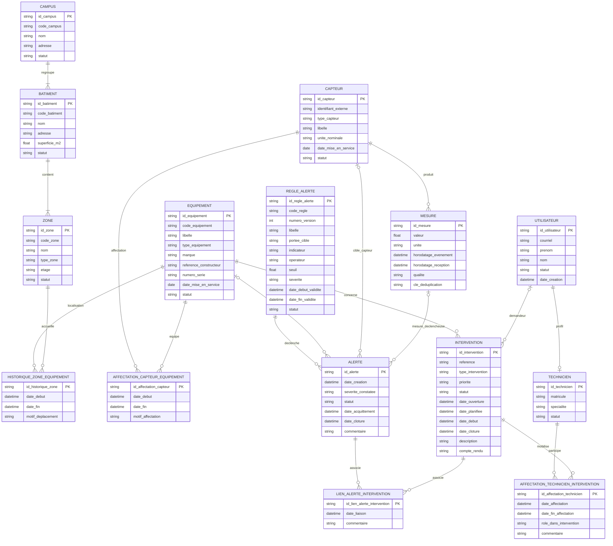

# TD 1 — Du cahier des charges au MCD

## Projet SmartCampus

**Livrable de modélisation conceptuelle — étapes 1 à 5**

## 1. Périmètre et conventions

SmartCampus est une plateforme de supervision technique et énergétique d’un ou plusieurs campus. Elle centralise les bâtiments, zones, équipements, capteurs, mesures, alertes et opérations de maintenance. Le cas de dimensionnement associé à la plateforme prévoit 8 bâtiments, environ 160 zones, 250 équipements, 600 capteurs, une mesure toutes les 30 secondes par capteur, 12 mois de rétention brute et environ 50 utilisateurs actifs en journée.

Les volumes sont des ordres de grandeur, pas des cardinalités d’intégrité. Le nombre de mesures estimé sur une année de 365 jours est de 630 720 000, hors retransmissions.

Conventions de modélisation :

- Les identifiants `id_*` sont des identifiants techniques stables. Ils ne portent pas de signification métier et ne remplacent pas les codes lisibles ou références métier.
- `Oui` dans la colonne « Identifiant ? » signifie que l’attribut participe à l’identification de l’occurrence; sinon, `Non`.
- `Oui` dans la colonne « Obligatoire ? » signifie que l’information doit être présente pour toute occurrence valide selon l’hypothèse de travail retenue. Les attributs ou liens optionnels sont signalés et expliqués.
- Les noms de dates et horodatages sont distingués : une **date** ne contient pas d’heure; un **horodatage** représente un instant. Les instants sont interprétés en UTC.
- Les intervalles d’affectation sont semi-ouverts `[date_debut, date_fin[` : le début est inclus et la fin est exclue. Une fin non renseignée représente une période en cours.
- Le MCD exprime les règles métier. Les types SQL, les index et les clés étrangères physiques relèvent du modèle logique et physique, non de ce TD.

## Étape 1 — Identification des entités métier

### 1.1 Entités principales

| Entité | Rôle exact dans SmartCampus | Caractéristiques principales | Identifiant unique | Unicités métier / remarques |
|---|---|---|---|---|
| **Campus** | Regroupe un ensemble de bâtiments supervisés. | Code, nom, adresse, statut. | `id_campus` | `code_campus` est unique dans le périmètre de la plateforme. |
| **Bâtiment** | Représente un bâtiment physique d’un campus. | Code, nom, adresse, superficie, statut. | `id_batiment` | `code_batiment` est retenu comme référence métier unique. |
| **Zone** | Représente un espace d’un bâtiment : salle, couloir, local technique, etc. | Code, nom, type, étage, statut. | `id_zone` | Hypothèse : `code_zone` est unique dans un bâtiment, pas nécessairement à l’échelle de tous les campus. |
| **Équipement** | Actif technique supervisé ou maintenu : chauffage, climatisation, ventilation, éclairage, installation électrique, etc. | Code, nom/libellé, type, marque, référence constructeur, numéro de série éventuel, date de mise en service, statut. | `id_equipement` | `code_equipement` est unique; le numéro de série peut être unique par constructeur s’il est renseigné et si cette règle est confirmée. |
| **Capteur** | Appareil qui collecte une grandeur physique ou énergétique et émet des mesures. | Identifiant externe, type, unité nominale, date de première installation/mise en service, statut, libellé. | `id_capteur` | `identifiant_externe` est unique dans le périmètre d’intégration retenu. |
| **Mesure** | Observation datée produite par un capteur. | Capteur source, valeur, unité, horodatage d’événement, horodatage de réception, qualité, clé de déduplication éventuelle. | `id_mesure` | Aucune unicité sur le couple capteur/horodatage n’est imposée sans règle de protocole; des événements peuvent partager un horodatage. |
| **Alerte** | Événement signalant une condition à traiter sur un capteur ou un équipement. | Date de création, cible, sévérité, statut, dates d’acquittement/clôture, commentaire, règle déclenchante. | `id_alerte` | La cible est exactement un équipement ou un capteur. Une règle versionnée est conservée comme référence. |
| **Intervention** | Action de maintenance portant sur un équipement. | Référence, dates de création/planification/réalisation, type, priorité, statut, description, compte rendu, demandeur éventuel. | `id_intervention` | `reference` est unique. Une intervention porte sur un équipement selon l’hypothèse de périmètre retenue. |
| **Technicien** | Profil professionnel d’une personne qui réalise ou prend part à des interventions. | Matricule, nom, prénom, courriel professionnel, spécialité, statut. | `id_technicien` | `matricule` et courriel professionnel sont uniques. Le courriel est une donnée personnelle/professionnelle à protéger. |
| **Utilisateur** | Compte d’une personne qui consulte ou utilise la plateforme et dont les actions peuvent être tracées. | Identifiant de connexion/courriel, nom, prénom, statut, date de création. | `id_utilisateur` | Courriel unique. Données personnelles : accès limité aux besoins métier et journalisation adaptée. Un utilisateur peut aussi avoir un profil technicien. |

### 1.2 Entités-associations nécessaires au MCD

Ces objets sont modélisés séparément car ils portent leurs propres dates, rôles ou informations métier. Ils ne sont pas de simples attributs répétés de leurs entités parentes.

| Entité-association | Rôle | Identifiant |
|---|---|---|
| **Historique_Zone_Equipement** | Enregistre une période pendant laquelle un équipement est situé dans une zone. | `id_historique_zone` |
| **Affectation_Capteur_Equipement** | Enregistre une période pendant laquelle un capteur est affecté à un équipement. | `id_affectation_capteur` |
| **Affectation_Technicien_Intervention** | Enregistre la participation d’un technicien à une intervention, éventuellement avec rôle et période. | `id_affectation_technicien` |
| **Lien_Alerte_Intervention** | Trace le lien entre une ou plusieurs alertes et une ou plusieurs interventions. | `id_lien_alerte_intervention` |
| **Règle_Alerte** | Définit une règle versionnée de détection et sa portée. | `id_regle_alerte` |

La règle d’alerte est une entité de soutien du MCD étendu : le cas demande la gestion des alertes, sans spécifier précisément leur paramétrage. La règle est incluse pour expliquer la provenance d’une alerte; les seuils et transitions sont des hypothèses à valider.

## Étape 2 — Dictionnaire de données

Le tableau suivant respecte le format demandé. Les identifiants techniques sont marqués `Oui` dans la colonne d’identification. Les références aux autres objets sont indiquées `Non (référence)` : elles décrivent une association au MCD et ne sont pas des identifiants de l’entité.

### 2.1 Référentiel spatial

| Entité | Attribut | Définition métier | Identifiant ? | Obligatoire ? |
|---|---|---|---|---|
| Campus | `id_campus` | Identifiant technique stable du campus; sans signification métier. | Oui | Oui |
| Campus | `code_campus` | Code lisible permettant de retrouver le campus dans les échanges et écrans. Unique dans SmartCampus selon l’hypothèse retenue. | Non | Oui |
| Campus | `nom` | Nom usuel du campus. | Non | Oui |
| Campus | `adresse` | Adresse postale ou description de localisation du campus. | Non | Non |
| Campus | `statut` | Situation du campus dans le référentiel : actif, inactif ou archivé. | Non | Oui |
| Bâtiment | `id_batiment` | Identifiant technique stable du bâtiment. | Oui | Oui |
| Bâtiment | `code_batiment` | Code métier de référence du bâtiment, unique dans le périmètre retenu. | Non | Oui |
| Bâtiment | `nom` | Nom usuel ou désignation du bâtiment. | Non | Oui |
| Bâtiment | `adresse` | Adresse ou indication d’accès au bâtiment. | Non | Oui |
| Bâtiment | `superficie_m2` | Superficie du bâtiment, exprimée en mètres carrés (m²). Précision et surface de référence à confirmer (surface utile, plancher, etc.). | Non | Oui |
| Bâtiment | `statut` | Situation du bâtiment dans le référentiel : actif, inactif ou archivé. | Non | Oui |
| Bâtiment | `id_campus` (association) | Référence au campus auquel le bâtiment appartient. | Non (référence) | Oui |
| Zone | `id_zone` | Identifiant technique stable de la zone. | Oui | Oui |
| Zone | `id_batiment` (association) | Référence au bâtiment qui contient cette zone. | Non (référence) | Oui |
| Zone | `code_zone` | Code d’identification de la zone, unique à l’intérieur de son bâtiment selon l’hypothèse retenue. | Non | Oui |
| Zone | `nom` | Nom ou désignation compréhensible de la zone. | Non | Oui |
| Zone | `type_zone` | Catégorie de l’espace, par exemple salle, couloir ou local technique. | Non | Oui |
| Zone | `etage` | Niveau ou étage auquel se trouve la zone, selon le codage du bâtiment. | Non | Non |
| Zone | `statut` | Situation de la zone : active, fermée ou archivée. | Non | Oui |

### 2.2 Équipements, capteurs et mesures

| Entité | Attribut | Définition métier | Identifiant ? | Obligatoire ? |
|---|---|---|---|---|
| Équipement | `id_equipement` | Identifiant technique stable de l’équipement. | Oui | Oui |
| Équipement | `code_equipement` | Référence interne métier de l’équipement, unique dans la plateforme. | Non | Oui |
| Équipement | `nom` / `libelle` | Désignation lisible de l’équipement dans le référentiel et les écrans. | Non | Oui |
| Équipement | `type_equipement` | Famille technique, par exemple chauffage, climatisation, ventilation, éclairage ou installation électrique. | Non | Oui |
| Équipement | `marque` | Marque ou fabricant de l’équipement. | Non | Non |
| Équipement | `reference_constructeur` | Référence de modèle/catalogue fournie par le constructeur; distincte du numéro de série individuel. | Non | Oui |
| Équipement | `numero_serie` | Numéro de série attribué à l’exemplaire par le fabricant, s’il est disponible. | Non | Non |
| Équipement | `date_mise_en_service` | Date de première mise en exploitation de l’équipement. | Non | Non |
| Équipement | `statut` | État du cycle de vie : en préparation, en service, hors service, retiré, etc. | Non | Oui |
| Capteur | `id_capteur` | Identifiant technique interne et stable du capteur. | Oui | Oui |
| Capteur | `identifiant_externe` | Identifiant transmis par le capteur ou la passerelle; unique dans le périmètre de collecte. | Non | Oui |
| Capteur | `type_capteur` | Type de grandeur observée, par exemple température, humidité, consommation électrique ou vibration. | Non | Oui |
| Capteur | `libelle` | Désignation lisible du capteur. | Non | Oui |
| Capteur | `unite_nominale` | Unité attendue pour les mesures du capteur, par exemple °C, % (humidité relative), kWh, kW ou mm/s selon la grandeur. Le symbole et la convention doivent être normalisés par type. | Non | Oui |
| Capteur | `date_premiere_installation` | Date de la première mise en place ou mise en service du capteur. Les dates de chaque réaffectation figurent dans l’entité-association historisée. | Non | Non |
| Capteur | `statut` | Situation opérationnelle du capteur : en stock, en service, indisponible, retiré ou archivé. | Non | Oui |
| Mesure | `id_mesure` | Identifiant technique de l’observation. Ne présume pas d’une unicité du seul couple capteur/horodatage. | Oui | Oui |
| Mesure | `id_capteur` (association) | Référence au capteur ayant produit l’observation. Une mesure non rattachée à un capteur connu n’est pas admise dans les mesures de référence. | Non (référence) | Oui |
| Mesure | `horodatage_evenement` | Instant auquel la valeur a été observée par le capteur, en UTC. Utilisé pour replacer l’observation dans son contexte historique. | Non | Oui |
| Mesure | `horodatage_reception` | Instant auquel la plateforme a reçu la mesure, en UTC. Distinct de l’événement pour identifier les retards et reprises. | Non | Oui |
| Mesure | `valeur` | Valeur numérique observée. La précision et les plages admissibles dépendent du type de capteur. | Non | Oui |
| Mesure | `unite` | Unité de la valeur au moment de l’observation. À conserver avec la mesure même si l’unité nominale du capteur évolue. | Non | Oui |
| Mesure | `qualite` | Indication de validité ou de qualité : valide, invalide, estimée, inconnue, selon un vocabulaire à définir. | Non | Oui |
| Mesure | `cle_deduplication` | Identifiant de message source, si le protocole en fournit un, utilisé pour reconnaître une retransmission. Son unicité doit être définie avec le périmètre de la source. | Non | Non |

### 2.3 Alertes, interventions, techniciens et utilisateurs

| Entité | Attribut | Définition métier | Identifiant ? | Obligatoire ? |
|---|---|---|---|---|
| Règle_Alerte | `id_regle_alerte` | Identifiant technique d’une version de règle. | Oui | Oui |
| Règle_Alerte | `code_regle` | Code stable identifiant la règle logique au fil de ses versions. | Non | Oui |
| Règle_Alerte | `numero_version` | Numéro de version; unique avec `code_regle`. | Non | Oui |
| Règle_Alerte | `libelle` | Désignation compréhensible de la règle. | Non | Oui |
| Règle_Alerte | `portee_cible` | Type d’objet visé par la règle : équipement ou capteur. | Non | Oui |
| Règle_Alerte | `indicateur` | Grandeur ou condition évaluée par la règle. | Non | Oui |
| Règle_Alerte | `operateur` | Opérateur logique comparant la valeur à un seuil (par exemple supérieur ou égal). | Non | Oui |
| Règle_Alerte | `seuil` | Seuil de comparaison dans l’unité spécifiée par l’indicateur ou la règle. | Non | Oui |
| Règle_Alerte | `severite` | Sévérité configurée pour une occurrence déclenchée. Vocabulaire à valider. | Non | Oui |
| Règle_Alerte | `date_debut_validite` | Instant de début d’application de cette version. | Non | Oui |
| Règle_Alerte | `date_fin_validite` | Instant de fin exclusive de validité; absent si la version est encore applicable. | Non | Non |
| Règle_Alerte | `statut` | État de publication de la règle : brouillon, active, suspendue, expirée, etc. | Non | Oui |
| Alerte | `id_alerte` | Identifiant technique stable de l’alerte. | Oui | Oui |
| Alerte | `id_regle_alerte` (association) | Référence à la version exacte de règle ayant déclenché l’alerte. | Non (référence) | Oui |
| Alerte | `id_equipement_cible` (association) | Équipement concerné, renseigné si la cible de l’alerte est un équipement. Exclusif avec la cible capteur. | Non (référence) | Selon la cible |
| Alerte | `id_capteur_cible` (association) | Capteur concerné, renseigné si la cible de l’alerte est un capteur. Exclusif avec la cible équipement. | Non (référence) | Selon la cible |
| Alerte | `id_mesure_declencheuse` (association) | Référence éventuelle à la mesure directement à l’origine du déclenchement. Peut être absente pour une alerte non issue d’une mesure unique. | Non (référence) | Non |
| Alerte | `date_creation` | Instant de création de l’alerte dans SmartCampus. | Non | Oui |
| Alerte | `severite_constatee` | Niveau de sévérité de cette occurrence au moment de sa création. | Non | Oui |
| Alerte | `statut` | État de traitement de l’alerte : ouverte, acquittée, en cours, clôturée, etc. | Non | Oui |
| Alerte | `date_acquittement` | Instant auquel un utilisateur habilité a acquitté l’alerte. | Non | Non |
| Alerte | `date_cloture` | Instant auquel le traitement de l’alerte a été clôturé. | Non | Non |
| Alerte | `commentaire` | Contexte ou information de suivi associée à l’alerte. | Non | Non |
| Intervention | `id_intervention` | Identifiant technique stable de l’intervention. | Oui | Oui |
| Intervention | `reference` | Référence métier lisible de suivi, unique dans la plateforme. | Non | Oui |
| Intervention | `id_equipement` (association) | Référence à l’équipement faisant l’objet de l’intervention. | Non (référence) | Oui |
| Intervention | `id_demandeur` (association) | Référence à l’utilisateur qui a demandé l’intervention; absente si intervention planifiée ou créée automatiquement selon l’hypothèse retenue. | Non (référence) | Non |
| Intervention | `type_intervention` | Nature de l’action, par exemple corrective, préventive ou inspection. | Non | Oui |
| Intervention | `priorite` | Niveau de priorité opérationnelle. Vocabulaire à définir. | Non | Oui |
| Intervention | `statut` | État du cycle de vie, par exemple à planifier, planifiée, en cours, terminée ou annulée. | Non | Oui |
| Intervention | `date_creation` / `date_ouverture` | Instant de création ou d’ouverture de la demande d’intervention. | Non | Oui |
| Intervention | `date_planifiee` | Instant prévu pour la réalisation, s’il est planifié. | Non | Non |
| Intervention | `date_realisation` / `date_debut` | Instant de début effectif des travaux. | Non | Non |
| Intervention | `date_cloture` | Instant de fin effective et de clôture de l’intervention. | Non | Non |
| Intervention | `description` | Motif, symptôme ou objet de l’intervention. | Non | Oui |
| Intervention | `compte_rendu` | Résumé des actions réalisées et du résultat constaté. | Non | Non |
| Technicien | `id_technicien` | Identifiant technique du profil technicien. | Oui | Oui |
| Technicien | `id_utilisateur` (association) | Référence au compte utilisateur de la personne technicienne. Un compte ne porte au plus qu’un profil technicien. | Non (référence) | Oui |
| Technicien | `matricule` | Identifiant professionnel unique du technicien. | Non | Oui |
| Technicien | `nom` | Nom de famille du technicien. Donnée personnelle. | Non | Oui |
| Technicien | `prenom` | Prénom du technicien. Donnée personnelle. | Non | Oui |
| Technicien | `courriel_professionnel` | Adresse de contact professionnelle du technicien, unique selon l’hypothèse retenue. Donnée personnelle/professionnelle. | Non | Oui |
| Technicien | `specialite` | Domaine de compétence du technicien, par exemple électricité ou CVC. | Non | Non |
| Technicien | `statut` | Situation du profil : actif, indisponible ou inactif. | Non | Oui |
| Utilisateur | `id_utilisateur` | Identifiant technique du compte utilisateur. | Oui | Oui |
| Utilisateur | `courriel` | Adresse de connexion ou de contact, unique dans SmartCampus. Donnée personnelle. | Non | Oui |
| Utilisateur | `nom` | Nom de famille du titulaire du compte. Donnée personnelle. | Non | Oui |
| Utilisateur | `prenom` | Prénom du titulaire du compte. Donnée personnelle. | Non | Oui |
| Utilisateur | `statut` | État du compte : actif, suspendu ou désactivé. | Non | Oui |
| Utilisateur | `date_creation` | Instant de création du compte dans la plateforme. | Non | Oui |

### 2.4 Entités-associations historisées et porteuses d’attributs

| Entité | Attribut | Définition métier | Identifiant ? | Obligatoire ? |
|---|---|---|---|---|
| Historique_Zone_Equipement | `id_historique_zone` | Identifiant technique d’une période de localisation. | Oui | Oui |
| Historique_Zone_Equipement | `id_equipement` | Équipement localisé pendant cette période. | Non (référence) | Oui |
| Historique_Zone_Equipement | `id_zone` | Zone occupée pendant cette période. | Non (référence) | Oui |
| Historique_Zone_Equipement | `date_debut` | Instant inclusif de début de localisation. | Non | Oui |
| Historique_Zone_Equipement | `date_fin` | Instant exclusif de fin; absent pour la localisation actuellement en cours. | Non | Non |
| Historique_Zone_Equipement | `motif_deplacement` | Motif connu du déplacement ou de la fin de localisation. | Non | Non |
| Affectation_Capteur_Equipement | `id_affectation_capteur` | Identifiant technique d’une période de rattachement. | Oui | Oui |
| Affectation_Capteur_Equipement | `id_capteur` | Capteur affecté pendant la période. | Non (référence) | Oui |
| Affectation_Capteur_Equipement | `id_equipement` | Équipement auquel le capteur est affecté pendant la période. | Non (référence) | Oui |
| Affectation_Capteur_Equipement | `date_debut` | Instant inclusif de début de l’affectation. | Non | Oui |
| Affectation_Capteur_Equipement | `date_fin` | Instant exclusif de fin; absent tant que l’affectation est en cours. | Non | Non |
| Affectation_Capteur_Equipement | `motif_affectation` | Motif d’installation, de remplacement, de déplacement ou de retrait. | Non | Non |
| Affectation_Technicien_Intervention | `id_affectation_technicien` | Identifiant technique d’une période de participation. | Oui | Oui |
| Affectation_Technicien_Intervention | `id_intervention` | Intervention à laquelle le technicien participe. | Non (référence) | Oui |
| Affectation_Technicien_Intervention | `id_technicien` | Technicien affecté à l’intervention. | Non (référence) | Oui |
| Affectation_Technicien_Intervention | `date_affectation` | Instant inclusif de début de la participation/affectation. | Non | Oui |
| Affectation_Technicien_Intervention | `date_fin_affectation` | Instant exclusif de fin de la participation; absent si elle est en cours. | Non | Non |
| Affectation_Technicien_Intervention | `role_dans_intervention` | Rôle éventuel du technicien (principal, soutien, spécialiste, etc.). | Non | Non |
| Affectation_Technicien_Intervention | `commentaire` | Information complémentaire sur la participation. | Non | Non |
| Lien_Alerte_Intervention | `id_lien_alerte_intervention` | Identifiant technique du lien entre une alerte et une intervention. | Oui | Oui |
| Lien_Alerte_Intervention | `id_alerte` | Alerte concernée par le lien. | Non (référence) | Oui |
| Lien_Alerte_Intervention | `id_intervention` | Intervention liée à l’alerte. | Non (référence) | Oui |
| Lien_Alerte_Intervention | `date_liaison` | Instant de création du lien. | Non | Oui |
| Lien_Alerte_Intervention | `commentaire` | Justification ou contexte du lien. | Non | Non |

Les cardinalités des associations sans attribut propre ne sont pas des attributs de données et n’ajoutent donc pas de ligne au dictionnaire. Elles sont décrites à l’étape 3.

## Étape 3 — Associations et cardinalités

### 3.1 Convention de cardinalité

Dans chaque ligne ci-dessous, `Entité A (min,max)` et `Entité B (min,max)` décrivent le nombre de participations de **chaque occurrence** de l’entité à l’association. Par exemple, `0,N` signifie zéro, une ou plusieurs; `1,1` signifie exactement une. Toute cardinalité est accompagnée d’une règle métier. Les valeurs correspondant à des hypothèses faute de précision du cahier des charges sont explicitement signalées.

### 3.2 Associations du référentiel

| Association | Entités concernées et cardinalités | Règle de gestion justifiant les cardinalités |
|---|---|---|
| **Rattacher au campus** | Campus `(1,N)` — Bâtiment `(1,1)` | Un campus regroupe un ou plusieurs bâtiments; chaque bâtiment relève d’un seul campus. Le minimum `1` côté campus suit le sens de « campus supervisé » et l’hypothèse qu’un campus vide n’est pas conservé dans le référentiel. Si la création anticipée d’un campus vide est admise, ce minimum devient `0`. |
| **Composer / contenir** | Bâtiment `(1,N)` — Zone `(1,1)` | Le cahier des charges indique qu’un bâtiment est composé de plusieurs zones; chaque zone est rattachée à un seul bâtiment. Le MCD impose donc au bâtiment au moins une zone et à la zone un seul parent. La question de création temporaire d’un bâtiment sans zone est à confirmer. |

### 3.3 Associations d’équipements, capteurs et mesures

| Association | Entités concernées et cardinalités | Règle de gestion justifiant les cardinalités |
|---|---|---|
| **Localiser dans** — association historisée `Historique_Zone_Equipement` | Équipement `(0,N)` — Zone `(0,N)`; chaque occurrence de l’association référence exactement un équipement `(1,1)` et une zone `(1,1)` | Un équipement peut changer de zone et doit conserver toutes ses localisations successives. Une zone peut contenir aucun, un ou plusieurs équipements selon les périodes. Un équipement peut ne pas encore être installé ou être retiré; conditionnellement, un équipement en service doit avoir exactement une période ouverte. |
| **Affecter à** — association historisée `Affectation_Capteur_Equipement` | Capteur `(0,N)` — Équipement `(0,N)`; chaque occurrence référence exactement un capteur `(1,1)` et un équipement `(1,1)` | Plusieurs capteurs peuvent équiper un même équipement. Un capteur peut être sans affectation (stock, préparation ou retrait) et être réaffecté à plusieurs équipements successivement. Un capteur ne peut être rattaché qu’à un équipement au plus à un instant donné. |
| **Produire** | Capteur `(0,N)` — Mesure `(1,1)` | Un capteur peut n’avoir encore produit aucune mesure ou en produire de nombreuses; chaque mesure est produite par un seul capteur identifié. Une mesure n’est jamais orpheline dans le référentiel de mesures. |

### 3.4 Associations d’alertes et de maintenance

| Association | Entités concernées et cardinalités | Règle de gestion justifiant les cardinalités |
|---|---|---|
| **Déclencher** | Règle_Alerte `(0,N)` — Alerte `(1,1)` | Une version de règle peut n’avoir déclenché aucune alerte ou plusieurs; chaque alerte automatisée référence la version précise de la règle qui l’a produite. Une alerte manuelle sans règle nécessiterait de rendre ce lien optionnel; ce comportement n’est pas retenu par défaut. |
| **Concerner un équipement** | Équipement `(0,N)` — Alerte `(0,1)` | Un équipement peut être concerné par plusieurs alertes au cours du temps; une alerte vise au plus un équipement par cette association. |
| **Concerner un capteur** | Capteur `(0,N)` — Alerte `(0,1)` | Un capteur peut être concerné par plusieurs alertes; une alerte vise au plus un capteur par cette association. **Contrainte globale XOR : chaque alerte concerne exactement un équipement ou exactement un capteur**, jamais zéro cible ni les deux à la fois. |
| **Être déclenchée par** | Mesure `(0,N)` — Alerte `(0,1)` | Une mesure peut être à l’origine de plusieurs alertes selon les règles; une alerte peut référencer au plus une mesure déclencheuse. Le lien est optionnel pour permettre une alerte sans mesure unique identifiable. |
| **Faire l’objet de** | Équipement `(0,N)` — Intervention `(1,1)` | Un équipement peut n’avoir aucune intervention ou en avoir plusieurs; chaque intervention porte sur un équipement selon le périmètre de maintenance retenu. Une intervention visant uniquement une zone ou un capteur est hors périmètre et demanderait une extension. |
| **Être demandée par** | Utilisateur `(0,N)` — Intervention `(0,1)` | Un utilisateur peut soumettre plusieurs demandes. Une intervention peut ne pas avoir de demandeur humain si elle est préventive ou créée automatiquement. |
| **Posséder un profil technicien** | Utilisateur `(0,1)` — Technicien `(1,1)` | Un utilisateur peut ne pas être technicien; chaque profil technicien correspond à exactement un compte utilisateur. Le compte est unique pour un profil. |
| **Participer à** — association `Affectation_Technicien_Intervention` | Technicien `(0,N)` — Intervention `(0,N)`; chaque occurrence relie exactement un technicien `(1,1)` et une intervention `(1,1)` | Une intervention peut mobiliser plusieurs techniciens, et un technicien peut participer à plusieurs interventions. L’entité-association garde une trace des périodes, rôles et réaffectations. |
| **Relier alerte et intervention** — association `Lien_Alerte_Intervention` | Alerte `(0,N)` — Intervention `(0,N)`; chaque lien relie exactement une alerte `(1,1)` et une intervention `(1,1)` | Le lien est optionnel car une alerte peut ne pas donner lieu à une intervention; une intervention peut être préventive et sans alerte. Plusieurs alertes peuvent être traitées par une intervention et une alerte peut nécessiter plusieurs interventions. |

### 3.5 Représentation textuelle synthétique du MCD

```text
Campus (1,N) ── Rattacher au campus ── (1,1) Bâtiment
Bâtiment (1,N) ── Contenir ── (1,1) Zone

Équipement (0,N) ── Historique_Zone_Equipement ── (0,N) Zone
Équipement (0,N) ── Affectation_Capteur_Equipement ── (0,N) Capteur
Capteur (0,N) ── Produire ── (1,1) Mesure

Règle_Alerte (0,N) ── Déclencher ── (1,1) Alerte
Alerte (0,1) ── Concerner ── (0,N) Équipement
Alerte (0,1) ── Concerner ── (0,N) Capteur
  Contrainte XOR : exactement une cible par alerte.
Mesure (0,N) ── Être à l'origine de ── (0,1) Alerte

Équipement (0,N) ── Faire l'objet de ── (1,1) Intervention
Utilisateur (0,N) ── Demander ── (0,1) Intervention
Utilisateur (0,1) ── Posséder un profil ── (1,1) Technicien
Technicien (0,N) ── Affectation_Technicien_Intervention ── (0,N) Intervention
Alerte (0,N) ── Lien_Alerte_Intervention ── (0,N) Intervention
```

Les deux associations historisées sont détaillées à l’étape suivante. Les associations `Affectation_Technicien_Intervention` et `Lien_Alerte_Intervention` deviennent également des entités-associations, car elles portent des attributs et/ou une traçabilité.

### 3.6 Représentation graphique du MCD (Mermaid)

Le diagramme représente les entités métier et les entités-associations porteuses d’attributs ou d’historique. Chaque occurrence d’une entité-association relie exactement une occurrence de chacune de ses entités parentes.



Les cardinalités des liens de cible d’`ALERTE` indiquent qu’une alerte peut concerner au plus un équipement et au plus un capteur; la règle métier impose qu’elle concerne exactement l’un des deux (XOR). Les contraintes d’exclusion mutuelle, dont ce XOR, ainsi que la gestion des intervalles temporels semi-ouverts `[date_debut, date_fin[` des associations historisées ne sont pas représentées complètement par le diagramme. Elles sont précisées dans les règles textuelles associées et seront traduites au niveau logique et physique.

## Étape 4 — Traitement des données historiques

### 4.1 Cas 1 : historique de localisation des équipements

#### Modélisation retenue

Une relation directe « équipement situé dans zone » ne suffit pas si elle ne stocke qu’une seule zone : un déplacement écraserait l’emplacement antérieur. Le MCD introduit donc l’entité-association historisée **`Historique_Zone_Equipement`** :

```text
HISTORIQUE_ZONE_EQUIPEMENT(
  id_historique_zone,
  équipement,
  zone,
  date_debut,
  date_fin,
  motif_deplacement
)
```

Chaque occurrence relie exactement un équipement à exactement une zone et représente une période de validité. `date_debut` est obligatoire; `date_fin` est optionnelle et absente pour la période en cours; le motif est optionnel.

#### Règles temporelles

- Intervalle semi-ouvert : `[date_debut, date_fin[`.
- Pour un même équipement, deux intervalles de localisation ne se chevauchent pas.
- Deux périodes consécutives peuvent se toucher : la fin exclusive de l’une peut être égale au début inclusif de la suivante.
- Une localisation courante est l’occurrence dont `date_fin` est absente.
- La durée passée dans une zone est calculable par `date_fin - date_debut`; pour la période ouverte, elle est calculée jusqu’à l’instant de consultation.
- La période ouverte est unique pour un équipement. Pour un équipement en service, l’hypothèse métier est qu’une seule localisation courante existe; avant installation ou après retrait, aucune période ouverte peut être admise.
- L’historique est conservé après un déplacement; une zone ou un équipement référencé n’est pas supprimé physiquement sans stratégie d’archivage.

#### Réponses permises par le modèle

| Question métier | Réponse conceptuelle |
|---|---|
| Dans quelle zone l’équipement se trouve-t-il actuellement ? | Chercher sa période dont `date_fin` est absente, sous réserve de son statut. |
| Où se trouvait-il précédemment ? | Lire ses occurrences historiques ordonnées par `date_debut`. |
| Quand a-t-il été déplacé ? | La fin de l’ancienne période et le début de la nouvelle indiquent l’instant de transition; le motif peut en préciser la cause. |
| Combien de temps est-il resté dans chaque zone ? | Calculer la durée de l’intervalle correspondant; définir la convention de fuseau/affichage pour les dates. |

Une correction rétroactive est une zone grise : elle ne doit pas créer un chevauchement ni modifier silencieusement l’interprétation des mesures déjà analysées. Le processus d’audit des corrections est à définir.

### 4.2 Cas 2 : historique des affectations capteur-équipement

#### Modélisation retenue

L’association entre capteur et équipement n’est pas permanente. Le capteur peut être remplacé, déplacé ou affecté à un autre équipement. Une relation courante simple perdrait cette information; le MCD introduit l’entité-association historisée **`Affectation_Capteur_Equipement`** :

```text
AFFECTATION_CAPTEUR_EQUIPEMENT(
  id_affectation_capteur,
  capteur,
  équipement,
  date_debut,
  date_fin,
  motif_affectation
)
```

Chaque occurrence décrit exactement un capteur affecté à exactement un équipement pendant un intervalle. Un équipement peut recevoir plusieurs capteurs; un capteur peut rester sans affectation ou avoir plusieurs affectations successives au cours de son cycle de vie.

#### Règles temporelles et remplacement

- Intervalles semi-ouverts `[date_debut, date_fin[` avec `date_debut < date_fin` si `date_fin` est renseignée.
- Pour un même capteur, les intervalles d’affectation ne se chevauchent pas : un capteur n’est pas partagé simultanément entre plusieurs équipements dans l’hypothèse retenue.
- Une période ouverte identifie l’équipement actuellement associé au capteur; il ne peut y en avoir qu’une au plus par capteur.
- Une fin d’affectation et un début d’affectation ultérieur décrivent le retrait, remplacement ou transfert. Le motif reste optionnel tant que le processus métier ne l’exige pas.
- L’association à un équipement est facultative hors période de service : stock, préparation, réparation ou retrait.
- Pour rattacher une mesure retardée à son équipement historique, rechercher l’affectation qui contient son `horodatage_evenement`, pas seulement son instant de réception.
- Si aucun intervalle ne couvre la date de la mesure, conserver la mesure si le capteur est connu et les règles de réception l’autorisent, mais la placer en anomalie/quarantaine métier pour résolution; ne pas inventer un équipement associé.

La date de première installation portée par `Capteur` décrit le début de vie opérationnelle globale; les dates de chaque installation/réaffectation sont portées par l’entité-association. Si le métier entend par « date d’installation » uniquement l’installation courante, cet attribut devra plutôt être dérivé de la période d’affectation ouverte.

## Étape 5 — Hypothèses et questions ouvertes

| Sujet / règle manquante | Hypothèse retenue pour le MCD | Conséquence sur la modélisation |
|---|---|---|
| **Nombre de campus** | Un ou plusieurs campus sont possibles; le cas ne fixe pas le nombre. | Entité `Campus` autonome; les volumes de 8 bâtiments ne définissent pas le nombre de campus. |
| **Campus sans bâtiment** | Non conservé comme état normal : un campus du référentiel regroupe au moins un bâtiment. | Cardinalité `Campus (1,N)` — `Bâtiment (1,1)`. Si la création à l’avance est admise, minimum `0` côté Campus. |
| **Bâtiment créé avant sa première zone** | Hypothèse principale : non, car le cahier décrit un bâtiment composé de plusieurs zones; à confirmer pour les phases de préparation. | `Bâtiment (1,N)` — `Zone (1,1)`. Une phase provisoire pourrait conduire à `0,N` côté Bâtiment sans rendre la zone orpheline. |
| **Zone créée avant son bâtiment** | Non : une zone doit toujours appartenir à un bâtiment identifié. | L’association Zone–Bâtiment est obligatoire (`1,1` côté Zone); aucun bâtiment nul ou zone autonome. |
| **Unicité des codes spatiaux** | Code bâtiment unique dans SmartCampus; code de zone unique à l’intérieur de son bâtiment. | Clés candidates respectives `code_batiment` et `(id_batiment, code_zone)`; à modifier si les codes sont seulement uniques par campus. |
| **Superficie du bâtiment** | Valeur exprimée en m²; « superficie » désigne la surface de référence fonctionnelle du bâtiment. | Attribut `superficie_m2` obligatoire dans l’hypothèse; définition (surface utile, plancher, etc.), précision et possibilité d’absence à valider. |
| **Localisation d’un équipement avant/après service** | Un équipement en service a exactement une localisation en cours; un équipement en préparation ou retiré peut en avoir zéro. | Cardinalité générale équipement-historique `0,N` et contrôle conditionnel lié au statut; la localisation n’est pas un simple attribut courant. |
| **Déplacements et historique** | Périodes semi-ouvertes sans chevauchement; horodatages en UTC; corrections rétroactives contrôlées. | Association historisée porteuse de dates et motif; besoin potentiel d’audit distinct pour tracer auteur et correction. |
| **Affectation d’un capteur** | Affectation facultative hors service; au plus un équipement simultané par capteur; plusieurs capteurs possibles sur un équipement. | Association historisée M:N dans le temps, avec non-chevauchement par capteur. Le partage d’un capteur n’est pas autorisé dans l’hypothèse initiale. |
| **Mesure d’un capteur sans affectation active** | Une mesure doit référencer un capteur connu. L’état « inactif aujourd’hui » n’annule pas une mesure passée; si aucune affectation ne couvre l’instant de l’événement, l’anomalie est conservée et traitée selon une règle d’exception. | Lien Capteur–Mesure obligatoire; lien temporel au niveau d’affectation résolu à la date d’événement. Une quarantaine et une période de tolérance d’arrivée tardive sont à définir. |
| **Mesure d’un capteur inconnu** | Ne pas insérer comme mesure métier orpheline; rejeter ou isoler le message avec identifiant source et motif. | Référence de mesure vers Capteur obligatoire; prévoir une file de quarantaine technique ou un journal de rejet distinct du MCD métier. |
| **Horodatages, fuseaux et dérive d’horloge** | Conserver l’instant d’événement et l’instant de réception en UTC; l’heure source peut être imparfaite. | Deux attributs temporels dans `Mesure`; définir tolérance d’horloge et règles de détection des dates impossibles. |
| **Unité et qualité de mesure** | Chaque mesure conserve sa propre unité et un statut de qualité contrôlé; l’unité nominale du capteur sert de référence, non de substitut à l’unité observée. | Attributs obligatoires `unite` et `qualite` dans `Mesure`; vocabulaires et conversions par type restent à fixer. |
| **Unicité/doublons de mesures** | Pas d’unicité automatique sur `(id_capteur, horodatage_evenement)`; identifiant source facultatif en attente du contrat IoT. | `id_mesure` reste identifiant technique; la déduplication dépend d’une clé de message et de son périmètre, pas d’une hypothèse d’horodatage unique. |
| **Cible d’une alerte** | Une alerte concerne exactement un équipement ou un capteur; elle peut être déclenchée à partir d’une mesure d’un capteur différente de sa cible métier. | Deux associations de cible avec contrainte globale XOR; lien facultatif à une mesure déclencheuse; association à une version de règle dans le MCD étendu. |
| **Alertes sans règle ou événements manuels** | Non dans l’hypothèse principale : toute alerte est rattachée à une version de règle. | Cardinalités Règle_Alerte `(0,N)` — Alerte `(1,1)`. Si des alertes manuelles sont nécessaires, rendre l’association optionnelle et distinguer leur origine. |
| **Intervention et équipement** | Toute intervention concerne exactement un équipement; une intervention préventive peut être créée sans alerte et sans demandeur humain. | Équipement `(0,N)` — Intervention `(1,1)`; liens demandeur et alerte-intervention facultatifs. Les interventions visant une zone entière sont hors périmètre. |
| **Affectation de plusieurs techniciens** | Plusieurs techniciens peuvent travailler sur une intervention; les réaffectations et dates doivent être traçables. | Association M:N transformée en `Affectation_Technicien_Intervention` avec début/fin et rôle éventuel. Le technicien principal reste à confirmer. |
| **Technicien et compte utilisateur** | Chaque technicien possède un compte; un utilisateur n’a au plus qu’un profil technicien. | Association `Utilisateur (0,1)` — `Technicien (1,1)`; l’identité d’accès reste séparée du profil professionnel. |
| **Attributs utilisateur et rôles** | `Utilisateur` représente le compte et l’identité minimale; les rôles/habilitations détaillés ne sont pas modélisés dans ce TD. | Le modèle pourra être étendu par des entités rôle/permission et une association plusieurs-à-plusieurs si les droits l’exigent. |
| **Données personnelles** | Courriels, noms et prénoms sont nécessaires à l’identité et à la traçabilité, avec accès limité. | Les données restent dans `Utilisateur`/`Technicien`; définir habilitations, durée de conservation et règles de protection selon la politique applicable. |
| **Rétention des mesures** | Mesures brutes conservées 12 mois; régime de conservation des alertes, interventions, historiques et sauvegardes non spécifié. | La rétention des données brutes est une règle de cycle de vie; les alertes pouvant référencer une mesure nécessitent une politique de purge/archivage compatible. |
| **Indicateurs énergétiques et disponibilité** | Ils sont calculés à partir des mesures, états et interventions; leur définition n’est pas spécifiée. | Pas d’entité d’indicateur ajoutée au MCD de base; agréger ou modéliser ultérieurement après définition des formules, unités et périodes. |

## Conclusion

Le MCD distingue les objets métier stables — campus, bâtiments, zones, équipements, capteurs, mesures, alertes, interventions, techniciens et utilisateurs — des relations qui possèdent une durée de vie ou des attributs propres. Il justifie chaque cardinalité par une règle ou une hypothèse explicite et rend les deux historiques exigés interrogeables sans écraser les faits passés.

Les arbitrages prioritaires avant de figer le modèle logique sont les cardinalités minimales de campus/bâtiments/zones, les règles de localisation des équipements en service, le protocole d’identité et de déduplication des mesures, le traitement des événements reçus sans affectation historique, les règles d’alerte et de cycle de vie des interventions, ainsi que les durées de conservation des mesures référencées par les alertes.

