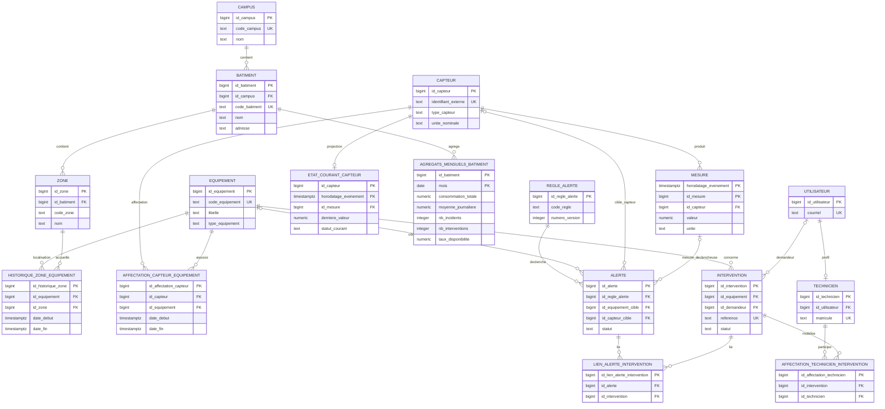

# TD 3 — Arbitrage entre normalisation et dénormalisation

## Tableau d'arbitrage

| Critère | Scénario 1 — Référentiel des équipements | Scénario 2 — Fiche équipement et dernier état | Scénario 3 — Reporting mensuel par bâtiment |
|---|---|---|---|
| **Usage dominant** | Gestion du référentiel et opérations CRUD sur les bâtiments, zones et équipements. | Consultation fréquente de la fiche d'un équipement et du dernier état de chacun de ses capteurs. | Consultation de tableaux de bord et d'indicateurs historiques par bâtiment, mois et zone. |
| **Lectures / Écritures** | Lectures et écritures régulières; priorité à la cohérence des mises à jour. | Lectures dominantes par rapport aux écritures de mesures; forte exigence de latence de lecture. | Lectures analytiques dominantes; ingestion continue des mesures et actualisations périodiques des agrégats. |
| **Modèle recommandé** | Modèle normalisé. | Modèle hybride : historique normalisé et projection dénormalisée de l'état courant. | Modèle hybride : données sources normalisées et agrégats pré-calculés pour le reporting. |
| **Niveau de normalisation** | 3NF pour le référentiel : les bâtiments, zones et équipements sont stockés séparément et reliés par des clés étrangères. | Données sources normalisées; table d'état courant volontairement dénormalisée. | Données sources normalisées; tables d'agrégats dénormalisées, avec une granularité définie par les besoins du rapport. |
| **Dénormalisation envisagée** | Aucune pour les attributs du référentiel. Le nom et l'adresse du bâtiment sont obtenus via la zone, sans duplication dans Équipements. | `ETAT_COURANT_CAPTEUR`, une ligne par capteur avec la dernière valeur, son horodatage et son statut. L'historique complet des mesures est conservé séparément. | `AGREGATS_MENSUELS_BATIMENT`, une ligne par bâtiment et par mois. Prévoir une table complémentaire par zone et par mois si le tableau doit détailler les résultats par zone. |
| **Avantage principal** | Réduit les redondances et les anomalies de mise à jour; les contraintes référentielles maintiennent la cohérence des rattachements. | Évite de recalculer la dernière mesure depuis un historique massif à chaque consultation. | Rend les lectures du tableau de bord rapides et prévisibles en évitant de réagréger tout l'historique à chaque affichage. |
| **Risque principal** | Les consultations descriptives nécessitent des jointures entre les tables du référentiel. | L'état courant peut diverger ou être en retard sur l'historique si sa mise à jour échoue. | Les agrégats peuvent être périmés et divergents; les corrections tardives imposent de recalculer les périodes concernées. |
| **Mécanisme de synchronisation** | Modifications transactionnelles dans la table concernée; clés étrangères et contraintes d'intégrité. | Idéalement, insertion de la mesure et mise à jour conditionnelle de l'état courant dans la même transaction. Si asynchrone : événement fiable, traitement idempotent, reprises et réconciliation depuis l'historique. | Batch périodique idempotent pour les nouvelles données; recalcul et remplacement atomique de l'agrégat du bâtiment et du mois affectés lors d'une correction tardive. |

## Analyse détaillée des scénarios

### Scénario 1 — Gestion du référentiel des équipements

Le référentiel est optimisé pour des créations, consultations et mises à jour cohérentes. L'adresse est un attribut du **bâtiment** et doit être enregistrée dans `BATIMENT`, avec le nom et les autres données qui décrivent ce bâtiment. La zone porte une clé étrangère vers le bâtiment. Dans le modèle SmartCampus, la localisation de l'équipement est historisée dans `HISTORIQUE_ZONE_EQUIPEMENT`; le bâtiment correspondant se retrouve en suivant cette affectation vers `ZONE`, puis `BATIMENT`.

Il ne faut pas répéter le nom ou l'adresse du bâtiment dans chaque équipement. En cas de changement d'adresse ou de nom, cette duplication obligerait à modifier plusieurs lignes et pourrait laisser des équipements avec des valeurs anciennes. Les anomalies de mise à jour qui en résultent compromettent la cohérence du référentiel. Avec des données normalisées, l'information du bâtiment est modifiée une seule fois.

La contrainte de clé étrangère de `HISTORIQUE_ZONE_EQUIPEMENT.id_zone` vers `ZONE.id_zone` interdit de rattacher un équipement à une zone inexistante. La clé étrangère de `ZONE.id_batiment` vers `BATIMENT.id_batiment` garantit à son tour que la zone dépend d'un bâtiment existant. Une politique de suppression restrictive (ou une suppression logique selon les règles métier) évite de supprimer un parent encore référencé. Les transactions garantissent que chaque opération CRUD est appliquée entièrement ou annulée.

### Scénario 2 — Consultation de la fiche équipement et du dernier état

Les mesures sont une table d'historique volumineuse, alimentée continuellement. Dans un modèle entièrement normalisé, une consultation répétée doit retrouver, pour chacun des capteurs de l'équipement, la mesure dont l'horodatage est maximal, puis associer cette mesure au capteur et à sa fiche. Une agrégation telle que `MAX(horodatage)` peut impliquer de parcourir de nombreuses lignes, de regrouper les mesures par capteur, puis de joindre les résultats à l'historique et au référentiel. Répéter ces opérations pour chaque affichage augmente les lectures disque, le coût de calcul et la latence, et peut concurrencer les insertions de nouvelles mesures.

Ce coût dépend toutefois du schéma physique : un index adapté, par exemple sur `(id_capteur, horodatage)`, peut accélérer la recherche du dernier relevé. La projection d'état courant répond surtout au besoin de rendre les consultations fréquentes plus prévisibles en évitant de recalculer la dernière mesure depuis l'historique à chaque requête.

`ETAT_COURANT_CAPTEUR` contient une ligne par capteur, identifiée par `id_capteur`, et les champs utiles à l'affichage, notamment la dernière valeur, l'horodatage de la mesure et son statut. La requête de consultation relie cette table aux capteurs et aux équipements concernés; elle récupère ainsi leurs états sans rechercher les dernières lignes dans l'historique massif. L'historique reste conservé comme source de vérité et pour l'analyse temporelle.

À chaque insertion de mesure, l'état courant doit être mis à jour en même temps que l'historique, idéalement dans la même transaction. La mise à jour est conditionnée par l'horodatage afin qu'une mesure reçue en retard ne remplace pas une mesure plus récente. Si la synchronisation est asynchrone, elle doit permettre les reprises idempotentes, signaler les erreurs et offrir une procédure de réconciliation à partir de l'historique; sinon, l'état affiché peut être périmé.

### Scénario 3 — Reporting mensuel par bâtiment

Un calcul à la volée du tableau de bord peut agréger des millions de mesures afin de calculer les consommations, les moyennes journalières et les valeurs par bâtiment ou par zone. Il faut également agréger les incidents et interventions, puis calculer la disponibilité selon une définition métier explicite. Ces traitements mobilisent les capacités d'E/S et de calcul, effectuent des jointures et des regroupements, et peuvent prendre du temps lorsqu'ils sont relancés à chaque consultation ou par plusieurs utilisateurs.

`AGREGATS_MENSUELS_BATIMENT` conserve une ligne par bâtiment et par mois, identifiée par la clé composée `(id_batiment, mois)`. Elle contient les indicateurs calculés à l'avance : consommation totale, composantes nécessaires à la moyenne journalière, nombres d'incidents et d'interventions selon des règles de comptage définies, ainsi que les composantes du taux de disponibilité. Pour présenter une ventilation par zone, une table d'agrégats distincte à la granularité zone-mois est nécessaire. Le tableau de bord lit alors un volume d'agrégats réduit au lieu de recalculer l'ensemble des historiques.

Un batch périodique, par exemple quotidien, actualise les périodes concernées. Il doit être idempotent afin qu'une relance ne compte pas les mêmes faits plusieurs fois. Si une ancienne mesure est corrigée, le traitement repère le bâtiment et le mois auxquels elle contribue, recalcule entièrement cet agrégat à partir des données corrigées, puis remplace la ligne de manière atomique. Recalculer le bucket complet est plus sûr que d'ajouter simplement une différence si les corrections peuvent toucher la valeur, l'horodatage ou l'affectation de la mesure. La date de dernière actualisation et les erreurs de traitement doivent être suivies pour rendre visible tout retard.

## Modèles logiques de données et schémas

### Schéma logique normalisé de référence (3NF)

Les clés étrangères et attributs ci-dessous reprennent le modèle relationnel SmartCampus. Les champs non concernés par les clés sont indiqués de façon synthétique.

```text
CAMPUS(
  id_campus [PK],
  code_campus [UQ],
  nom,
  adresse,
  statut
)

BATIMENT(
  id_batiment [PK],
  id_campus [FK -> CAMPUS.id_campus],
  code_batiment [UQ],
  nom,
  adresse,
  statut
)

ZONE(
  id_zone [PK],
  id_batiment [FK -> BATIMENT.id_batiment],
  code_zone,
  nom,
  type_zone,
  etage,
  statut,
  [UQ(id_batiment, code_zone)]
)

EQUIPEMENT(
  id_equipement [PK],
  code_equipement [UQ],
  libelle,
  type_equipement,
  marque,
  modele,
  numero_serie,
  date_mise_en_service,
  statut
)

HISTORIQUE_ZONE_EQUIPEMENT(
  id_historique_zone [PK],
  id_equipement [FK -> EQUIPEMENT.id_equipement],
  id_zone [FK -> ZONE.id_zone],
  date_debut,
  date_fin,
  motif_deplacement
)

CAPTEUR(
  id_capteur [PK],
  identifiant_externe [UQ],
  type_capteur,
  libelle,
  unite_nominale,
  statut,
  date_mise_en_service
)

AFFECTATION_CAPTEUR_EQUIPEMENT(
  id_affectation_capteur [PK],
  id_capteur [FK -> CAPTEUR.id_capteur],
  id_equipement [FK -> EQUIPEMENT.id_equipement],
  date_debut,
  date_fin,
  motif_affectation
)

MESURE(
  horodatage_evenement [PK physique],
  id_mesure [PK physique],
  id_capteur [FK -> CAPTEUR.id_capteur],
  horodatage_reception,
  valeur,
  unite,
  qualite,
  cle_deduplication,
  [PK physique(horodatage_evenement, id_mesure)]
)

REGLE_ALERTE(
  id_regle_alerte [PK],
  code_regle,
  numero_version,
  libelle,
  portee_cible,
  indicateur,
  operateur,
  seuil,
  severite,
  date_debut_validite,
  date_fin_validite,
  statut,
  [UQ(code_regle, numero_version)]
)

ALERTE(
  id_alerte [PK],
  id_regle_alerte [FK -> REGLE_ALERTE.id_regle_alerte],
  id_equipement_cible [FK nullable -> EQUIPEMENT.id_equipement],
  id_capteur_cible [FK nullable -> CAPTEUR.id_capteur],
  horodatage_mesure_declencheuse,
  id_mesure_declencheuse,
  date_creation,
  severite_constatee,
  statut,
  date_acquittement,
  date_cloture,
  commentaire,
  [FK(horodatage_mesure_declencheuse, id_mesure_declencheuse)
    -> MESURE(horodatage_evenement, id_mesure)],
  [CHECK : exactement une cible, équipement XOR capteur]
)

UTILISATEUR(
  id_utilisateur [PK],
  courriel [UQ],
  prenom,
  nom,
  statut,
  date_creation
)

TECHNICIEN(
  id_technicien [PK],
  id_utilisateur [FK, UQ -> UTILISATEUR.id_utilisateur],
  matricule [UQ],
  specialite,
  statut
)

INTERVENTION(
  id_intervention [PK],
  reference [UQ],
  id_equipement [FK -> EQUIPEMENT.id_equipement],
  id_demandeur [FK nullable -> UTILISATEUR.id_utilisateur],
  type_intervention,
  priorite,
  statut,
  date_ouverture,
  date_planifiee,
  date_debut,
  date_cloture,
  description,
  compte_rendu
)

AFFECTATION_TECHNICIEN_INTERVENTION(
  id_affectation_technicien [PK],
  id_intervention [FK -> INTERVENTION.id_intervention],
  id_technicien [FK -> TECHNICIEN.id_technicien],
  date_affectation,
  date_fin_affectation,
  role_dans_intervention,
  commentaire
)

LIEN_ALERTE_INTERVENTION(
  id_lien_alerte_intervention [PK],
  id_alerte [FK -> ALERTE.id_alerte],
  id_intervention [FK -> INTERVENTION.id_intervention],
  date_liaison,
  commentaire,
  [UQ(id_alerte, id_intervention)]
)
```

`ALERTE` représente ici l'événement/incidence détecté; l'intervention de maintenance reste une entité distincte et peut être liée à une ou plusieurs alertes. Les tables `HISTORIQUE_ZONE_EQUIPEMENT` et `AFFECTATION_CAPTEUR_EQUIPEMENT` conservent les rattachements temporels au lieu d'écraser la localisation ou l'affectation antérieure. La PK physique de `MESURE` inclut l'horodatage, car la table est partitionnée sur cette colonne.

### Structures dénormalisées de lecture

#### `ETAT_COURANT_CAPTEUR` — scénario 2

Une ligne par capteur disposant d'une mesure; la clé primaire garantit l'unicité de l'état courant.

```text
ETAT_COURANT_CAPTEUR(
  id_capteur BIGINT [PK, FK -> CAPTEUR.id_capteur],
  horodatage_evenement TIMESTAMPTZ,
  id_mesure BIGINT,
  derniere_valeur NUMERIC,
  unite TEXT,
  qualite TEXT,
  statut_courant TEXT,
  mis_a_jour_le TIMESTAMPTZ,
  [FK(horodatage_evenement, id_mesure)
    -> MESURE(horodatage_evenement, id_mesure)]
)
```

`statut_courant` est le statut destiné à la consultation (par exemple normal, alerte ou inactif), selon une règle métier définie. La paire `horodatage_evenement` / `id_mesure` identifie la mesure source; une mise à jour ne doit pas remplacer un état plus récent par une mesure reçue en retard.

#### `AGREGATS_MENSUELS_BATIMENT` — scénario 3

Une ligne par bâtiment et par mois; `mois` contient le premier jour du mois.

```text
AGREGATS_MENSUELS_BATIMENT(
  id_batiment BIGINT [PK, FK -> BATIMENT.id_batiment],
  mois DATE [PK],
  consommation_totale NUMERIC,
  moyenne_journaliere NUMERIC,
  nb_jours_observes INTEGER,
  nb_incidents INTEGER,
  nb_interventions INTEGER,
  temps_disponible_secondes NUMERIC,
  temps_observe_secondes NUMERIC,
  taux_disponibilite NUMERIC,
  mis_a_jour_le TIMESTAMPTZ,
  [PK(id_batiment, mois)]
)
```

Les unités et règles de calcul doivent être fixées. Conserver les durées disponibles et observées permet de recalculer le taux de disponibilité; `nb_jours_observes` documente le dénominateur de la moyenne journalière. Une ventilation par zone nécessite une table complémentaire à la granularité `(id_zone, mois)`.

### Diagramme relationnel Mermaid



Les deux relations optionnelles `ALERTE` vers `EQUIPEMENT` et `CAPTEUR` sont soumises à une contrainte XOR : une alerte cible exactement l'un des deux. Les cardinalités temporelles et la FK composite de l'alerte vers sa mesure déclencheuse sont indiquées dans les définitions de tables; le diagramme se concentre sur les relations principales.

## Précisions de conception

- Dans le scénario 2, l'actualisation de l'état courant doit empêcher qu'une mesure reçue en retard remplace une mesure plus récente. L'historique des mesures reste la source de référence et permet de reconstruire la projection.
- Dans le scénario 3, stocker les composantes des indicateurs (par exemple, consommation totale et nombre de jours observés) permet de recalculer correctement les moyennes. Pour un taux de disponibilité, conserver le numérateur et le dénominateur évite de moyenner incorrectement des taux calculés sur des durées différentes.
- Si un capteur ou un équipement change de zone ou de bâtiment, le rattachement historique des mesures doit être défini : le référentiel courant seul peut attribuer rétroactivement les mesures au nouvel emplacement.

## Critères de réussite

Il n'existe pas de règle universelle imposant de normaliser ou de dénormaliser toutes les données. Le bon arbitrage dépend des usages dominants, du volume, de la fréquence des lectures et des écritures, ainsi que des objectifs de cohérence et de fraîcheur. Le référentiel reste normalisé pour maîtriser les mises à jour; les projections dénormalisées ne sont introduites que pour répondre à des besoins de lecture identifiés, avec un mécanisme de synchronisation, de reprise et de contrôle adapté.
