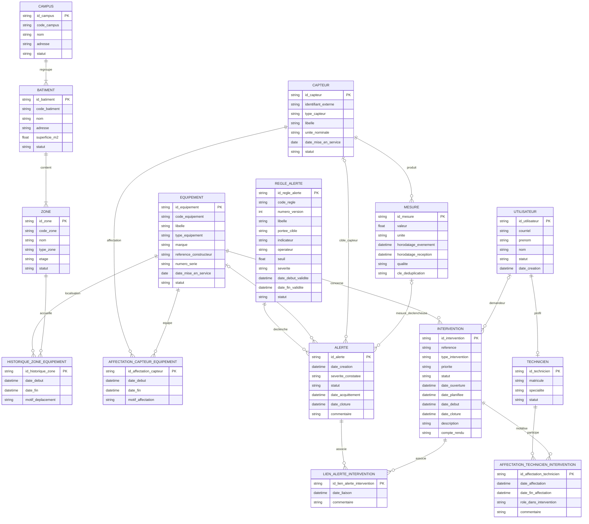
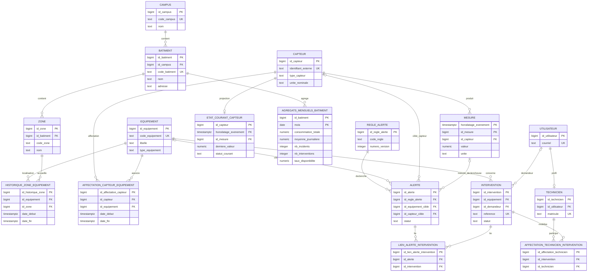

> [!IMPORTANT]
> **Prévisualisation :** Ouvrez ce fichier dans VS Code en mode **Preview** (`Ctrl+Shift+V`) pour afficher correctement les diagrammes Mermaid.

# TD 1 — Du cahier des charges au MCD

## Projet SmartCampus

**Livrable de modélisation conceptuelle — étapes 1 à 5**

## 1. Périmètre et conventions

SmartCampus est une plateforme de supervision technique et énergétique d’un ou plusieurs campus. Elle centralise les bâtiments, zones, équipements, capteurs, mesures, alertes et opérations de maintenance. Le cas de dimensionnement associé à la plateforme prévoit 8 bâtiments, environ 160 zones, 250 équipements, 600 capteurs, une mesure toutes les 30 secondes par capteur, 12 mois de rétention brute et environ 50 utilisateurs actifs en journée.

Les volumes sont des ordres de grandeur, pas des cardinalités d’intégrité. Le nombre de mesures estimé sur une année de 365 jours est de 630 720 000, hors retransmissions.

Conventions de modélisation :

- Les identifiants `id_*` sont des identifiants techniques stables. Ils ne portent pas de signification métier et ne remplacent pas les codes lisibles ou références métier.
- `Oui` dans la colonne « Identifiant ? » signifie que l’attribut participe à l’identification de l’occurrence; sinon, `Non`.
- `Oui` dans la colonne « Obligatoire ? » signifie que l’information doit être présente pour toute occurrence valide selon l’hypothèse de travail retenue. Les attributs ou liens optionnels sont signalés et expliqués.
- Les noms de dates et horodatages sont distingués : une **date** ne contient pas d’heure; un **horodatage** représente un instant. Les instants sont interprétés en UTC.
- Les intervalles d’affectation sont semi-ouverts `[date_debut, date_fin[` : le début est inclus et la fin est exclue. Une fin non renseignée représente une période en cours.
- Le MCD exprime les règles métier. Les types SQL, les index et les clés étrangères physiques relèvent du modèle logique et physique, non de ce TD.

## Étape 1 — Identification des entités métier

### 1.1 Entités principales

| Entité | Rôle exact dans SmartCampus | Caractéristiques principales | Identifiant unique | Unicités métier / remarques |
|---|---|---|---|---|
| **Campus** | Regroupe un ensemble de bâtiments supervisés. | Code, nom, adresse, statut. | `id_campus` | `code_campus` est unique dans le périmètre de la plateforme. |
| **Bâtiment** | Représente un bâtiment physique d’un campus. | Code, nom, adresse, superficie, statut. | `id_batiment` | `code_batiment` est retenu comme référence métier unique. |
| **Zone** | Représente un espace d’un bâtiment : salle, couloir, local technique, etc. | Code, nom, type, étage, statut. | `id_zone` | Hypothèse : `code_zone` est unique dans un bâtiment, pas nécessairement à l’échelle de tous les campus. |
| **Équipement** | Actif technique supervisé ou maintenu : chauffage, climatisation, ventilation, éclairage, installation électrique, etc. | Code, nom/libellé, type, marque, référence constructeur, numéro de série éventuel, date de mise en service, statut. | `id_equipement` | `code_equipement` est unique; le numéro de série peut être unique par constructeur s’il est renseigné et si cette règle est confirmée. |
| **Capteur** | Appareil qui collecte une grandeur physique ou énergétique et émet des mesures. | Identifiant externe, type, unité nominale, date de première installation/mise en service, statut, libellé. | `id_capteur` | `identifiant_externe` est unique dans le périmètre d’intégration retenu. |
| **Mesure** | Observation datée produite par un capteur. | Capteur source, valeur, unité, horodatage d’événement, horodatage de réception, qualité, clé de déduplication éventuelle. | `id_mesure` | Aucune unicité sur le couple capteur/horodatage n’est imposée sans règle de protocole; des événements peuvent partager un horodatage. |
| **Alerte** | Événement signalant une condition à traiter sur un capteur ou un équipement. | Date de création, cible, sévérité, statut, dates d’acquittement/clôture, commentaire, règle déclenchante. | `id_alerte` | La cible est exactement un équipement ou un capteur. Une règle versionnée est conservée comme référence. |
| **Intervention** | Action de maintenance portant sur un équipement. | Référence, dates de création/planification/réalisation, type, priorité, statut, description, compte rendu, demandeur éventuel. | `id_intervention` | `reference` est unique. Une intervention porte sur un équipement selon l’hypothèse de périmètre retenue. |
| **Technicien** | Profil professionnel d’une personne qui réalise ou prend part à des interventions. | Matricule, nom, prénom, courriel professionnel, spécialité, statut. | `id_technicien` | `matricule` et courriel professionnel sont uniques. Le courriel est une donnée personnelle/professionnelle à protéger. |
| **Utilisateur** | Compte d’une personne qui consulte ou utilise la plateforme et dont les actions peuvent être tracées. | Identifiant de connexion/courriel, nom, prénom, statut, date de création. | `id_utilisateur` | Courriel unique. Données personnelles : accès limité aux besoins métier et journalisation adaptée. Un utilisateur peut aussi avoir un profil technicien. |

### 1.2 Entités-associations nécessaires au MCD

Ces objets sont modélisés séparément car ils portent leurs propres dates, rôles ou informations métier. Ils ne sont pas de simples attributs répétés de leurs entités parentes.

| Entité-association | Rôle | Identifiant |
|---|---|---|
| **Historique_Zone_Equipement** | Enregistre une période pendant laquelle un équipement est situé dans une zone. | `id_historique_zone` |
| **Affectation_Capteur_Equipement** | Enregistre une période pendant laquelle un capteur est affecté à un équipement. | `id_affectation_capteur` |
| **Affectation_Technicien_Intervention** | Enregistre la participation d’un technicien à une intervention, éventuellement avec rôle et période. | `id_affectation_technicien` |
| **Lien_Alerte_Intervention** | Trace le lien entre une ou plusieurs alertes et une ou plusieurs interventions. | `id_lien_alerte_intervention` |
| **Règle_Alerte** | Définit une règle versionnée de détection et sa portée. | `id_regle_alerte` |

La règle d’alerte est une entité de soutien du MCD étendu : le cas demande la gestion des alertes, sans spécifier précisément leur paramétrage. La règle est incluse pour expliquer la provenance d’une alerte; les seuils et transitions sont des hypothèses à valider.

## Étape 2 — Dictionnaire de données

Le tableau suivant respecte le format demandé. Les identifiants techniques sont marqués `Oui` dans la colonne d’identification. Les références aux autres objets sont indiquées `Non (référence)` : elles décrivent une association au MCD et ne sont pas des identifiants de l’entité.

### 2.1 Référentiel spatial

| Entité | Attribut | Définition métier | Identifiant ? | Obligatoire ? |
|---|---|---|---|---|
| Campus | `id_campus` | Identifiant technique stable du campus; sans signification métier. | Oui | Oui |
| Campus | `code_campus` | Code lisible permettant de retrouver le campus dans les échanges et écrans. Unique dans SmartCampus selon l’hypothèse retenue. | Non | Oui |
| Campus | `nom` | Nom usuel du campus. | Non | Oui |
| Campus | `adresse` | Adresse postale ou description de localisation du campus. | Non | Non |
| Campus | `statut` | Situation du campus dans le référentiel : actif, inactif ou archivé. | Non | Oui |
| Bâtiment | `id_batiment` | Identifiant technique stable du bâtiment. | Oui | Oui |
| Bâtiment | `code_batiment` | Code métier de référence du bâtiment, unique dans le périmètre retenu. | Non | Oui |
| Bâtiment | `nom` | Nom usuel ou désignation du bâtiment. | Non | Oui |
| Bâtiment | `adresse` | Adresse ou indication d’accès au bâtiment. | Non | Oui |
| Bâtiment | `superficie_m2` | Superficie du bâtiment, exprimée en mètres carrés (m²). Précision et surface de référence à confirmer (surface utile, plancher, etc.). | Non | Oui |
| Bâtiment | `statut` | Situation du bâtiment dans le référentiel : actif, inactif ou archivé. | Non | Oui |
| Bâtiment | `id_campus` (association) | Référence au campus auquel le bâtiment appartient. | Non (référence) | Oui |
| Zone | `id_zone` | Identifiant technique stable de la zone. | Oui | Oui |
| Zone | `id_batiment` (association) | Référence au bâtiment qui contient cette zone. | Non (référence) | Oui |
| Zone | `code_zone` | Code d’identification de la zone, unique à l’intérieur de son bâtiment selon l’hypothèse retenue. | Non | Oui |
| Zone | `nom` | Nom ou désignation compréhensible de la zone. | Non | Oui |
| Zone | `type_zone` | Catégorie de l’espace, par exemple salle, couloir ou local technique. | Non | Oui |
| Zone | `etage` | Niveau ou étage auquel se trouve la zone, selon le codage du bâtiment. | Non | Non |
| Zone | `statut` | Situation de la zone : active, fermée ou archivée. | Non | Oui |

### 2.2 Équipements, capteurs et mesures

| Entité | Attribut | Définition métier | Identifiant ? | Obligatoire ? |
|---|---|---|---|---|
| Équipement | `id_equipement` | Identifiant technique stable de l’équipement. | Oui | Oui |
| Équipement | `code_equipement` | Référence interne métier de l’équipement, unique dans la plateforme. | Non | Oui |
| Équipement | `nom` / `libelle` | Désignation lisible de l’équipement dans le référentiel et les écrans. | Non | Oui |
| Équipement | `type_equipement` | Famille technique, par exemple chauffage, climatisation, ventilation, éclairage ou installation électrique. | Non | Oui |
| Équipement | `marque` | Marque ou fabricant de l’équipement. | Non | Non |
| Équipement | `reference_constructeur` | Référence de modèle/catalogue fournie par le constructeur; distincte du numéro de série individuel. | Non | Oui |
| Équipement | `numero_serie` | Numéro de série attribué à l’exemplaire par le fabricant, s’il est disponible. | Non | Non |
| Équipement | `date_mise_en_service` | Date de première mise en exploitation de l’équipement. | Non | Non |
| Équipement | `statut` | État du cycle de vie : en préparation, en service, hors service, retiré, etc. | Non | Oui |
| Capteur | `id_capteur` | Identifiant technique interne et stable du capteur. | Oui | Oui |
| Capteur | `identifiant_externe` | Identifiant transmis par le capteur ou la passerelle; unique dans le périmètre de collecte. | Non | Oui |
| Capteur | `type_capteur` | Type de grandeur observée, par exemple température, humidité, consommation électrique ou vibration. | Non | Oui |
| Capteur | `libelle` | Désignation lisible du capteur. | Non | Oui |
| Capteur | `unite_nominale` | Unité attendue pour les mesures du capteur, par exemple °C, % (humidité relative), kWh, kW ou mm/s selon la grandeur. Le symbole et la convention doivent être normalisés par type. | Non | Oui |
| Capteur | `date_premiere_installation` | Date de la première mise en place ou mise en service du capteur. Les dates de chaque réaffectation figurent dans l’entité-association historisée. | Non | Non |
| Capteur | `statut` | Situation opérationnelle du capteur : en stock, en service, indisponible, retiré ou archivé. | Non | Oui |
| Mesure | `id_mesure` | Identifiant technique de l’observation. Ne présume pas d’une unicité du seul couple capteur/horodatage. | Oui | Oui |
| Mesure | `id_capteur` (association) | Référence au capteur ayant produit l’observation. Une mesure non rattachée à un capteur connu n’est pas admise dans les mesures de référence. | Non (référence) | Oui |
| Mesure | `horodatage_evenement` | Instant auquel la valeur a été observée par le capteur, en UTC. Utilisé pour replacer l’observation dans son contexte historique. | Non | Oui |
| Mesure | `horodatage_reception` | Instant auquel la plateforme a reçu la mesure, en UTC. Distinct de l’événement pour identifier les retards et reprises. | Non | Oui |
| Mesure | `valeur` | Valeur numérique observée. La précision et les plages admissibles dépendent du type de capteur. | Non | Oui |
| Mesure | `unite` | Unité de la valeur au moment de l’observation. À conserver avec la mesure même si l’unité nominale du capteur évolue. | Non | Oui |
| Mesure | `qualite` | Indication de validité ou de qualité : valide, invalide, estimée, inconnue, selon un vocabulaire à définir. | Non | Oui |
| Mesure | `cle_deduplication` | Identifiant de message source, si le protocole en fournit un, utilisé pour reconnaître une retransmission. Son unicité doit être définie avec le périmètre de la source. | Non | Non |

### 2.3 Alertes, interventions, techniciens et utilisateurs

| Entité | Attribut | Définition métier | Identifiant ? | Obligatoire ? |
|---|---|---|---|---|
| Règle_Alerte | `id_regle_alerte` | Identifiant technique d’une version de règle. | Oui | Oui |
| Règle_Alerte | `code_regle` | Code stable identifiant la règle logique au fil de ses versions. | Non | Oui |
| Règle_Alerte | `numero_version` | Numéro de version; unique avec `code_regle`. | Non | Oui |
| Règle_Alerte | `libelle` | Désignation compréhensible de la règle. | Non | Oui |
| Règle_Alerte | `portee_cible` | Type d’objet visé par la règle : équipement ou capteur. | Non | Oui |
| Règle_Alerte | `indicateur` | Grandeur ou condition évaluée par la règle. | Non | Oui |
| Règle_Alerte | `operateur` | Opérateur logique comparant la valeur à un seuil (par exemple supérieur ou égal). | Non | Oui |
| Règle_Alerte | `seuil` | Seuil de comparaison dans l’unité spécifiée par l’indicateur ou la règle. | Non | Oui |
| Règle_Alerte | `severite` | Sévérité configurée pour une occurrence déclenchée. Vocabulaire à valider. | Non | Oui |
| Règle_Alerte | `date_debut_validite` | Instant de début d’application de cette version. | Non | Oui |
| Règle_Alerte | `date_fin_validite` | Instant de fin exclusive de validité; absent si la version est encore applicable. | Non | Non |
| Règle_Alerte | `statut` | État de publication de la règle : brouillon, active, suspendue, expirée, etc. | Non | Oui |
| Alerte | `id_alerte` | Identifiant technique stable de l’alerte. | Oui | Oui |
| Alerte | `id_regle_alerte` (association) | Référence à la version exacte de règle ayant déclenché l’alerte. | Non (référence) | Oui |
| Alerte | `id_equipement_cible` (association) | Équipement concerné, renseigné si la cible de l’alerte est un équipement. Exclusif avec la cible capteur. | Non (référence) | Selon la cible |
| Alerte | `id_capteur_cible` (association) | Capteur concerné, renseigné si la cible de l’alerte est un capteur. Exclusif avec la cible équipement. | Non (référence) | Selon la cible |
| Alerte | `id_mesure_declencheuse` (association) | Référence éventuelle à la mesure directement à l’origine du déclenchement. Peut être absente pour une alerte non issue d’une mesure unique. | Non (référence) | Non |
| Alerte | `date_creation` | Instant de création de l’alerte dans SmartCampus. | Non | Oui |
| Alerte | `severite_constatee` | Niveau de sévérité de cette occurrence au moment de sa création. | Non | Oui |
| Alerte | `statut` | État de traitement de l’alerte : ouverte, acquittée, en cours, clôturée, etc. | Non | Oui |
| Alerte | `date_acquittement` | Instant auquel un utilisateur habilité a acquitté l’alerte. | Non | Non |
| Alerte | `date_cloture` | Instant auquel le traitement de l’alerte a été clôturé. | Non | Non |
| Alerte | `commentaire` | Contexte ou information de suivi associée à l’alerte. | Non | Non |
| Intervention | `id_intervention` | Identifiant technique stable de l’intervention. | Oui | Oui |
| Intervention | `reference` | Référence métier lisible de suivi, unique dans la plateforme. | Non | Oui |
| Intervention | `id_equipement` (association) | Référence à l’équipement faisant l’objet de l’intervention. | Non (référence) | Oui |
| Intervention | `id_demandeur` (association) | Référence à l’utilisateur qui a demandé l’intervention; absente si intervention planifiée ou créée automatiquement selon l’hypothèse retenue. | Non (référence) | Non |
| Intervention | `type_intervention` | Nature de l’action, par exemple corrective, préventive ou inspection. | Non | Oui |
| Intervention | `priorite` | Niveau de priorité opérationnelle. Vocabulaire à définir. | Non | Oui |
| Intervention | `statut` | État du cycle de vie, par exemple à planifier, planifiée, en cours, terminée ou annulée. | Non | Oui |
| Intervention | `date_creation` / `date_ouverture` | Instant de création ou d’ouverture de la demande d’intervention. | Non | Oui |
| Intervention | `date_planifiee` | Instant prévu pour la réalisation, s’il est planifié. | Non | Non |
| Intervention | `date_realisation` / `date_debut` | Instant de début effectif des travaux. | Non | Non |
| Intervention | `date_cloture` | Instant de fin effective et de clôture de l’intervention. | Non | Non |
| Intervention | `description` | Motif, symptôme ou objet de l’intervention. | Non | Oui |
| Intervention | `compte_rendu` | Résumé des actions réalisées et du résultat constaté. | Non | Non |
| Technicien | `id_technicien` | Identifiant technique du profil technicien. | Oui | Oui |
| Technicien | `id_utilisateur` (association) | Référence au compte utilisateur de la personne technicienne. Un compte ne porte au plus qu’un profil technicien. | Non (référence) | Oui |
| Technicien | `matricule` | Identifiant professionnel unique du technicien. | Non | Oui |
| Technicien | `nom` | Nom de famille du technicien. Donnée personnelle. | Non | Oui |
| Technicien | `prenom` | Prénom du technicien. Donnée personnelle. | Non | Oui |
| Technicien | `courriel_professionnel` | Adresse de contact professionnelle du technicien, unique selon l’hypothèse retenue. Donnée personnelle/professionnelle. | Non | Oui |
| Technicien | `specialite` | Domaine de compétence du technicien, par exemple électricité ou CVC. | Non | Non |
| Technicien | `statut` | Situation du profil : actif, indisponible ou inactif. | Non | Oui |
| Utilisateur | `id_utilisateur` | Identifiant technique du compte utilisateur. | Oui | Oui |
| Utilisateur | `courriel` | Adresse de connexion ou de contact, unique dans SmartCampus. Donnée personnelle. | Non | Oui |
| Utilisateur | `nom` | Nom de famille du titulaire du compte. Donnée personnelle. | Non | Oui |
| Utilisateur | `prenom` | Prénom du titulaire du compte. Donnée personnelle. | Non | Oui |
| Utilisateur | `statut` | État du compte : actif, suspendu ou désactivé. | Non | Oui |
| Utilisateur | `date_creation` | Instant de création du compte dans la plateforme. | Non | Oui |

### 2.4 Entités-associations historisées et porteuses d’attributs

| Entité | Attribut | Définition métier | Identifiant ? | Obligatoire ? |
|---|---|---|---|---|
| Historique_Zone_Equipement | `id_historique_zone` | Identifiant technique d’une période de localisation. | Oui | Oui |
| Historique_Zone_Equipement | `id_equipement` | Équipement localisé pendant cette période. | Non (référence) | Oui |
| Historique_Zone_Equipement | `id_zone` | Zone occupée pendant cette période. | Non (référence) | Oui |
| Historique_Zone_Equipement | `date_debut` | Instant inclusif de début de localisation. | Non | Oui |
| Historique_Zone_Equipement | `date_fin` | Instant exclusif de fin; absent pour la localisation actuellement en cours. | Non | Non |
| Historique_Zone_Equipement | `motif_deplacement` | Motif connu du déplacement ou de la fin de localisation. | Non | Non |
| Affectation_Capteur_Equipement | `id_affectation_capteur` | Identifiant technique d’une période de rattachement. | Oui | Oui |
| Affectation_Capteur_Equipement | `id_capteur` | Capteur affecté pendant la période. | Non (référence) | Oui |
| Affectation_Capteur_Equipement | `id_equipement` | Équipement auquel le capteur est affecté pendant la période. | Non (référence) | Oui |
| Affectation_Capteur_Equipement | `date_debut` | Instant inclusif de début de l’affectation. | Non | Oui |
| Affectation_Capteur_Equipement | `date_fin` | Instant exclusif de fin; absent tant que l’affectation est en cours. | Non | Non |
| Affectation_Capteur_Equipement | `motif_affectation` | Motif d’installation, de remplacement, de déplacement ou de retrait. | Non | Non |
| Affectation_Technicien_Intervention | `id_affectation_technicien` | Identifiant technique d’une période de participation. | Oui | Oui |
| Affectation_Technicien_Intervention | `id_intervention` | Intervention à laquelle le technicien participe. | Non (référence) | Oui |
| Affectation_Technicien_Intervention | `id_technicien` | Technicien affecté à l’intervention. | Non (référence) | Oui |
| Affectation_Technicien_Intervention | `date_affectation` | Instant inclusif de début de la participation/affectation. | Non | Oui |
| Affectation_Technicien_Intervention | `date_fin_affectation` | Instant exclusif de fin de la participation; absent si elle est en cours. | Non | Non |
| Affectation_Technicien_Intervention | `role_dans_intervention` | Rôle éventuel du technicien (principal, soutien, spécialiste, etc.). | Non | Non |
| Affectation_Technicien_Intervention | `commentaire` | Information complémentaire sur la participation. | Non | Non |
| Lien_Alerte_Intervention | `id_lien_alerte_intervention` | Identifiant technique du lien entre une alerte et une intervention. | Oui | Oui |
| Lien_Alerte_Intervention | `id_alerte` | Alerte concernée par le lien. | Non (référence) | Oui |
| Lien_Alerte_Intervention | `id_intervention` | Intervention liée à l’alerte. | Non (référence) | Oui |
| Lien_Alerte_Intervention | `date_liaison` | Instant de création du lien. | Non | Oui |
| Lien_Alerte_Intervention | `commentaire` | Justification ou contexte du lien. | Non | Non |

Les cardinalités des associations sans attribut propre ne sont pas des attributs de données et n’ajoutent donc pas de ligne au dictionnaire. Elles sont décrites à l’étape 3.

## Étape 3 — Associations et cardinalités

### 3.1 Convention de cardinalité

Dans chaque ligne ci-dessous, `Entité A (min,max)` et `Entité B (min,max)` décrivent le nombre de participations de **chaque occurrence** de l’entité à l’association. Par exemple, `0,N` signifie zéro, une ou plusieurs; `1,1` signifie exactement une. Toute cardinalité est accompagnée d’une règle métier. Les valeurs correspondant à des hypothèses faute de précision du cahier des charges sont explicitement signalées.

### 3.2 Associations du référentiel

| Association | Entités concernées et cardinalités | Règle de gestion justifiant les cardinalités |
|---|---|---|
| **Rattacher au campus** | Campus `(1,N)` — Bâtiment `(1,1)` | Un campus regroupe un ou plusieurs bâtiments; chaque bâtiment relève d’un seul campus. Le minimum `1` côté campus suit le sens de « campus supervisé » et l’hypothèse qu’un campus vide n’est pas conservé dans le référentiel. Si la création anticipée d’un campus vide est admise, ce minimum devient `0`. |
| **Composer / contenir** | Bâtiment `(1,N)` — Zone `(1,1)` | Le cahier des charges indique qu’un bâtiment est composé de plusieurs zones; chaque zone est rattachée à un seul bâtiment. Le MCD impose donc au bâtiment au moins une zone et à la zone un seul parent. La question de création temporaire d’un bâtiment sans zone est à confirmer. |

### 3.3 Associations d’équipements, capteurs et mesures

| Association | Entités concernées et cardinalités | Règle de gestion justifiant les cardinalités |
|---|---|---|
| **Localiser dans** — association historisée `Historique_Zone_Equipement` | Équipement `(0,N)` — Zone `(0,N)`; chaque occurrence de l’association référence exactement un équipement `(1,1)` et une zone `(1,1)` | Un équipement peut changer de zone et doit conserver toutes ses localisations successives. Une zone peut contenir aucun, un ou plusieurs équipements selon les périodes. Un équipement peut ne pas encore être installé ou être retiré; conditionnellement, un équipement en service doit avoir exactement une période ouverte. |
| **Affecter à** — association historisée `Affectation_Capteur_Equipement` | Capteur `(0,N)` — Équipement `(0,N)`; chaque occurrence référence exactement un capteur `(1,1)` et un équipement `(1,1)` | Plusieurs capteurs peuvent équiper un même équipement. Un capteur peut être sans affectation (stock, préparation ou retrait) et être réaffecté à plusieurs équipements successivement. Un capteur ne peut être rattaché qu’à un équipement au plus à un instant donné. |
| **Produire** | Capteur `(0,N)` — Mesure `(1,1)` | Un capteur peut n’avoir encore produit aucune mesure ou en produire de nombreuses; chaque mesure est produite par un seul capteur identifié. Une mesure n’est jamais orpheline dans le référentiel de mesures. |

### 3.4 Associations d’alertes et de maintenance

| Association | Entités concernées et cardinalités | Règle de gestion justifiant les cardinalités |
|---|---|---|
| **Déclencher** | Règle_Alerte `(0,N)` — Alerte `(1,1)` | Une version de règle peut n’avoir déclenché aucune alerte ou plusieurs; chaque alerte automatisée référence la version précise de la règle qui l’a produite. Une alerte manuelle sans règle nécessiterait de rendre ce lien optionnel; ce comportement n’est pas retenu par défaut. |
| **Concerner un équipement** | Équipement `(0,N)` — Alerte `(0,1)` | Un équipement peut être concerné par plusieurs alertes au cours du temps; une alerte vise au plus un équipement par cette association. |
| **Concerner un capteur** | Capteur `(0,N)` — Alerte `(0,1)` | Un capteur peut être concerné par plusieurs alertes; une alerte vise au plus un capteur par cette association. **Contrainte globale XOR : chaque alerte concerne exactement un équipement ou exactement un capteur**, jamais zéro cible ni les deux à la fois. |
| **Être déclenchée par** | Mesure `(0,N)` — Alerte `(0,1)` | Une mesure peut être à l’origine de plusieurs alertes selon les règles; une alerte peut référencer au plus une mesure déclencheuse. Le lien est optionnel pour permettre une alerte sans mesure unique identifiable. |
| **Faire l’objet de** | Équipement `(0,N)` — Intervention `(1,1)` | Un équipement peut n’avoir aucune intervention ou en avoir plusieurs; chaque intervention porte sur un équipement selon le périmètre de maintenance retenu. Une intervention visant uniquement une zone ou un capteur est hors périmètre et demanderait une extension. |
| **Être demandée par** | Utilisateur `(0,N)` — Intervention `(0,1)` | Un utilisateur peut soumettre plusieurs demandes. Une intervention peut ne pas avoir de demandeur humain si elle est préventive ou créée automatiquement. |
| **Posséder un profil technicien** | Utilisateur `(0,1)` — Technicien `(1,1)` | Un utilisateur peut ne pas être technicien; chaque profil technicien correspond à exactement un compte utilisateur. Le compte est unique pour un profil. |
| **Participer à** — association `Affectation_Technicien_Intervention` | Technicien `(0,N)` — Intervention `(0,N)`; chaque occurrence relie exactement un technicien `(1,1)` et une intervention `(1,1)` | Une intervention peut mobiliser plusieurs techniciens, et un technicien peut participer à plusieurs interventions. L’entité-association garde une trace des périodes, rôles et réaffectations. |
| **Relier alerte et intervention** — association `Lien_Alerte_Intervention` | Alerte `(0,N)` — Intervention `(0,N)`; chaque lien relie exactement une alerte `(1,1)` et une intervention `(1,1)` | Le lien est optionnel car une alerte peut ne pas donner lieu à une intervention; une intervention peut être préventive et sans alerte. Plusieurs alertes peuvent être traitées par une intervention et une alerte peut nécessiter plusieurs interventions. |

### 3.5 Représentation textuelle synthétique du MCD

```text
Campus (1,N) ── Rattacher au campus ── (1,1) Bâtiment
Bâtiment (1,N) ── Contenir ── (1,1) Zone

Équipement (0,N) ── Historique_Zone_Equipement ── (0,N) Zone
Équipement (0,N) ── Affectation_Capteur_Equipement ── (0,N) Capteur
Capteur (0,N) ── Produire ── (1,1) Mesure

Règle_Alerte (0,N) ── Déclencher ── (1,1) Alerte
Alerte (0,1) ── Concerner ── (0,N) Équipement
Alerte (0,1) ── Concerner ── (0,N) Capteur
  Contrainte XOR : exactement une cible par alerte.
Mesure (0,N) ── Être à l'origine de ── (0,1) Alerte

Équipement (0,N) ── Faire l'objet de ── (1,1) Intervention
Utilisateur (0,N) ── Demander ── (0,1) Intervention
Utilisateur (0,1) ── Posséder un profil ── (1,1) Technicien
Technicien (0,N) ── Affectation_Technicien_Intervention ── (0,N) Intervention
Alerte (0,N) ── Lien_Alerte_Intervention ── (0,N) Intervention
```

Les deux associations historisées sont détaillées à l’étape suivante. Les associations `Affectation_Technicien_Intervention` et `Lien_Alerte_Intervention` deviennent également des entités-associations, car elles portent des attributs et/ou une traçabilité.

### 3.6 Représentation graphique du MCD (Mermaid)

Le diagramme représente les entités métier et les entités-associations porteuses d’attributs ou d’historique. Chaque occurrence d’une entité-association relie exactement une occurrence de chacune de ses entités parentes.



Les cardinalités des liens de cible d’`ALERTE` indiquent qu’une alerte peut concerner au plus un équipement et au plus un capteur; la règle métier impose qu’elle concerne exactement l’un des deux (XOR). Les contraintes d’exclusion mutuelle, dont ce XOR, ainsi que la gestion des intervalles temporels semi-ouverts `[date_debut, date_fin[` des associations historisées ne sont pas représentées complètement par le diagramme. Elles sont précisées dans les règles textuelles associées et seront traduites au niveau logique et physique.

## Étape 4 — Traitement des données historiques

### 4.1 Cas 1 : historique de localisation des équipements

#### Modélisation retenue

Une relation directe « équipement situé dans zone » ne suffit pas si elle ne stocke qu’une seule zone : un déplacement écraserait l’emplacement antérieur. Le MCD introduit donc l’entité-association historisée **`Historique_Zone_Equipement`** :

```text
HISTORIQUE_ZONE_EQUIPEMENT(
  id_historique_zone,
  équipement,
  zone,
  date_debut,
  date_fin,
  motif_deplacement
)
```

Chaque occurrence relie exactement un équipement à exactement une zone et représente une période de validité. `date_debut` est obligatoire; `date_fin` est optionnelle et absente pour la période en cours; le motif est optionnel.

#### Règles temporelles

- Intervalle semi-ouvert : `[date_debut, date_fin[`.
- Pour un même équipement, deux intervalles de localisation ne se chevauchent pas.
- Deux périodes consécutives peuvent se toucher : la fin exclusive de l’une peut être égale au début inclusif de la suivante.
- Une localisation courante est l’occurrence dont `date_fin` est absente.
- La durée passée dans une zone est calculable par `date_fin - date_debut`; pour la période ouverte, elle est calculée jusqu’à l’instant de consultation.
- La période ouverte est unique pour un équipement. Pour un équipement en service, l’hypothèse métier est qu’une seule localisation courante existe; avant installation ou après retrait, aucune période ouverte peut être admise.
- L’historique est conservé après un déplacement; une zone ou un équipement référencé n’est pas supprimé physiquement sans stratégie d’archivage.

#### Réponses permises par le modèle

| Question métier | Réponse conceptuelle |
|---|---|
| Dans quelle zone l’équipement se trouve-t-il actuellement ? | Chercher sa période dont `date_fin` est absente, sous réserve de son statut. |
| Où se trouvait-il précédemment ? | Lire ses occurrences historiques ordonnées par `date_debut`. |
| Quand a-t-il été déplacé ? | La fin de l’ancienne période et le début de la nouvelle indiquent l’instant de transition; le motif peut en préciser la cause. |
| Combien de temps est-il resté dans chaque zone ? | Calculer la durée de l’intervalle correspondant; définir la convention de fuseau/affichage pour les dates. |

Une correction rétroactive est une zone grise : elle ne doit pas créer un chevauchement ni modifier silencieusement l’interprétation des mesures déjà analysées. Le processus d’audit des corrections est à définir.

### 4.2 Cas 2 : historique des affectations capteur-équipement

#### Modélisation retenue

L’association entre capteur et équipement n’est pas permanente. Le capteur peut être remplacé, déplacé ou affecté à un autre équipement. Une relation courante simple perdrait cette information; le MCD introduit l’entité-association historisée **`Affectation_Capteur_Equipement`** :

```text
AFFECTATION_CAPTEUR_EQUIPEMENT(
  id_affectation_capteur,
  capteur,
  équipement,
  date_debut,
  date_fin,
  motif_affectation
)
```

Chaque occurrence décrit exactement un capteur affecté à exactement un équipement pendant un intervalle. Un équipement peut recevoir plusieurs capteurs; un capteur peut rester sans affectation ou avoir plusieurs affectations successives au cours de son cycle de vie.

#### Règles temporelles et remplacement

- Intervalles semi-ouverts `[date_debut, date_fin[` avec `date_debut < date_fin` si `date_fin` est renseignée.
- Pour un même capteur, les intervalles d’affectation ne se chevauchent pas : un capteur n’est pas partagé simultanément entre plusieurs équipements dans l’hypothèse retenue.
- Une période ouverte identifie l’équipement actuellement associé au capteur; il ne peut y en avoir qu’une au plus par capteur.
- Une fin d’affectation et un début d’affectation ultérieur décrivent le retrait, remplacement ou transfert. Le motif reste optionnel tant que le processus métier ne l’exige pas.
- L’association à un équipement est facultative hors période de service : stock, préparation, réparation ou retrait.
- Pour rattacher une mesure retardée à son équipement historique, rechercher l’affectation qui contient son `horodatage_evenement`, pas seulement son instant de réception.
- Si aucun intervalle ne couvre la date de la mesure, conserver la mesure si le capteur est connu et les règles de réception l’autorisent, mais la placer en anomalie/quarantaine métier pour résolution; ne pas inventer un équipement associé.

La date de première installation portée par `Capteur` décrit le début de vie opérationnelle globale; les dates de chaque installation/réaffectation sont portées par l’entité-association. Si le métier entend par « date d’installation » uniquement l’installation courante, cet attribut devra plutôt être dérivé de la période d’affectation ouverte.

## Étape 5 — Hypothèses et questions ouvertes

| Sujet / règle manquante | Hypothèse retenue pour le MCD | Conséquence sur la modélisation |
|---|---|---|
| **Nombre de campus** | Un ou plusieurs campus sont possibles; le cas ne fixe pas le nombre. | Entité `Campus` autonome; les volumes de 8 bâtiments ne définissent pas le nombre de campus. |
| **Campus sans bâtiment** | Non conservé comme état normal : un campus du référentiel regroupe au moins un bâtiment. | Cardinalité `Campus (1,N)` — `Bâtiment (1,1)`. Si la création à l’avance est admise, minimum `0` côté Campus. |
| **Bâtiment créé avant sa première zone** | Hypothèse principale : non, car le cahier décrit un bâtiment composé de plusieurs zones; à confirmer pour les phases de préparation. | `Bâtiment (1,N)` — `Zone (1,1)`. Une phase provisoire pourrait conduire à `0,N` côté Bâtiment sans rendre la zone orpheline. |
| **Zone créée avant son bâtiment** | Non : une zone doit toujours appartenir à un bâtiment identifié. | L’association Zone–Bâtiment est obligatoire (`1,1` côté Zone); aucun bâtiment nul ou zone autonome. |
| **Unicité des codes spatiaux** | Code bâtiment unique dans SmartCampus; code de zone unique à l’intérieur de son bâtiment. | Clés candidates respectives `code_batiment` et `(id_batiment, code_zone)`; à modifier si les codes sont seulement uniques par campus. |
| **Superficie du bâtiment** | Valeur exprimée en m²; « superficie » désigne la surface de référence fonctionnelle du bâtiment. | Attribut `superficie_m2` obligatoire dans l’hypothèse; définition (surface utile, plancher, etc.), précision et possibilité d’absence à valider. |
| **Localisation d’un équipement avant/après service** | Un équipement en service a exactement une localisation en cours; un équipement en préparation ou retiré peut en avoir zéro. | Cardinalité générale équipement-historique `0,N` et contrôle conditionnel lié au statut; la localisation n’est pas un simple attribut courant. |
| **Déplacements et historique** | Périodes semi-ouvertes sans chevauchement; horodatages en UTC; corrections rétroactives contrôlées. | Association historisée porteuse de dates et motif; besoin potentiel d’audit distinct pour tracer auteur et correction. |
| **Affectation d’un capteur** | Affectation facultative hors service; au plus un équipement simultané par capteur; plusieurs capteurs possibles sur un équipement. | Association historisée M:N dans le temps, avec non-chevauchement par capteur. Le partage d’un capteur n’est pas autorisé dans l’hypothèse initiale. |
| **Mesure d’un capteur sans affectation active** | Une mesure doit référencer un capteur connu. L’état « inactif aujourd’hui » n’annule pas une mesure passée; si aucune affectation ne couvre l’instant de l’événement, l’anomalie est conservée et traitée selon une règle d’exception. | Lien Capteur–Mesure obligatoire; lien temporel au niveau d’affectation résolu à la date d’événement. Une quarantaine et une période de tolérance d’arrivée tardive sont à définir. |
| **Mesure d’un capteur inconnu** | Ne pas insérer comme mesure métier orpheline; rejeter ou isoler le message avec identifiant source et motif. | Référence de mesure vers Capteur obligatoire; prévoir une file de quarantaine technique ou un journal de rejet distinct du MCD métier. |
| **Horodatages, fuseaux et dérive d’horloge** | Conserver l’instant d’événement et l’instant de réception en UTC; l’heure source peut être imparfaite. | Deux attributs temporels dans `Mesure`; définir tolérance d’horloge et règles de détection des dates impossibles. |
| **Unité et qualité de mesure** | Chaque mesure conserve sa propre unité et un statut de qualité contrôlé; l’unité nominale du capteur sert de référence, non de substitut à l’unité observée. | Attributs obligatoires `unite` et `qualite` dans `Mesure`; vocabulaires et conversions par type restent à fixer. |
| **Unicité/doublons de mesures** | Pas d’unicité automatique sur `(id_capteur, horodatage_evenement)`; identifiant source facultatif en attente du contrat IoT. | `id_mesure` reste identifiant technique; la déduplication dépend d’une clé de message et de son périmètre, pas d’une hypothèse d’horodatage unique. |
| **Cible d’une alerte** | Une alerte concerne exactement un équipement ou un capteur; elle peut être déclenchée à partir d’une mesure d’un capteur différente de sa cible métier. | Deux associations de cible avec contrainte globale XOR; lien facultatif à une mesure déclencheuse; association à une version de règle dans le MCD étendu. |
| **Alertes sans règle ou événements manuels** | Non dans l’hypothèse principale : toute alerte est rattachée à une version de règle. | Cardinalités Règle_Alerte `(0,N)` — Alerte `(1,1)`. Si des alertes manuelles sont nécessaires, rendre l’association optionnelle et distinguer leur origine. |
| **Intervention et équipement** | Toute intervention concerne exactement un équipement; une intervention préventive peut être créée sans alerte et sans demandeur humain. | Équipement `(0,N)` — Intervention `(1,1)`; liens demandeur et alerte-intervention facultatifs. Les interventions visant une zone entière sont hors périmètre. |
| **Affectation de plusieurs techniciens** | Plusieurs techniciens peuvent travailler sur une intervention; les réaffectations et dates doivent être traçables. | Association M:N transformée en `Affectation_Technicien_Intervention` avec début/fin et rôle éventuel. Le technicien principal reste à confirmer. |
| **Technicien et compte utilisateur** | Chaque technicien possède un compte; un utilisateur n’a au plus qu’un profil technicien. | Association `Utilisateur (0,1)` — `Technicien (1,1)`; l’identité d’accès reste séparée du profil professionnel. |
| **Attributs utilisateur et rôles** | `Utilisateur` représente le compte et l’identité minimale; les rôles/habilitations détaillés ne sont pas modélisés dans ce TD. | Le modèle pourra être étendu par des entités rôle/permission et une association plusieurs-à-plusieurs si les droits l’exigent. |
| **Données personnelles** | Courriels, noms et prénoms sont nécessaires à l’identité et à la traçabilité, avec accès limité. | Les données restent dans `Utilisateur`/`Technicien`; définir habilitations, durée de conservation et règles de protection selon la politique applicable. |
| **Rétention des mesures** | Mesures brutes conservées 12 mois; régime de conservation des alertes, interventions, historiques et sauvegardes non spécifié. | La rétention des données brutes est une règle de cycle de vie; les alertes pouvant référencer une mesure nécessitent une politique de purge/archivage compatible. |
| **Indicateurs énergétiques et disponibilité** | Ils sont calculés à partir des mesures, états et interventions; leur définition n’est pas spécifiée. | Pas d’entité d’indicateur ajoutée au MCD de base; agréger ou modéliser ultérieurement après définition des formules, unités et périodes. |

## Conclusion

Le MCD distingue les objets métier stables — campus, bâtiments, zones, équipements, capteurs, mesures, alertes, interventions, techniciens et utilisateurs — des relations qui possèdent une durée de vie ou des attributs propres. Il justifie chaque cardinalité par une règle ou une hypothèse explicite et rend les deux historiques exigés interrogeables sans écraser les faits passés.

Les arbitrages prioritaires avant de figer le modèle logique sont les cardinalités minimales de campus/bâtiments/zones, les règles de localisation des équipements en service, le protocole d’identité et de déduplication des mesures, le traitement des événements reçus sans affectation historique, les règles d’alerte et de cycle de vie des interventions, ainsi que les durées de conservation des mesures référencées par les alertes.


# TD 2 — Du MCD au MLD / MPD SQL

## Projet SmartCampus

**Objet :** traduction du MCD en schéma relationnel, définition du MPD PostgreSQL, contraintes, index et vérifications d’intégrité.  
**SGBD de référence :** PostgreSQL 15 ou ultérieur.  
**Références :** [MCD du projet](../projet/etapes/02-mcd.md) et [MPD détaillé](../projet/etapes/03-mld-mpd.md).

## Périmètre et conventions

Le schéma reprend le périmètre SmartCampus établi au TD 1 : campus, bâtiments, zones, équipements, capteurs, mesures, alertes et maintenance. Les liens de localisation d’un équipement et d’affectation d’un capteur sont historisés avec des intervalles semi-ouverts `[début, fin[`. Le modèle physique prévoit le partitionnement mensuel de `mesure` par horodatage d’événement.

Les identifiants techniques sont des `BIGINT` générés par identité. Les horodatages sont des instants `TIMESTAMPTZ`, stockés et exploités en UTC. Dans les tableaux, **NN** signifie `NOT NULL`, **NULL** signifie facultatif. Les valeurs d’énumération données dans les domaines sont les valeurs acceptées par les `CHECK` du MPD de référence. Les vocabulaires sont volontairement contrôlés en ligne; ils pourront devenir des tables de référence s’ils doivent être administrés.

## Étape 1 — Traduire le MCD en MLD

### 1.1 Règles de passage appliquées

| Règle de passage | Application dans SmartCampus |
|---|---|
| Une entité devient une table. | Les entités du MCD deviennent notamment `campus`, `batiment`, `zone`, `equipement`, `capteur`, `mesure`, `regle_alerte`, `alerte`, `intervention`, `technicien` et `utilisateur`. |
| Un attribut devient une colonne. | Les propriétés métier sont des colonnes typées dans la table correspondante. Un identifiant externe de capteur reste une chaîne distincte de l’identifiant technique interne. |
| Un identifiant devient une clé primaire. | Chaque table de référentiel et d’association porte une clé primaire technique. Exception physique : la clé primaire de `mesure` est composée de `(horodatage_evenement, id_mesure)` car PostgreSQL impose que la clé unique d’une table partitionnée inclue la clé de partition. |
| Une association 1,N est portée par une FK du côté N. | `batiment.id_campus`, `zone.id_batiment`, `mesure.id_capteur`, `intervention.id_equipement` et `alerte.id_regle_alerte` référencent leur parent. |
| Une association 1,1 est matérialisée par une FK `UNIQUE`. | `technicien.id_utilisateur` est obligatoire et `UNIQUE` : un profil technicien correspond à un compte utilisateur, et un compte ne porte au plus qu’un profil. |
| Une association N,N devient une table associative. | Les relations avec attributs propres sont des tables : `historique_zone_equipement`, `affectation_capteur_equipement`, `affectation_technicien_intervention` et `lien_alerte_intervention`. |
| Une association facultative devient une FK nullable. | `intervention.id_demandeur`, les deux FK de cible d’alerte et la référence facultative à une mesure déclencheuse acceptent `NULL`, avec les contraintes métier appropriées. |
| Une association porteuse d’historique conserve les occurrences passées. | Une nouvelle ligne représente chaque période; la ligne précédente est close et n’est pas écrasée par une nouvelle affectation. |

### 1.2 Schéma relationnel (MLD)

`PK` : clé primaire; `FK` : clé étrangère; `UQ` : unicité; `NN` : non nul.

```text
CAMPUS(PK id_campus, UQ code_campus, nom NN, adresse, statut NN)
BATIMENT(PK id_batiment, FK id_campus NN -> CAMPUS, UQ code_batiment,
         nom NN, adresse, statut NN)
ZONE(PK id_zone, FK id_batiment NN -> BATIMENT, code_zone NN, nom NN,
     type_zone NN, etage, statut NN, UQ(id_batiment, code_zone))
EQUIPEMENT(PK id_equipement, UQ code_equipement, libelle NN,
           type_equipement NN, marque, modele, numero_serie,
           date_mise_en_service, statut NN)
HISTORIQUE_ZONE_EQUIPEMENT(PK id_historique_zone,
    FK id_equipement NN -> EQUIPEMENT, FK id_zone NN -> ZONE,
    date_debut NN, date_fin, motif_deplacement,
    CHECK date_debut < date_fin si date_fin existe,
    EXCLUDE même équipement et périodes qui se chevauchent)
CAPTEUR(PK id_capteur, UQ identifiant_externe, type_capteur NN,
        libelle NN, unite_nominale NN, statut NN, date_mise_en_service)
AFFECTATION_CAPTEUR_EQUIPEMENT(PK id_affectation_capteur,
    FK id_capteur NN -> CAPTEUR, FK id_equipement NN -> EQUIPEMENT,
    date_debut NN, date_fin, motif_affectation,
    CHECK date_debut < date_fin si date_fin existe,
    EXCLUDE même capteur et périodes qui se chevauchent)
MESURE(PK physique(horodatage_evenement, id_mesure),
       id_mesure NN, FK id_capteur NN -> CAPTEUR,
       horodatage_evenement NN, horodatage_reception NN,
       valeur NN, unite NN, qualite NN, cle_deduplication)
REGLE_ALERTE(PK id_regle_alerte, UQ(code_regle, numero_version),
    code_regle NN, numero_version NN, libelle NN, portee_cible NN,
    indicateur NN, operateur NN, seuil NN, severite NN,
    date_debut_validite NN, date_fin_validite, statut NN)
ALERTE(PK id_alerte, FK id_regle_alerte NN -> REGLE_ALERTE,
    FK id_equipement_cible -> EQUIPEMENT, FK id_capteur_cible -> CAPTEUR,
    FK (horodatage_mesure_declencheuse, id_mesure_declencheuse) -> MESURE,
    date_creation NN, severite_constatee NN, statut NN,
    date_acquittement, date_cloture, commentaire,
    CHECK exactement une cible : équipement XOR capteur)
UTILISATEUR(PK id_utilisateur, UQ courriel, prenom NN, nom NN,
            statut NN, date_creation NN)
TECHNICIEN(PK id_technicien, FK UQ id_utilisateur NN -> UTILISATEUR,
           UQ matricule, specialite, statut NN)
INTERVENTION(PK id_intervention, UQ reference,
    FK id_equipement NN -> EQUIPEMENT,
    FK id_demandeur -> UTILISATEUR, type_intervention NN,
    priorite NN, statut NN, date_ouverture NN, date_planifiee,
    date_debut, date_cloture, description NN, compte_rendu)
AFFECTATION_TECHNICIEN_INTERVENTION(PK id_affectation_technicien,
    FK id_intervention NN -> INTERVENTION, FK id_technicien NN -> TECHNICIEN,
    date_affectation NN, date_fin_affectation, role_dans_intervention,
    commentaire)
LIEN_ALERTE_INTERVENTION(PK id_lien_alerte_intervention,
    FK id_alerte NN -> ALERTE, FK id_intervention NN -> INTERVENTION,
    date_liaison NN, commentaire, UQ(id_alerte, id_intervention))
```

La mesure est identifiée conceptuellement par `id_mesure`, mais, sur la table partitionnée, la garantie d’unicité déclarée par la base porte sur le couple `(horodatage_evenement, id_mesure)`. Toute FK vers une mesure doit donc conserver les deux valeurs. Le couple `(id_capteur, horodatage_evenement)` n’est pas unique : plusieurs observations peuvent partager le même instant.

### 1.3 Historisation et absence de chevauchements

Les deux relations temporelles sont représentées par des tables associatives. Une fin `NULL` est interprétée comme une borne supérieure infinie. La convention `[)` inclut la borne de début et exclut la borne de fin : deux localisations peuvent donc se succéder exactement à la même date/heure sans chevauchement.

```sql
CREATE EXTENSION IF NOT EXISTS btree_gist;

ALTER TABLE smartcampus.historique_zone_equipement
  ADD CONSTRAINT ck_hze_intervalle
  CHECK (date_fin IS NULL OR date_debut < date_fin),
  ADD CONSTRAINT ex_hze_equipement_periode
  EXCLUDE USING gist (
    id_equipement WITH =,
    tstzrange(date_debut, date_fin, '[)') WITH &&
  );

ALTER TABLE smartcampus.affectation_capteur_equipement
  ADD CONSTRAINT ck_ace_intervalle
  CHECK (date_fin IS NULL OR date_debut < date_fin),
  ADD CONSTRAINT ex_ace_capteur_periode
  EXCLUDE USING gist (
    id_capteur WITH =,
    tstzrange(date_debut, date_fin, '[)') WITH &&
  );
```

L’opérateur `&&` détecte le chevauchement des plages. L’index GiST créé par chaque exclusion interdit deux intervalles qui se chevauchent pour le même équipement dans son historique spatial, ou pour le même capteur dans ses affectations. Il accepte une borne finale ouverte, refuse les intervalles inversés et autorise les intervalles contigus. La deuxième règle exprime « au plus un équipement à la fois par capteur »; elle n’interdit pas qu’un équipement possède plusieurs capteurs.

### 1.4 Choix physiques associés

- `mesure` est partitionnée par `RANGE (horodatage_evenement)`, sur des partitions mensuelles. Toute clé unique et toute FK qui la référence inclut donc l’horodatage.
- Le partitionnement nécessite une supervision des partitions futures et une politique de purge compatible avec les alertes qui référencent éventuellement une mesure.
- Les noms SQL sont en `snake_case`; les identifiants techniques utilisent `BIGINT GENERATED BY DEFAULT AS IDENTITY`.

## Étape 2 — Définir les types de données

Les tableaux suivants couvrent **toutes les colonnes métier et techniques déclarées** dans les 15 tables du MLD. `DEFAULT` indique une valeur fournie par la base. Les domaines sont ceux du MPD de référence; ils doivent être élargis par migration si de nouveaux états métier sont approuvés.

### 2.1 Référentiel spatial

| Table | Colonne | Type SQL | NULL | Justification et domaine |
|---|---|---|---|---|
| `campus` | `id_campus` | `BIGINT GENERATED BY DEFAULT AS IDENTITY` | NN | Identifiant technique 64 bits, généré par PostgreSQL; PK. |
| `campus` | `code_campus` | `VARCHAR(80)` | NN | Code stable d’intégration; `UNIQUE`. |
| `campus` | `nom` | `VARCHAR(160)` | NN | Nom affichable avec longueur bornée. |
| `campus` | `adresse` | `VARCHAR(500)` | NULL | Adresse facultative; longueur maximale adaptée à une adresse complète. |
| `campus` | `statut` | `VARCHAR(30)` | NN | `CHECK` : `ACTIF`, `INACTIF`, `ARCHIVE`. |
| `batiment` | `id_batiment` | `BIGINT GENERATED BY DEFAULT AS IDENTITY` | NN | Identifiant technique; PK. |
| `batiment` | `id_campus` | `BIGINT` | NN | FK vers `campus.id_campus`; relation obligatoire. |
| `batiment` | `code_batiment` | `VARCHAR(80)` | NN | Code métier stable; `UNIQUE`. |
| `batiment` | `nom` | `VARCHAR(160)` | NN | Désignation obligatoire du bâtiment. |
| `batiment` | `adresse` | `VARCHAR(500)` | NULL | Adresse facultative, distincte du nom. |
| `batiment` | `statut` | `VARCHAR(30)` | NN | `CHECK` : `ACTIF`, `INACTIF`, `ARCHIVE`. |
| `zone` | `id_zone` | `BIGINT GENERATED BY DEFAULT AS IDENTITY` | NN | Identifiant technique; PK. |
| `zone` | `id_batiment` | `BIGINT` | NN | FK vers `batiment.id_batiment`; relation obligatoire. |
| `zone` | `code_zone` | `VARCHAR(80)` | NN | Code local au bâtiment; `UNIQUE(id_batiment, code_zone)`. |
| `zone` | `nom` | `VARCHAR(160)` | NN | Nom lisible de la zone. |
| `zone` | `type_zone` | `VARCHAR(50)` | NN | Catégorie de zone; domaine contrôlé par le référentiel applicatif. |
| `zone` | `etage` | `VARCHAR(40)` | NULL | Peut être absent (extérieur, sous-sol non numéroté, etc.); chaîne pour gérer des valeurs non numériques. |
| `zone` | `statut` | `VARCHAR(30)` | NN | `CHECK` : `ACTIVE`, `FERMEE`, `ARCHIVEE`. |

### 2.2 Équipements, capteurs et mesures

| Table | Colonne | Type SQL | NULL | Justification et domaine |
|---|---|---|---|---|
| `equipement` | `id_equipement` | `BIGINT GENERATED BY DEFAULT AS IDENTITY` | NN | Identifiant technique; PK. |
| `equipement` | `code_equipement` | `VARCHAR(100)` | NN | Identifiant métier unique dans le parc; `UNIQUE`. |
| `equipement` | `libelle` | `VARCHAR(200)` | NN | Désignation courte nécessaire à l’exploitation. |
| `equipement` | `type_equipement` | `VARCHAR(80)` | NN | Famille technique contrôlée par le domaine métier. |
| `equipement` | `marque` | `VARCHAR(100)` | NULL | Le fabricant peut être inconnu ou sans objet. |
| `equipement` | `modele` | `VARCHAR(100)` | NULL | Modèle éventuellement non renseigné. |
| `equipement` | `numero_serie` | `VARCHAR(120)` | NULL | Certains actifs ne possèdent pas de numéro exploitable. |
| `equipement` | `date_mise_en_service` | `DATE` | NULL | Date civile, sans heure ni fuseau. |
| `equipement` | `statut` | `VARCHAR(30)` | NN | `CHECK` : `EN_PREPARATION`, `EN_SERVICE`, `HORS_SERVICE`, `RETIRE`, `ARCHIVE`. |
| `historique_zone_equipement` | `id_historique_zone` | `BIGINT GENERATED BY DEFAULT AS IDENTITY` | NN | Identifiant de l’occurrence d’historique; PK. |
| `historique_zone_equipement` | `id_equipement` | `BIGINT` | NN | FK vers l’équipement localisé. |
| `historique_zone_equipement` | `id_zone` | `BIGINT` | NN | FK vers la zone; une localisation porte toujours sur une zone. |
| `historique_zone_equipement` | `date_debut` | `TIMESTAMPTZ` | NN | Instant UTC de début; début inclus. |
| `historique_zone_equipement` | `date_fin` | `TIMESTAMPTZ` | NULL | Fin exclusive; `NULL` signifie période toujours ouverte. |
| `historique_zone_equipement` | `motif_deplacement` | `VARCHAR(500)` | NULL | Motif facultatif, borné pour le texte court. |
| `capteur` | `id_capteur` | `BIGINT GENERATED BY DEFAULT AS IDENTITY` | NN | Identifiant technique; PK. |
| `capteur` | `identifiant_externe` | `VARCHAR(160)` | NN | Identité transmise par la source IoT; `UNIQUE`. |
| `capteur` | `type_capteur` | `VARCHAR(80)` | NN | Type/grandeur mesurée; domaine métier. |
| `capteur` | `libelle` | `VARCHAR(200)` | NN | Nom affichable du capteur. |
| `capteur` | `unite_nominale` | `VARCHAR(30)` | NN | Unité attendue à l’installation; format court. |
| `capteur` | `statut` | `VARCHAR(30)` | NN | `CHECK` : `EN_STOCK`, `EN_SERVICE`, `INDISPONIBLE`, `RETIRE`, `ARCHIVE`. |
| `capteur` | `date_mise_en_service` | `DATE` | NULL | Date civile facultative de mise en service. |
| `affectation_capteur_equipement` | `id_affectation_capteur` | `BIGINT GENERATED BY DEFAULT AS IDENTITY` | NN | Identifiant d’une période d’affectation; PK. |
| `affectation_capteur_equipement` | `id_capteur` | `BIGINT` | NN | FK du capteur affecté. |
| `affectation_capteur_equipement` | `id_equipement` | `BIGINT` | NN | FK de l’équipement supervisé pendant la période. |
| `affectation_capteur_equipement` | `date_debut` | `TIMESTAMPTZ` | NN | Début inclus de l’affectation. |
| `affectation_capteur_equipement` | `date_fin` | `TIMESTAMPTZ` | NULL | Fin exclusive; NULL tant que l’affectation reste ouverte. |
| `affectation_capteur_equipement` | `motif_affectation` | `VARCHAR(500)` | NULL | Motif facultatif d’installation ou de réaffectation. |
| `mesure` | `id_mesure` | `BIGINT GENERATED BY DEFAULT AS IDENTITY` | NN | Identifiant technique; partie de la PK physique composée avec l’horodatage de partition. |
| `mesure` | `id_capteur` | `BIGINT` | NN | FK vers le capteur producteur. |
| `mesure` | `horodatage_evenement` | `TIMESTAMPTZ` | NN | Instant de mesure et clé de partition; nécessaire dans la PK physique. |
| `mesure` | `horodatage_reception` | `TIMESTAMPTZ` | NN, `DEFAULT CURRENT_TIMESTAMP` | Instant d’arrivée côté plateforme, utile pour mesurer le retard de transmission. |
| `mesure` | `valeur` | `NUMERIC(20,6)` | NN | Décimal exact; précision et échelle initiales à valider selon les capteurs. |
| `mesure` | `unite` | `VARCHAR(30)` | NN | Unité réellement portée par cette observation; distincte de l’unité nominale. |
| `mesure` | `qualite` | `VARCHAR(30)` | NN | `CHECK` : `VALIDE`, `INVALIDE`, `ESTIMEE`, `INCONNUE`. |
| `mesure` | `cle_deduplication` | `VARCHAR(160)` | NULL | Identifiant de message source optionnel; pas d’unicité sans périmètre de déduplication approuvé. |

### 2.3 Alertes et règles

| Table | Colonne | Type SQL | NULL | Justification et domaine |
|---|---|---|---|---|
| `regle_alerte` | `id_regle_alerte` | `BIGINT GENERATED BY DEFAULT AS IDENTITY` | NN | Identifiant de version de règle; PK. |
| `regle_alerte` | `code_regle` | `VARCHAR(100)` | NN | Code stable d’une règle, répété entre ses versions. |
| `regle_alerte` | `numero_version` | `INTEGER` | NN | Petit entier ordonné; `CHECK > 0`, `UNIQUE(code_regle, numero_version)`. |
| `regle_alerte` | `libelle` | `VARCHAR(200)` | NN | Désignation de la version de règle. |
| `regle_alerte` | `portee_cible` | `VARCHAR(20)` | NN | `CHECK` : `EQUIPEMENT` ou `CAPTEUR`; doit correspondre à la cible de l’alerte. |
| `regle_alerte` | `indicateur` | `VARCHAR(80)` | NN | Identifie la grandeur comparée au seuil. |
| `regle_alerte` | `operateur` | `VARCHAR(20)` | NN | `CHECK` : `>`, `>=`, `<`, `<=`, `=`, `<>`. |
| `regle_alerte` | `seuil` | `NUMERIC(20,6)` | NN | Seuil décimal exact, cohérent avec la précision des mesures. |
| `regle_alerte` | `severite` | `VARCHAR(30)` | NN | `CHECK` : `INFO`, `MINEURE`, `MAJEURE`, `CRITIQUE`. |
| `regle_alerte` | `date_debut_validite` | `TIMESTAMPTZ` | NN | Début inclus de validité de la version. |
| `regle_alerte` | `date_fin_validite` | `TIMESTAMPTZ` | NULL | Fin exclusive éventuelle; doit être postérieure au début. |
| `regle_alerte` | `statut` | `VARCHAR(20)` | NN | `CHECK` : `BROUILLON`, `ACTIVE`, `SUSPENDUE`, `EXPIREE`. |
| `alerte` | `id_alerte` | `BIGINT GENERATED BY DEFAULT AS IDENTITY` | NN | Identifiant technique; PK. |
| `alerte` | `id_regle_alerte` | `BIGINT` | NN | FK vers la version exacte ayant déclenché l’alerte. |
| `alerte` | `id_equipement_cible` | `BIGINT` | NULL | FK équipement; exactement l’une des deux cibles doit être présente. |
| `alerte` | `id_capteur_cible` | `BIGINT` | NULL | FK capteur; XOR avec `id_equipement_cible`. |
| `alerte` | `id_mesure_declencheuse` | `BIGINT` | NULL | Identifiant d’une mesure déclencheuse; FK composite avec son horodatage. |
| `alerte` | `horodatage_mesure_declencheuse` | `TIMESTAMPTZ` | NULL | Composante de la FK vers la PK partitionnée de `mesure`; nullable avec l’identifiant. |
| `alerte` | `date_creation` | `TIMESTAMPTZ` | NN, `DEFAULT CURRENT_TIMESTAMP` | Instant de création de l’alerte. |
| `alerte` | `severite_constatee` | `VARCHAR(30)` | NN | `CHECK` : `INFO`, `MINEURE`, `MAJEURE`, `CRITIQUE`. |
| `alerte` | `statut` | `VARCHAR(30)` | NN | `CHECK` : `OUVERTE`, `ACQUITTEE`, `EN_COURS`, `CLOTUREE`, `IGNOREE`. |
| `alerte` | `date_acquittement` | `TIMESTAMPTZ` | NULL | Instant d’acquittement, absent tant que non acquittée. |
| `alerte` | `date_cloture` | `TIMESTAMPTZ` | NULL | Instant de clôture, absent tant que non clôturée. |
| `alerte` | `commentaire` | `TEXT` | NULL | Commentaire de longueur variable; aucune limite métier établie. |

### 2.4 Utilisateurs, techniciens et interventions

| Table | Colonne | Type SQL | NULL | Justification et domaine |
|---|---|---|---|---|
| `utilisateur` | `id_utilisateur` | `BIGINT GENERATED BY DEFAULT AS IDENTITY` | NN | Identifiant technique; PK. |
| `utilisateur` | `courriel` | `VARCHAR(254)` | NN | Taille maximale pratique pour une adresse de courrier; `UNIQUE`. |
| `utilisateur` | `prenom` | `VARCHAR(100)` | NN | Prénom d’affichage; donnée personnelle à accès restreint. |
| `utilisateur` | `nom` | `VARCHAR(100)` | NN | Nom d’affichage; donnée personnelle à accès restreint. |
| `utilisateur` | `statut` | `VARCHAR(30)` | NN | `CHECK` : `ACTIF`, `SUSPENDU`, `DESACTIVE`. |
| `utilisateur` | `date_creation` | `TIMESTAMPTZ` | NN, `DEFAULT CURRENT_TIMESTAMP` | Instant de création du compte. |
| `technicien` | `id_technicien` | `BIGINT GENERATED BY DEFAULT AS IDENTITY` | NN | Identifiant technique du profil; PK. |
| `technicien` | `id_utilisateur` | `BIGINT` | NN | FK `UNIQUE` vers `utilisateur`; matérialise le 1:1 optionnel côté utilisateur. |
| `technicien` | `matricule` | `VARCHAR(80)` | NN | Identifiant professionnel; `UNIQUE`. |
| `technicien` | `specialite` | `VARCHAR(100)` | NULL | Spécialité éventuelle; domaine contrôlé par le métier. |
| `technicien` | `statut` | `VARCHAR(30)` | NN | `CHECK` : `ACTIF`, `INDISPONIBLE`, `INACTIF`. |
| `intervention` | `id_intervention` | `BIGINT GENERATED BY DEFAULT AS IDENTITY` | NN | Identifiant technique; PK. |
| `intervention` | `reference` | `VARCHAR(100)` | NN | Référence lisible; `UNIQUE`. |
| `intervention` | `id_equipement` | `BIGINT` | NN | FK obligatoire vers l’équipement concerné par l’intervention. |
| `intervention` | `id_demandeur` | `BIGINT` | NULL | FK facultative vers l’utilisateur demandeur; une intervention peut être préventive ou automatique. |
| `intervention` | `type_intervention` | `VARCHAR(30)` | NN | `CHECK` : `CORRECTIVE`, `PREVENTIVE`, `INSPECTION`, `AUTRE`. |
| `intervention` | `priorite` | `VARCHAR(30)` | NN | `CHECK` : `BASSE`, `NORMALE`, `HAUTE`, `URGENTE`. |
| `intervention` | `statut` | `VARCHAR(30)` | NN | `CHECK` : `A_PLANIFIER`, `PLANIFIEE`, `EN_COURS`, `EN_ATTENTE`, `TERMINEE`, `ANNULEE`. |
| `intervention` | `date_ouverture` | `TIMESTAMPTZ` | NN, `DEFAULT CURRENT_TIMESTAMP` | Instant de création/ouverture. |
| `intervention` | `date_planifiee` | `TIMESTAMPTZ` | NULL | Instant prévu, non obligatoire à la création. |
| `intervention` | `date_debut` | `TIMESTAMPTZ` | NULL | Début effectif, absent avant réalisation. |
| `intervention` | `date_cloture` | `TIMESTAMPTZ` | NULL | Clôture effective facultative. |
| `intervention` | `description` | `TEXT` | NN | Description libre, sans taille maximale métier fixée. |
| `intervention` | `compte_rendu` | `TEXT` | NULL | Compte rendu ajouté après l’intervention. |
| `affectation_technicien_intervention` | `id_affectation_technicien` | `BIGINT GENERATED BY DEFAULT AS IDENTITY` | NN | Identifiant de l’occurrence d’affectation; PK. |
| `affectation_technicien_intervention` | `id_intervention` | `BIGINT` | NN | FK vers l’intervention. |
| `affectation_technicien_intervention` | `id_technicien` | `BIGINT` | NN | FK vers le technicien. |
| `affectation_technicien_intervention` | `date_affectation` | `TIMESTAMPTZ` | NN | Début inclus de participation. |
| `affectation_technicien_intervention` | `date_fin_affectation` | `TIMESTAMPTZ` | NULL | Fin exclusive facultative; doit être postérieure au début si renseignée. |
| `affectation_technicien_intervention` | `role_dans_intervention` | `VARCHAR(40)` | NULL | Rôle facultatif de l’intervenant. |
| `affectation_technicien_intervention` | `commentaire` | `TEXT` | NULL | Note de participation, texte libre. |
| `lien_alerte_intervention` | `id_lien_alerte_intervention` | `BIGINT GENERATED BY DEFAULT AS IDENTITY` | NN | Identifiant technique de l’association; PK. |
| `lien_alerte_intervention` | `id_alerte` | `BIGINT` | NN | FK vers l’alerte reliée. |
| `lien_alerte_intervention` | `id_intervention` | `BIGINT` | NN | FK vers l’intervention reliée. |
| `lien_alerte_intervention` | `date_liaison` | `TIMESTAMPTZ` | NN, `DEFAULT CURRENT_TIMESTAMP` | Instant de création de l’association. |
| `lien_alerte_intervention` | `commentaire` | `TEXT` | NULL | Commentaire facultatif sur le lien. |

## Étape 3 — Définir les contraintes d’intégrité

### 3.1 Contraintes appliquées

| Contrainte | Application | Justification |
|---|---|---|
| `PRIMARY KEY` | Une PK par table; `(horodatage_evenement, id_mesure)` pour `mesure`. | Garantit l’identification non nulle et unique des lignes, en conformité avec le partitionnement PostgreSQL. |
| `FOREIGN KEY` | Toutes les relations parent-enfant du MLD, dont les associations historiques. FK de mesure déclencheuse composite. | Interdit les références orphelines et protège la cohérence temporelle référençable. |
| `ON DELETE RESTRICT` | Toutes les FK. | Préserve l’historique et empêche qu’une suppression en cascade efface un actif, une alerte ou une trace de maintenance. Utiliser archivage/statut plutôt que suppression. |
| `ON UPDATE RESTRICT` | Toutes les FK. | Les identifiants techniques sont stables et ne doivent pas être propagés par mise à jour. |
| `NOT NULL` | Identifiants, champs indispensables, FK des associations obligatoires, `date_debut`, valeur/unité/qualité des mesures, équipement d’une intervention. | Traduit les participations minimales `1,1` et empêche les objets incomplets. |
| `UNIQUE` | Codes de campus, bâtiment et équipement; `identifiant_externe`; matricule, courriel, référence d’intervention; `(code_regle, numero_version)`; `(id_batiment, code_zone)`; `(id_alerte, id_intervention)`. | Protège les identifiants métier et empêche les doublons incohérents dans les associations. |
| `CHECK` de domaine | Statuts, sévérités, types, priorités, portée, opérateurs, qualités et `numero_version > 0`. | Ferme les valeurs invalides au niveau de la base sans multiplier les petites tables de référence. |
| `CHECK` d’intervalle | `date_fin IS NULL OR date_debut < date_fin`, même règle sur validité de règle et affectation technicien. | Rejette les durées nulles ou inversées. |
| `EXCLUDE USING gist` | Historique de zone par équipement; affectation par capteur. | Garantit l’absence de chevauchement malgré les écritures concurrentes, là où un contrôle applicatif seul serait sujet aux courses. |
| `CHECK` XOR | Sur `alerte`, exactement une FK cible non nulle. | Autorise une et une seule cible : équipement ou capteur. |
| FK composite nullables par paire | Sur la mesure déclencheuse, avec un `CHECK` de cohérence des deux colonnes. | PostgreSQL ignore une FK si l’une de ses colonnes est `NULL`; le `CHECK` impose que les deux soient soit présentes, soit absentes. |

### 3.2 XOR d’une alerte

```sql
CONSTRAINT ck_alerte_cible_xor CHECK (
  (id_equipement_cible IS NOT NULL)
  <> (id_capteur_cible IS NOT NULL)
)
```

L’opérateur booléen `<>` est un XOR : deux cibles absentes et deux cibles présentes sont refusées; une seule cible présente est acceptée. Une vérification supplémentaire par déclencheur compare cette cible à `regle_alerte.portee_cible`. Un `CHECK` SQL ne peut pas consulter une autre table.

## Étape 4 — Requêtes métier et index nécessaires

Les requêtes sont écrites avec des paramètres nommés (`:...`) à remplacer par des paramètres préparés du pilote. Le partitionnement de `mesure` n’annule pas l’intérêt des index locaux; une borne temporelle explicite permet au planificateur d’élaguer les partitions non concernées.

### Requête 1 — Équipements d’un bâtiment

**Usage et règle temporelle.** La localisation n’est pas une colonne de `equipement`; on consulte l’emplacement valide à l’instant demandé. Pour l’emplacement courant, fournir `CURRENT_TIMESTAMP` ou une valeur UTC. La contrainte d’exclusion garantit au plus une ligne de localisation pour un équipement à cet instant.

```sql
SELECT e.id_equipement, e.code_equipement, e.libelle, e.type_equipement,
       z.id_zone, z.code_zone, z.nom AS nom_zone
FROM smartcampus.zone AS z
JOIN smartcampus.historique_zone_equipement AS h
  ON h.id_zone = z.id_zone
JOIN smartcampus.equipement AS e
  ON e.id_equipement = h.id_equipement
WHERE z.id_batiment = :id_batiment
  AND h.date_debut <= :a_date
  AND (h.date_fin IS NULL OR :a_date < h.date_fin)
ORDER BY z.code_zone, e.code_equipement;
```

| Index adapté | Type | Rôle |
|---|---|---|
| PK `zone(id_zone)`; `ix_zone_id_batiment(id_batiment)` | B-tree | Récupère les zones du bâtiment. |
| `ix_hze_zone_date_debut` sur `(id_zone, date_debut DESC) INCLUDE (id_equipement, date_fin)` | B-tree couvrant | Cherche, par zone et date, les localisations candidates et limite les retours à la table. |
| PK `equipement(id_equipement)` | B-tree | Jointure vers l’équipement. |
| Index GiST créé par `ex_hze_equipement_periode` | GiST | Assure l’exclusion; utile aux recherches temporelles commençant par l’équipement, mais n’est pas à lui seul l’index principal de cette requête qui part du bâtiment/zone. |

Pour les listes « uniquement aujourd’hui », un index partiel `(id_zone, id_equipement) WHERE date_fin IS NULL` peut être ajouté si les mesures démontrent que cette variante domine. Il ne remplace pas l’index permettant les recherches historiques.

### Requête 2 — Dernières mesures d’un capteur

```sql
SELECT id_mesure, id_capteur, horodatage_evenement,
       horodatage_reception, valeur, unite, qualite
FROM smartcampus.mesure
WHERE id_capteur = :id_capteur
  AND horodatage_evenement >= :depuis
  AND horodatage_evenement < :jusqua
ORDER BY horodatage_evenement DESC
LIMIT :limite;
```

| Index adapté | Type | Rôle |
|---|---|---|
| `ix_mesure_capteur_evenement` sur `(id_capteur, horodatage_evenement DESC) INCLUDE (valeur, unite, qualite, horodatage_reception)` | B-tree composite couvrant, local aux partitions | Filtre d’abord le capteur, renvoie les observations dans l’ordre demandé et peut couvrir la projection sans inclure les colonnes dans la clé de tri. |
| Partitionnement mensuel par `horodatage_evenement` | RANGE | Élimine les partitions hors période grâce aux deux bornes du prédicat. |

Sans filtre temporel, toutes les partitions encore présentes peuvent devoir être consultées pour trouver les dernières mesures; limiter la période lorsque le besoin fonctionnel le permet. L’index est maintenu sur chaque partition et augmente le coût d’ingestion.

### Requête 3 — Interventions d’un équipement

```sql
SELECT i.id_intervention, i.reference, i.type_intervention,
       i.priorite, i.statut, i.date_ouverture, i.date_cloture
FROM smartcampus.intervention AS i
WHERE i.id_equipement = :id_equipement
ORDER BY i.date_ouverture DESC
LIMIT :limite;
```

| Index adapté | Type | Rôle |
|---|---|---|
| `ix_intervention_equipement_ouverture` sur `(id_equipement, date_ouverture DESC) INCLUDE (reference, type_intervention, priorite, statut, date_cloture)` | B-tree composite couvrant | Filtre par équipement et fournit directement l’ordre chronologique décroissant. |
| PK `intervention(id_intervention)` | B-tree | Sert aux liens et autres consultations par identifiant. |

Un index `(id_equipement, statut, date_ouverture)` ne remplace pas celui proposé si la requête ne filtre pas sur `statut`, car le statut intermédiaire empêche l’ordre global par date pour un équipement.

### Requête 4 — Interventions d’un technicien

Une intervention peut contenir plusieurs lignes d’affectation historiques pour un même technicien. `EXISTS` évite de répéter l’intervention dans le résultat.

```sql
SELECT i.id_intervention, i.reference, i.id_equipement,
       i.statut, i.date_ouverture, i.date_cloture
FROM smartcampus.intervention AS i
WHERE EXISTS (
  SELECT 1
  FROM smartcampus.affectation_technicien_intervention AS ati
  WHERE ati.id_intervention = i.id_intervention
    AND ati.id_technicien = :id_technicien
)
ORDER BY i.date_ouverture DESC
LIMIT :limite;
```

| Index adapté | Type | Rôle |
|---|---|---|
| `ix_ati_technicien_intervention` sur `(id_technicien, id_intervention)` | B-tree composite | Recherche les interventions liées à un technicien sans balayer toutes les affectations. |
| `ix_ati_intervention` sur `(id_intervention)` | B-tree | Rend efficace la vérification de l’`EXISTS` côté intervention et les opérations référentielles. |
| PK `intervention(id_intervention)`; optionnel `ix_intervention_ouverture` sur `(date_ouverture DESC)` | B-tree | Récupération et tri des interventions. Le tri après le filtre `EXISTS` peut rester nécessaire; l’index de date seul n’est rentable que si le volume justifie une recherche par ordre. |

### Requête 5 — Consommation mensuelle d’un bâtiment

La requête résout la localisation **à la date de chaque mesure** : capteur → équipement historique → zone historique → bâtiment. Les contraintes temporelles garantissent au plus un équipement associé par capteur et une zone par équipement à l’instant de l’observation.

**Hypothèse de calcul :** chaque mesure valide en `kWh` représente une consommation de période (delta) et peut être additionnée. Le MCD ne précise pas si le capteur envoie des deltas ou un compteur cumulatif; dans ce dernier cas, `SUM(valeur)` serait incorrect et il faut calculer les différences successives, traiter les remises à zéro et définir la période de rattachement des différences.

```sql
SELECT date_trunc('month', m.horodatage_evenement AT TIME ZONE 'UTC')::date
         AS mois_utc,
       SUM(m.valeur) AS consommation_kwh
FROM smartcampus.mesure AS m
JOIN smartcampus.affectation_capteur_equipement AS ace
  ON ace.id_capteur = m.id_capteur
 AND ace.date_debut <= m.horodatage_evenement
 AND (ace.date_fin IS NULL OR m.horodatage_evenement < ace.date_fin)
JOIN smartcampus.historique_zone_equipement AS h
  ON h.id_equipement = ace.id_equipement
 AND h.date_debut <= m.horodatage_evenement
 AND (h.date_fin IS NULL OR m.horodatage_evenement < h.date_fin)
JOIN smartcampus.zone AS z
  ON z.id_zone = h.id_zone
WHERE z.id_batiment = :id_batiment
  AND m.horodatage_evenement >= :debut
  AND m.horodatage_evenement < :fin
  AND m.qualite = 'VALIDE'
  AND m.unite = 'kWh'
GROUP BY date_trunc('month', m.horodatage_evenement AT TIME ZONE 'UTC')::date
ORDER BY mois_utc;
```

| Index adapté | Type | Rôle |
|---|---|---|
| `ix_mesure_capteur_evenement` `(id_capteur, horodatage_evenement DESC) INCLUDE (valeur, unite, qualite)` | B-tree composite couvrant | Lecture par capteur et fenêtre de temps; le filtre explicite sur l’événement permet aussi l’élagage des partitions. |
| `ix_ace_capteur_debut` `(id_capteur, date_debut DESC) INCLUDE (id_equipement, date_fin)` | B-tree composite couvrant | Résout l’affectation capteur-équipement à l’instant de la mesure. |
| Index GiST d’exclusion `(id_capteur, tstzrange(...))` | GiST | Garantit l’absence d’affectations simultanées; l’index B-tree reste utile pour le parcours par capteur et début. |
| `ix_hze_equipement_debut` `(id_equipement, date_debut DESC) INCLUDE (id_zone, date_fin)` | B-tree composite couvrant | Résout la zone historique d’un équipement identifié à la mesure. |
| Index GiST d’exclusion `(id_equipement, tstzrange(...))` | GiST | Garantit l’absence de localisations simultanées et aide aux recherches de période par équipement. |
| `ix_zone_id_batiment(id_batiment)` | B-tree | Filtre les zones du bâtiment; selon les cardinalités, le plan peut partir des partitions temporelles des mesures ou des zones. |

L’agrégat étant spatial et historique, des agrégats matérialisés ne sont à envisager qu’après validation de la définition énergétique et mesure du plan. Confirmer les plans avec `EXPLAIN (ANALYZE, BUFFERS)` sur un jeu représentatif.

### Synthèse des index proposés

| Nom indicatif | Définition | Requêtes |
|---|---|---|
| `ix_batiment_id_campus` | `batiment(id_campus)` | Jointures / liste des bâtiments d’un campus. |
| `ix_zone_id_batiment` | `zone(id_batiment)` | 1 et 5. |
| `ix_hze_zone_date_debut` | `historique_zone_equipement(id_zone, date_debut DESC) INCLUDE (id_equipement, date_fin)` | 1. |
| `ix_hze_equipement_debut` | `historique_zone_equipement(id_equipement, date_debut DESC) INCLUDE (id_zone, date_fin)` | 5 et historique par équipement. |
| `ix_ace_capteur_debut` | `affectation_capteur_equipement(id_capteur, date_debut DESC) INCLUDE (id_equipement, date_fin)` | 5 et historique du capteur. |
| `ix_mesure_capteur_evenement` | `mesure(id_capteur, horodatage_evenement DESC) INCLUDE (valeur, unite, qualite, horodatage_reception)` | 2 et 5; index local à chaque partition. |
| `ix_intervention_equipement_ouverture` | `intervention(id_equipement, date_ouverture DESC) INCLUDE (reference, type_intervention, priorite, statut, date_cloture)` | 3. |
| `ix_ati_technicien_intervention` | `affectation_technicien_intervention(id_technicien, id_intervention)` | 4. |
| `ix_ati_intervention` | `affectation_technicien_intervention(id_intervention)` | 4, jointures et contrôles FK. |

Les PK et contraintes `UNIQUE` créent déjà leurs index B-tree : ne pas les dupliquer. Les FK seules ne créent pas automatiquement un index côté enfant dans PostgreSQL. Indexer les FK lorsque les jointures, recherches entrantes ou opérations référentielles le justifient. Chaque index secondaire consomme du stockage et ralentit les insertions IoT; mesurer avant d’ajouter des index partiels ou couvrants supplémentaires.

### Analyse du plan d’exécution

L’extrait ci-dessous illustre l’analyse de la Requête 5 sur une base peuplée. Les valeurs de bâtiment et de période sont concrètes pour rendre la requête exécutable; la période correspond à la partition d’exemple `mesure_2026_01` créée dans l’annexe. Il s’agit d’un plan **schématique, non mesuré** : le plan exact et ses coûts dépendent du volume, des statistiques, de la sélectivité et de la configuration PostgreSQL.

```sql
EXPLAIN (ANALYZE, BUFFERS)
SELECT date_trunc(
           'month',
           m.horodatage_evenement AT TIME ZONE 'UTC'
       )::date AS mois_utc,
       SUM(m.valeur) AS consommation_kwh
FROM smartcampus.mesure AS m
JOIN smartcampus.affectation_capteur_equipement AS ace
  ON ace.id_capteur = m.id_capteur
 AND ace.date_debut <= m.horodatage_evenement
 AND (ace.date_fin IS NULL OR m.horodatage_evenement < ace.date_fin)
JOIN smartcampus.historique_zone_equipement AS h
  ON h.id_equipement = ace.id_equipement
 AND h.date_debut <= m.horodatage_evenement
 AND (h.date_fin IS NULL OR m.horodatage_evenement < h.date_fin)
JOIN smartcampus.zone AS z
  ON z.id_zone = h.id_zone
WHERE z.id_batiment = 42
  AND m.horodatage_evenement >= TIMESTAMPTZ '2026-01-01 00:00:00+00'
  AND m.horodatage_evenement <  TIMESTAMPTZ '2026-02-01 00:00:00+00'
  AND m.qualite = 'VALIDE'
  AND m.unite = 'kWh'
GROUP BY date_trunc(
             'month',
             m.horodatage_evenement AT TIME ZONE 'UTC'
         )::date
ORDER BY mois_utc;
```

Une forme de plan possible, lorsque le planificateur commence par les mesures de la partition mensuelle et que les index des associations sont utilisables, est :

```text
GroupAggregate
  Group Key: date_trunc('month', ...)
  -> Sort
       Sort Key: date_trunc('month', ...)
       -> Nested Loop
            -> Nested Loop
                 -> Nested Loop
                      -> Seq Scan on mesure_2026_01 m
                           Filter: (horodatage_evenement >= début
                                    AND horodatage_evenement < fin
                                    AND qualite = 'VALIDE'
                                    AND unite = 'kWh')
                      -> Index Scan using ix_ace_capteur_debut
                           on affectation_capteur_equipement ace
                           Index Cond:
                             (id_capteur = m.id_capteur
                              AND date_debut <= m.horodatage_evenement)
                           Filter: (date_fin IS NULL
                                    OR m.horodatage_evenement < date_fin)
                 -> Index Scan using ix_hze_equipement_debut
                      on historique_zone_equipement h
                      Index Cond:
                        (id_equipement = ace.id_equipement
                         AND date_debut <= m.horodatage_evenement)
                      Filter: (date_fin IS NULL
                               OR m.horodatage_evenement < date_fin)
            -> Index Scan using pk_zone
                 on zone z
                 Index Cond: (id_zone = h.id_zone)
                 Filter: (id_batiment = 42)
```

Le détail peut aussi comporter des parcours indexés de `zone` et `historique_zone_equipement`, ou choisir un parcours séquentiel de la partition si une grande partie de ses lignes est requise. Avec les bornes temporelles constantes de cet exemple, l’élagage a lieu à la planification : seule `mesure_2026_01` apparaît dans le plan; les partitions des autres mois sont absentes. Avec un plan générique paramétré, l’élagage peut plutôt être réalisé à l’exécution et signalé par `Subplans Removed` sous un nœud `Append`.

Dans le plan illustré, le balayage séquentiel d’une seule partition peut être plus efficace que l’index de mesures si une grande fraction de ce mois est lue. Si le planificateur part plutôt de la liste des capteurs rattachés au bâtiment, l’index composite `(id_capteur, horodatage_evenement DESC)` peut servir à rechercher leurs mesures dans la fenêtre et couvrir des colonnes grâce à `INCLUDE`. Les index composites des affectations et historiques aident à résoudre les liens temporels. Le partitionnement réduit l’ensemble de données à parcourir, mais ne garantit pas à lui seul l’emploi d’un index : `EXPLAIN (ANALYZE, BUFFERS)` doit être exécuté sur des données représentatives, avec des statistiques à jour, pour confirmer les choix du planificateur et les lectures réellement effectuées.

## Étape 5 — Contrôler les anomalies (tests d’intégrité)

Les résultats ci-dessous découlent du DDL PostgreSQL de référence. PostgreSQL fournit un SQLSTATE stable, mais le texte complet du message varie selon la version, le nom de contrainte et la langue du serveur; les textes cités sont les formes attendues en anglais (`lc_messages` par défaut), accompagnées du SQLSTATE.

| Cas | Opération de test | Résultat | Contrainte / message attendu |
|---|---|---|---|
| 1. Équipement avec zone inexistante | Le MLD historisé ne possède pas de `id_zone` dans `equipement`. Créer l’équipement puis tenter d’insérer une ligne `historique_zone_equipement(id_equipement, id_zone, date_debut)` avec un `id_zone` absent. Si la création et la localisation sont dans la même transaction, annuler la transaction en cas d’échec. | L’insertion de l’équipement seul est valide; l’insertion de localisation est **refusée** (donc la transaction complète peut être annulée). Un `INSERT ... equipement(id_zone, ...)` est lui-même refusé car la colonne n’existe pas. | FK `historique_zone_equipement.id_zone -> zone.id_zone`; SQLSTATE `23503`, `violates foreign key constraint "..."`. Sur une insertion directe dans `equipement`, SQLSTATE `42703`, `column "id_zone" of relation "equipement" does not exist`. |
| 2. Bâtiment sans nom | `INSERT INTO batiment (..., nom, ...) VALUES (..., NULL, ...)` ou omission de `nom`. | **Refusée** dans les deux cas, car la colonne est `NOT NULL` et sans valeur par défaut. | `NOT NULL` sur `batiment.nom`; SQLSTATE `23502`, `null value in column "nom" ... violates not-null constraint`. |
| 3. Deux capteurs avec le même identifiant métier | Insérer deux lignes `capteur` avec des `identifiant_externe` identiques. | Première insertion acceptée si l’identifiant est libre; seconde **refusée**, y compris en concurrence. | `UNIQUE(capteur.identifiant_externe)`; SQLSTATE `23505`, `duplicate key value violates unique constraint "capteur_identifiant_externe_key"` (nom exact selon le DDL). |
| 4. Fin d’affectation antérieure au début | Insérer `affectation_capteur_equipement` avec `date_fin < date_debut`. | **Refusée** avant même le contrôle de chevauchement. | `CHECK ck_ace_intervalle`; SQLSTATE `23514`, `violates check constraint "ck_ace_intervalle"`. `date_fin = date_debut` est également refusée. |
| 5. Intervention sans équipement associé | Insérer une ligne `intervention` avec `id_equipement = NULL` ou omettre cette colonne. | **Refusée** : l’association équipement–intervention est obligatoire dans le MCD retenu. | `NOT NULL` sur `intervention.id_equipement`; SQLSTATE `23502`. Si une valeur non nulle mais inexistante est fournie, la FK intervient à la place (SQLSTATE `23503`). |

Pour vérifier également les intervalles simultanés, deux localisations qui se chevauchent pour le même équipement déclenchent SQLSTATE `23P01` (`exclusion_violation`) sur `ex_hze_equipement_periode`; l’équivalent pour un même capteur déclenche `ex_ace_capteur_periode`. Deux intervalles contigus `[t0,t1[` et `[t1,t2[` sont autorisés.

## Conclusion

Le passage au MLD conserve les cardinalités et les associations historisées du MCD; le MPD traduit ces règles par des FK, `NOT NULL`, `UNIQUE`, `CHECK` et contraintes d’exclusion. Les index sont alignés sur les cinq lectures demandées et sur la résolution de l’emplacement historique au moment de la mesure. Le principal point fonctionnel restant à arbitrer pour les consommations est la sémantique du signal énergétique (delta ou compteur cumulatif) et ses unités de calcul.

## Annexe A — Script SQL DDL complet

Le script suivant matérialise les principales tables du référentiel, les deux associations temporelles et la table de mesures partitionnée. Il cible PostgreSQL 15+. Les partitions présentées sont des exemples mensuels; un traitement d’exploitation doit créer à l’avance les partitions nécessaires aux périodes d’ingestion et de consultation.

```sql
BEGIN;

CREATE SCHEMA IF NOT EXISTS smartcampus;
CREATE EXTENSION IF NOT EXISTS btree_gist;

CREATE TABLE smartcampus.campus (
    id_campus BIGINT GENERATED BY DEFAULT AS IDENTITY,
    code_campus VARCHAR(80) NOT NULL,
    nom VARCHAR(160) NOT NULL,
    adresse VARCHAR(500),
    statut VARCHAR(30) NOT NULL,

    CONSTRAINT pk_campus PRIMARY KEY (id_campus),
    CONSTRAINT uq_campus_code UNIQUE (code_campus),
    CONSTRAINT ck_campus_statut
        CHECK (statut IN ('ACTIF', 'INACTIF', 'ARCHIVE'))
);

CREATE TABLE smartcampus.batiment (
    id_batiment BIGINT GENERATED BY DEFAULT AS IDENTITY,
    id_campus BIGINT NOT NULL,
    code_batiment VARCHAR(80) NOT NULL,
    nom VARCHAR(160) NOT NULL,
    adresse VARCHAR(500),
    statut VARCHAR(30) NOT NULL,

    CONSTRAINT pk_batiment PRIMARY KEY (id_batiment),
    CONSTRAINT uq_batiment_code UNIQUE (code_batiment),
    CONSTRAINT fk_batiment_campus
        FOREIGN KEY (id_campus)
        REFERENCES smartcampus.campus (id_campus)
        ON UPDATE RESTRICT ON DELETE RESTRICT,
    CONSTRAINT ck_batiment_statut
        CHECK (statut IN ('ACTIF', 'INACTIF', 'ARCHIVE'))
);

CREATE TABLE smartcampus.zone (
    id_zone BIGINT GENERATED BY DEFAULT AS IDENTITY,
    id_batiment BIGINT NOT NULL,
    code_zone VARCHAR(80) NOT NULL,
    nom VARCHAR(160) NOT NULL,
    type_zone VARCHAR(50) NOT NULL,
    etage VARCHAR(40),
    statut VARCHAR(30) NOT NULL,

    CONSTRAINT pk_zone PRIMARY KEY (id_zone),
    CONSTRAINT fk_zone_batiment
        FOREIGN KEY (id_batiment)
        REFERENCES smartcampus.batiment (id_batiment)
        ON UPDATE RESTRICT ON DELETE RESTRICT,
    CONSTRAINT uq_zone_code_batiment UNIQUE (id_batiment, code_zone),
    CONSTRAINT ck_zone_statut
        CHECK (statut IN ('ACTIVE', 'FERMEE', 'ARCHIVEE'))
);

CREATE TABLE smartcampus.equipement (
    id_equipement BIGINT GENERATED BY DEFAULT AS IDENTITY,
    code_equipement VARCHAR(100) NOT NULL,
    libelle VARCHAR(200) NOT NULL,
    type_equipement VARCHAR(80) NOT NULL,
    marque VARCHAR(100),
    reference_constructeur VARCHAR(120),
    modele VARCHAR(100),
    numero_serie VARCHAR(120),
    date_mise_en_service DATE,
    statut VARCHAR(30) NOT NULL,

    CONSTRAINT pk_equipement PRIMARY KEY (id_equipement),
    CONSTRAINT uq_equipement_code UNIQUE (code_equipement),
    CONSTRAINT ck_equipement_statut
        CHECK (statut IN (
            'EN_PREPARATION', 'EN_SERVICE', 'HORS_SERVICE',
            'RETIRE', 'ARCHIVE'
        ))
);

-- Localisation historisée; les bornes sont semi-ouvertes : [début, fin).
CREATE TABLE smartcampus.historique_zone_equipement (
    id_historique_zone BIGINT GENERATED BY DEFAULT AS IDENTITY,
    id_equipement BIGINT NOT NULL,
    id_zone BIGINT NOT NULL,
    date_debut TIMESTAMPTZ NOT NULL,
    date_fin TIMESTAMPTZ,
    motif_deplacement VARCHAR(500),

    CONSTRAINT pk_historique_zone_equipement
        PRIMARY KEY (id_historique_zone),
    CONSTRAINT fk_hze_equipement
        FOREIGN KEY (id_equipement)
        REFERENCES smartcampus.equipement (id_equipement)
        ON UPDATE RESTRICT ON DELETE RESTRICT,
    CONSTRAINT fk_hze_zone
        FOREIGN KEY (id_zone)
        REFERENCES smartcampus.zone (id_zone)
        ON UPDATE RESTRICT ON DELETE RESTRICT,
    CONSTRAINT ck_hze_intervalle
        CHECK (date_fin IS NULL OR date_debut < date_fin),
    CONSTRAINT ex_hze_equipement_periode
        EXCLUDE USING gist (
            id_equipement WITH =,
            tstzrange(date_debut, date_fin, '[)') WITH &&
        )
);

CREATE TABLE smartcampus.capteur (
    id_capteur BIGINT GENERATED BY DEFAULT AS IDENTITY,
    identifiant_externe VARCHAR(160) NOT NULL,
    type_capteur VARCHAR(80) NOT NULL,
    libelle VARCHAR(200) NOT NULL,
    unite_nominale VARCHAR(30) NOT NULL,
    statut VARCHAR(30) NOT NULL,
    date_mise_en_service DATE,

    CONSTRAINT pk_capteur PRIMARY KEY (id_capteur),
    CONSTRAINT uq_capteur_identifiant_externe UNIQUE (identifiant_externe),
    CONSTRAINT ck_capteur_statut
        CHECK (statut IN (
            'EN_STOCK', 'EN_SERVICE', 'INDISPONIBLE', 'RETIRE', 'ARCHIVE'
        ))
);

-- Historise les équipements auxquels un capteur est affecté.
CREATE TABLE smartcampus.affectation_capteur_equipement (
    id_affectation_capteur BIGINT GENERATED BY DEFAULT AS IDENTITY,
    id_capteur BIGINT NOT NULL,
    id_equipement BIGINT NOT NULL,
    date_debut TIMESTAMPTZ NOT NULL,
    date_fin TIMESTAMPTZ,
    motif_affectation VARCHAR(500),

    CONSTRAINT pk_affectation_capteur_equipement
        PRIMARY KEY (id_affectation_capteur),
    CONSTRAINT fk_ace_capteur
        FOREIGN KEY (id_capteur)
        REFERENCES smartcampus.capteur (id_capteur)
        ON UPDATE RESTRICT ON DELETE RESTRICT,
    CONSTRAINT fk_ace_equipement
        FOREIGN KEY (id_equipement)
        REFERENCES smartcampus.equipement (id_equipement)
        ON UPDATE RESTRICT ON DELETE RESTRICT,
    CONSTRAINT ck_ace_intervalle
        CHECK (date_fin IS NULL OR date_debut < date_fin),
    CONSTRAINT ex_ace_capteur_periode
        EXCLUDE USING gist (
            id_capteur WITH =,
            tstzrange(date_debut, date_fin, '[)') WITH &&
        )
);

-- La PK comprend la clé de partition; id_mesure seul n'est pas déclaré UNIQUE.
CREATE TABLE smartcampus.mesure (
    id_mesure BIGINT GENERATED BY DEFAULT AS IDENTITY,
    id_capteur BIGINT NOT NULL,
    horodatage_evenement TIMESTAMPTZ NOT NULL,
    horodatage_reception TIMESTAMPTZ NOT NULL DEFAULT CURRENT_TIMESTAMP,
    valeur NUMERIC(20,6) NOT NULL,
    unite VARCHAR(30) NOT NULL,
    qualite VARCHAR(30) NOT NULL,
    cle_deduplication VARCHAR(160),

    CONSTRAINT pk_mesure
        PRIMARY KEY (horodatage_evenement, id_mesure),
    CONSTRAINT fk_mesure_capteur
        FOREIGN KEY (id_capteur)
        REFERENCES smartcampus.capteur (id_capteur)
        ON UPDATE RESTRICT ON DELETE RESTRICT,
    CONSTRAINT ck_mesure_qualite
        CHECK (qualite IN ('VALIDE', 'INVALIDE', 'ESTIMEE', 'INCONNUE'))
) PARTITION BY RANGE (horodatage_evenement);

-- Partitions mensuelles d'exemple. Le gestionnaire de partitions doit
-- créer les mois requis avant l'ingestion et gérer les périodes historiques.
CREATE TABLE smartcampus.mesure_2026_01
    PARTITION OF smartcampus.mesure
    FOR VALUES FROM ('2026-01-01 00:00:00+00')
                 TO ('2026-02-01 00:00:00+00');

CREATE TABLE smartcampus.mesure_2026_02
    PARTITION OF smartcampus.mesure
    FOR VALUES FROM ('2026-02-01 00:00:00+00')
                 TO ('2026-03-01 00:00:00+00');

CREATE TABLE smartcampus.mesure_2026_03
    PARTITION OF smartcampus.mesure
    FOR VALUES FROM ('2026-03-01 00:00:00+00')
                 TO ('2026-04-01 00:00:00+00');

-- Index B-tree composites pour les accès temporels et les jointures.
CREATE INDEX ix_mesure_capteur_evenement
    ON smartcampus.mesure (id_capteur, horodatage_evenement DESC)
    INCLUDE (valeur, unite, qualite, horodatage_reception);

CREATE INDEX ix_ace_capteur_debut
    ON smartcampus.affectation_capteur_equipement
       (id_capteur, date_debut DESC)
    INCLUDE (id_equipement, date_fin);

CREATE INDEX ix_ace_equipement_debut
    ON smartcampus.affectation_capteur_equipement
       (id_equipement, date_debut DESC)
    INCLUDE (id_capteur, date_fin);

CREATE INDEX ix_hze_zone_date_debut
    ON smartcampus.historique_zone_equipement
       (id_zone, date_debut DESC)
    INCLUDE (id_equipement, date_fin);

CREATE INDEX ix_hze_equipement_debut
    ON smartcampus.historique_zone_equipement
       (id_equipement, date_debut DESC)
    INCLUDE (id_zone, date_fin);

COMMIT;
```

Les partitions d’exemple couvrent trois mois de 2026. En production, la création des partitions doit être automatisée et supervisée; sans partition couvrant l’horodatage reçu, l’insertion échoue. La contrainte `UNIQUE(id_batiment, code_zone)` fournit déjà un index B-tree dont la première colonne est `id_batiment`; un index identique ne doit pas être ajouté sans justification mesurée.


# TD 3 — Arbitrage entre normalisation et dénormalisation

## Tableau d'arbitrage

| Critère | Scénario 1 — Référentiel des équipements | Scénario 2 — Fiche équipement et dernier état | Scénario 3 — Reporting mensuel par bâtiment |
|---|---|---|---|
| **Usage dominant** | Gestion du référentiel et opérations CRUD sur les bâtiments, zones et équipements. | Consultation fréquente de la fiche d'un équipement et du dernier état de chacun de ses capteurs. | Consultation de tableaux de bord et d'indicateurs historiques par bâtiment, mois et zone. |
| **Lectures / Écritures** | Lectures et écritures régulières; priorité à la cohérence des mises à jour. | Lectures dominantes par rapport aux écritures de mesures; forte exigence de latence de lecture. | Lectures analytiques dominantes; ingestion continue des mesures et actualisations périodiques des agrégats. |
| **Modèle recommandé** | Modèle normalisé. | Modèle hybride : historique normalisé et projection dénormalisée de l'état courant. | Modèle hybride : données sources normalisées et agrégats pré-calculés pour le reporting. |
| **Niveau de normalisation** | 3NF pour le référentiel : les bâtiments, zones et équipements sont stockés séparément et reliés par des clés étrangères. | Données sources normalisées; table d'état courant volontairement dénormalisée. | Données sources normalisées; tables d'agrégats dénormalisées, avec une granularité définie par les besoins du rapport. |
| **Dénormalisation envisagée** | Aucune pour les attributs du référentiel. Le nom et l'adresse du bâtiment sont obtenus via la zone, sans duplication dans Équipements. | `ETAT_COURANT_CAPTEUR`, une ligne par capteur avec la dernière valeur, son horodatage et son statut. L'historique complet des mesures est conservé séparément. | `AGREGATS_MENSUELS_BATIMENT`, une ligne par bâtiment et par mois. Prévoir une table complémentaire par zone et par mois si le tableau doit détailler les résultats par zone. |
| **Avantage principal** | Réduit les redondances et les anomalies de mise à jour; les contraintes référentielles maintiennent la cohérence des rattachements. | Évite de recalculer la dernière mesure depuis un historique massif à chaque consultation. | Rend les lectures du tableau de bord rapides et prévisibles en évitant de réagréger tout l'historique à chaque affichage. |
| **Risque principal** | Les consultations descriptives nécessitent des jointures entre les tables du référentiel. | L'état courant peut diverger ou être en retard sur l'historique si sa mise à jour échoue. | Les agrégats peuvent être périmés et divergents; les corrections tardives imposent de recalculer les périodes concernées. |
| **Mécanisme de synchronisation** | Modifications transactionnelles dans la table concernée; clés étrangères et contraintes d'intégrité. | Idéalement, insertion de la mesure et mise à jour conditionnelle de l'état courant dans la même transaction. Si asynchrone : événement fiable, traitement idempotent, reprises et réconciliation depuis l'historique. | Batch périodique idempotent pour les nouvelles données; recalcul et remplacement atomique de l'agrégat du bâtiment et du mois affectés lors d'une correction tardive. |

## Analyse détaillée des scénarios

### Scénario 1 — Gestion du référentiel des équipements

Le référentiel est optimisé pour des créations, consultations et mises à jour cohérentes. L'adresse est un attribut du **bâtiment** et doit être enregistrée dans `BATIMENT`, avec le nom et les autres données qui décrivent ce bâtiment. La zone porte une clé étrangère vers le bâtiment. Dans le modèle SmartCampus, la localisation de l'équipement est historisée dans `HISTORIQUE_ZONE_EQUIPEMENT`; le bâtiment correspondant se retrouve en suivant cette affectation vers `ZONE`, puis `BATIMENT`.

Il ne faut pas répéter le nom ou l'adresse du bâtiment dans chaque équipement. En cas de changement d'adresse ou de nom, cette duplication obligerait à modifier plusieurs lignes et pourrait laisser des équipements avec des valeurs anciennes. Les anomalies de mise à jour qui en résultent compromettent la cohérence du référentiel. Avec des données normalisées, l'information du bâtiment est modifiée une seule fois.

La contrainte de clé étrangère de `HISTORIQUE_ZONE_EQUIPEMENT.id_zone` vers `ZONE.id_zone` interdit de rattacher un équipement à une zone inexistante. La clé étrangère de `ZONE.id_batiment` vers `BATIMENT.id_batiment` garantit à son tour que la zone dépend d'un bâtiment existant. Une politique de suppression restrictive (ou une suppression logique selon les règles métier) évite de supprimer un parent encore référencé. Les transactions garantissent que chaque opération CRUD est appliquée entièrement ou annulée.

### Scénario 2 — Consultation de la fiche équipement et du dernier état

Les mesures sont une table d'historique volumineuse, alimentée continuellement. Dans un modèle entièrement normalisé, une consultation répétée doit retrouver, pour chacun des capteurs de l'équipement, la mesure dont l'horodatage est maximal, puis associer cette mesure au capteur et à sa fiche. Une agrégation telle que `MAX(horodatage)` peut impliquer de parcourir de nombreuses lignes, de regrouper les mesures par capteur, puis de joindre les résultats à l'historique et au référentiel. Répéter ces opérations pour chaque affichage augmente les lectures disque, le coût de calcul et la latence, et peut concurrencer les insertions de nouvelles mesures.

Ce coût dépend toutefois du schéma physique : un index adapté, par exemple sur `(id_capteur, horodatage)`, peut accélérer la recherche du dernier relevé. La projection d'état courant répond surtout au besoin de rendre les consultations fréquentes plus prévisibles en évitant de recalculer la dernière mesure depuis l'historique à chaque requête.

`ETAT_COURANT_CAPTEUR` contient une ligne par capteur, identifiée par `id_capteur`, et les champs utiles à l'affichage, notamment la dernière valeur, l'horodatage de la mesure et son statut. La requête de consultation relie cette table aux capteurs et aux équipements concernés; elle récupère ainsi leurs états sans rechercher les dernières lignes dans l'historique massif. L'historique reste conservé comme source de vérité et pour l'analyse temporelle.

À chaque insertion de mesure, l'état courant doit être mis à jour en même temps que l'historique, idéalement dans la même transaction. La mise à jour est conditionnée par l'horodatage afin qu'une mesure reçue en retard ne remplace pas une mesure plus récente. Si la synchronisation est asynchrone, elle doit permettre les reprises idempotentes, signaler les erreurs et offrir une procédure de réconciliation à partir de l'historique; sinon, l'état affiché peut être périmé.

### Scénario 3 — Reporting mensuel par bâtiment

Un calcul à la volée du tableau de bord peut agréger des millions de mesures afin de calculer les consommations, les moyennes journalières et les valeurs par bâtiment ou par zone. Il faut également agréger les incidents et interventions, puis calculer la disponibilité selon une définition métier explicite. Ces traitements mobilisent les capacités d'E/S et de calcul, effectuent des jointures et des regroupements, et peuvent prendre du temps lorsqu'ils sont relancés à chaque consultation ou par plusieurs utilisateurs.

`AGREGATS_MENSUELS_BATIMENT` conserve une ligne par bâtiment et par mois, identifiée par la clé composée `(id_batiment, mois)`. Elle contient les indicateurs calculés à l'avance : consommation totale, composantes nécessaires à la moyenne journalière, nombres d'incidents et d'interventions selon des règles de comptage définies, ainsi que les composantes du taux de disponibilité. Pour présenter une ventilation par zone, une table d'agrégats distincte à la granularité zone-mois est nécessaire. Le tableau de bord lit alors un volume d'agrégats réduit au lieu de recalculer l'ensemble des historiques.

Un batch périodique, par exemple quotidien, actualise les périodes concernées. Il doit être idempotent afin qu'une relance ne compte pas les mêmes faits plusieurs fois. Si une ancienne mesure est corrigée, le traitement repère le bâtiment et le mois auxquels elle contribue, recalcule entièrement cet agrégat à partir des données corrigées, puis remplace la ligne de manière atomique. Recalculer le bucket complet est plus sûr que d'ajouter simplement une différence si les corrections peuvent toucher la valeur, l'horodatage ou l'affectation de la mesure. La date de dernière actualisation et les erreurs de traitement doivent être suivies pour rendre visible tout retard.

## Modèles logiques de données et schémas

### Schéma logique normalisé de référence (3NF)

Les clés étrangères et attributs ci-dessous reprennent le modèle relationnel SmartCampus. Les champs non concernés par les clés sont indiqués de façon synthétique.

```text
CAMPUS(
  id_campus [PK],
  code_campus [UQ],
  nom,
  adresse,
  statut
)

BATIMENT(
  id_batiment [PK],
  id_campus [FK -> CAMPUS.id_campus],
  code_batiment [UQ],
  nom,
  adresse,
  statut
)

ZONE(
  id_zone [PK],
  id_batiment [FK -> BATIMENT.id_batiment],
  code_zone,
  nom,
  type_zone,
  etage,
  statut,
  [UQ(id_batiment, code_zone)]
)

EQUIPEMENT(
  id_equipement [PK],
  code_equipement [UQ],
  libelle,
  type_equipement,
  marque,
  modele,
  numero_serie,
  date_mise_en_service,
  statut
)

HISTORIQUE_ZONE_EQUIPEMENT(
  id_historique_zone [PK],
  id_equipement [FK -> EQUIPEMENT.id_equipement],
  id_zone [FK -> ZONE.id_zone],
  date_debut,
  date_fin,
  motif_deplacement
)

CAPTEUR(
  id_capteur [PK],
  identifiant_externe [UQ],
  type_capteur,
  libelle,
  unite_nominale,
  statut,
  date_mise_en_service
)

AFFECTATION_CAPTEUR_EQUIPEMENT(
  id_affectation_capteur [PK],
  id_capteur [FK -> CAPTEUR.id_capteur],
  id_equipement [FK -> EQUIPEMENT.id_equipement],
  date_debut,
  date_fin,
  motif_affectation
)

MESURE(
  horodatage_evenement [PK physique],
  id_mesure [PK physique],
  id_capteur [FK -> CAPTEUR.id_capteur],
  horodatage_reception,
  valeur,
  unite,
  qualite,
  cle_deduplication,
  [PK physique(horodatage_evenement, id_mesure)]
)

REGLE_ALERTE(
  id_regle_alerte [PK],
  code_regle,
  numero_version,
  libelle,
  portee_cible,
  indicateur,
  operateur,
  seuil,
  severite,
  date_debut_validite,
  date_fin_validite,
  statut,
  [UQ(code_regle, numero_version)]
)

ALERTE(
  id_alerte [PK],
  id_regle_alerte [FK -> REGLE_ALERTE.id_regle_alerte],
  id_equipement_cible [FK nullable -> EQUIPEMENT.id_equipement],
  id_capteur_cible [FK nullable -> CAPTEUR.id_capteur],
  horodatage_mesure_declencheuse,
  id_mesure_declencheuse,
  date_creation,
  severite_constatee,
  statut,
  date_acquittement,
  date_cloture,
  commentaire,
  [FK(horodatage_mesure_declencheuse, id_mesure_declencheuse)
    -> MESURE(horodatage_evenement, id_mesure)],
  [CHECK : exactement une cible, équipement XOR capteur]
)

UTILISATEUR(
  id_utilisateur [PK],
  courriel [UQ],
  prenom,
  nom,
  statut,
  date_creation
)

TECHNICIEN(
  id_technicien [PK],
  id_utilisateur [FK, UQ -> UTILISATEUR.id_utilisateur],
  matricule [UQ],
  specialite,
  statut
)

INTERVENTION(
  id_intervention [PK],
  reference [UQ],
  id_equipement [FK -> EQUIPEMENT.id_equipement],
  id_demandeur [FK nullable -> UTILISATEUR.id_utilisateur],
  type_intervention,
  priorite,
  statut,
  date_ouverture,
  date_planifiee,
  date_debut,
  date_cloture,
  description,
  compte_rendu
)

AFFECTATION_TECHNICIEN_INTERVENTION(
  id_affectation_technicien [PK],
  id_intervention [FK -> INTERVENTION.id_intervention],
  id_technicien [FK -> TECHNICIEN.id_technicien],
  date_affectation,
  date_fin_affectation,
  role_dans_intervention,
  commentaire
)

LIEN_ALERTE_INTERVENTION(
  id_lien_alerte_intervention [PK],
  id_alerte [FK -> ALERTE.id_alerte],
  id_intervention [FK -> INTERVENTION.id_intervention],
  date_liaison,
  commentaire,
  [UQ(id_alerte, id_intervention)]
)
```

`ALERTE` représente ici l'événement/incidence détecté; l'intervention de maintenance reste une entité distincte et peut être liée à une ou plusieurs alertes. Les tables `HISTORIQUE_ZONE_EQUIPEMENT` et `AFFECTATION_CAPTEUR_EQUIPEMENT` conservent les rattachements temporels au lieu d'écraser la localisation ou l'affectation antérieure. La PK physique de `MESURE` inclut l'horodatage, car la table est partitionnée sur cette colonne.

### Structures dénormalisées de lecture

#### `ETAT_COURANT_CAPTEUR` — scénario 2

Une ligne par capteur disposant d'une mesure; la clé primaire garantit l'unicité de l'état courant.

```text
ETAT_COURANT_CAPTEUR(
  id_capteur BIGINT [PK, FK -> CAPTEUR.id_capteur],
  horodatage_evenement TIMESTAMPTZ,
  id_mesure BIGINT,
  derniere_valeur NUMERIC,
  unite TEXT,
  qualite TEXT,
  statut_courant TEXT,
  mis_a_jour_le TIMESTAMPTZ,
  [FK(horodatage_evenement, id_mesure)
    -> MESURE(horodatage_evenement, id_mesure)]
)
```

`statut_courant` est le statut destiné à la consultation (par exemple normal, alerte ou inactif), selon une règle métier définie. La paire `horodatage_evenement` / `id_mesure` identifie la mesure source; une mise à jour ne doit pas remplacer un état plus récent par une mesure reçue en retard.

#### `AGREGATS_MENSUELS_BATIMENT` — scénario 3

Une ligne par bâtiment et par mois; `mois` contient le premier jour du mois.

```text
AGREGATS_MENSUELS_BATIMENT(
  id_batiment BIGINT [PK, FK -> BATIMENT.id_batiment],
  mois DATE [PK],
  consommation_totale NUMERIC,
  moyenne_journaliere NUMERIC,
  nb_jours_observes INTEGER,
  nb_incidents INTEGER,
  nb_interventions INTEGER,
  temps_disponible_secondes NUMERIC,
  temps_observe_secondes NUMERIC,
  taux_disponibilite NUMERIC,
  mis_a_jour_le TIMESTAMPTZ,
  [PK(id_batiment, mois)]
)
```

Les unités et règles de calcul doivent être fixées. Conserver les durées disponibles et observées permet de recalculer le taux de disponibilité; `nb_jours_observes` documente le dénominateur de la moyenne journalière. Une ventilation par zone nécessite une table complémentaire à la granularité `(id_zone, mois)`.

### Diagramme relationnel Mermaid



Les deux relations optionnelles `ALERTE` vers `EQUIPEMENT` et `CAPTEUR` sont soumises à une contrainte XOR : une alerte cible exactement l'un des deux. Les cardinalités temporelles et la FK composite de l'alerte vers sa mesure déclencheuse sont indiquées dans les définitions de tables; le diagramme se concentre sur les relations principales.

## Précisions de conception

- Dans le scénario 2, l'actualisation de l'état courant doit empêcher qu'une mesure reçue en retard remplace une mesure plus récente. L'historique des mesures reste la source de référence et permet de reconstruire la projection.
- Dans le scénario 3, stocker les composantes des indicateurs (par exemple, consommation totale et nombre de jours observés) permet de recalculer correctement les moyennes. Pour un taux de disponibilité, conserver le numérateur et le dénominateur évite de moyenner incorrectement des taux calculés sur des durées différentes.
- Si un capteur ou un équipement change de zone ou de bâtiment, le rattachement historique des mesures doit être défini : le référentiel courant seul peut attribuer rétroactivement les mesures au nouvel emplacement.

## Critères de réussite

Il n'existe pas de règle universelle imposant de normaliser ou de dénormaliser toutes les données. Le bon arbitrage dépend des usages dominants, du volume, de la fréquence des lectures et des écritures, ainsi que des objectifs de cohérence et de fraîcheur. Le référentiel reste normalisé pour maîtriser les mises à jour; les projections dénormalisées ne sont introduites que pour répondre à des besoins de lecture identifiés, avec un mécanisme de synchronisation, de reprise et de contrôle adapté.


# TD 4 — Paradigmes NoSQL, dataset et protocole de benchmark

## 1. Objet et périmètre

Ce document étudie l'adéquation de quatre paradigmes NoSQL aux besoins de SmartCampus : base orientée documents, clé-valeur, wide-column et graphe. Il définit ensuite un dataset de référence et un protocole reproductible pour comparer une solution relationnelle à des solutions NoSQL sur des accès représentatifs.

Les technologies citées sont des candidates à évaluer, et non des choix déjà validés. PostgreSQL demeure la source de vérité relationnelle du projet; un moteur spécialisé ne serait ajouté que si un besoin mesuré le justifie. Les volumes, cadences et durées ci-dessous sont des hypothèses de dimensionnement, pas des mesures de production ni des résultats de benchmark.

## 2. Scénarios NoSQL

### 2.1 Scénario A — Base orientée documents : fiche équipement complète

**Besoin.** Consulter rapidement une fiche d'équipement qui rassemble ses caractéristiques et les informations courantes utiles à l'interface.

**Document principal proposé.** Un document par équipement peut contenir :

- les attributs relativement stables : identifiant, nom, type, marque, référence constructeur, date d'installation et statut;
- une configuration propre à l'équipement, sous forme d'objet structuré;
- un résumé de localisation courante (identifiants et libellés de bâtiment et de zone) pour la lecture, en le considérant comme une projection et non comme la source de vérité;
- une liste bornée de capteurs associés, avec leurs identifiants, types, unités et états utiles à la fiche.

Exemple de forme logique :

```json
{
  "_id": "EQ-0250",
  "nom": "CTA-Est-01",
  "type": "centrale_traitement_air",
  "marque": "Exemple",
  "reference_constructeur": "CTA-450",
  "date_installation": "2024-06-15",
  "statut": "en_service",
  "configuration": {
    "puissance_nominale_kw": 18.5,
    "parametres": {}
  },
  "localisation_courante": {
    "id_batiment": "BAT-02",
    "nom_batiment": "Bâtiment Est",
    "id_zone": "Z-021"
  },
  "capteurs": [
    {
      "id_capteur": "CAP-0101",
      "type": "temperature",
      "unite": "degC",
      "actif": true
    }
  ]
}
```

Les propriétés imbriquées sont adaptées aux données consultées avec l'équipement et dont le nombre reste raisonnablement borné. Les mesures historiques, les interventions et les autres historiques non bornés doivent rester dans des collections ou tables séparées, indexées par équipement et période. Les embarquer dans la fiche entraînerait une croissance continue du document, des écritures coûteuses et des limites pratiques de taille.

**Avantages et risques.** La lecture de la fiche peut se faire en une requête avec peu de jointures. En contrepartie, les libellés de bâtiment ou de zone et les résumés de capteurs peuvent être dupliqués. Une modification de référentiel doit donc être propagée, idéalement par événements/outbox et traitement idempotent, avec surveillance et possibilité de reconstruire la projection. Une architecture document doit également définir clairement quelle source fait autorité pour chaque attribut.

### 2.2 Scénario B — Base clé-valeur : dernière valeur d'un capteur

**Besoin.** Lire très rapidement la valeur la plus récente reçue pour un capteur, sans parcourir l'historique des mesures.

**Convention de clé :**

```text
smartcampus:v1:capteur:{id_capteur}:latest
```

Exemple : `smartcampus:v1:capteur:CAP-0101:latest`.

**Valeur logique proposée :**

```json
{
  "id_capteur": "CAP-0101",
  "valeur": 21.7,
  "unite": "degC",
  "horodatage_mesure_utc": "2026-11-10T14:32:00Z",
  "horodatage_reception_utc": "2026-11-10T14:32:01Z",
  "statut": "valide",
  "qualite": "bonne",
  "id_mesure": "mes-8f12"
}
```

La mise à jour doit être atomique et conditionnée à l'ordre des mesures : remplacer la valeur courante uniquement si l'horodatage de la nouvelle mesure est plus récent. En cas d'horodatage identique, un numéro de séquence ou un identifiant de mesure stable sert de critère de départage. Une mesure reçue en retard peut être enregistrée dans l'historique sans faire régresser l'état courant. Le mécanisme doit être idempotent afin que le rejeu d'un événement ne produise pas d'effet incorrect.

Un TTL n'est pas obligatoire pour une donnée dont l'objectif est de représenter le dernier état. Si un TTL est utilisé pour libérer le cache, l'absence de clé ne doit pas être interprétée comme une valeur nulle ou comme une preuve que le capteur n'a jamais transmis. La fraîcheur doit être évaluée à partir de l'horodatage et d'un seuil métier, avec un état « périmé » ou « indisponible » explicite. Le cache ne remplace jamais l'historique durable des mesures.

### 2.3 Scénario C — Base wide-column : historique des mesures

**Besoin.** Ingestion soutenue et lecture de plages temporelles pour un capteur, sans créer de partitions démesurées.

**Clé de partitionnement et tri proposés :**

```text
Partition : (id_capteur, jour_utc)
Clustering : horodatage_evenement DESC, id_mesure ASC
```

La clé de partition contient le capteur et le jour UTC afin de répartir les données dans le temps et de limiter la taille de chaque partition. Exemple de forme Cassandra/CQL :

```sql
CREATE TABLE mesures_par_capteur_jour (
    id_capteur text,
    jour_utc date,
    horodatage_evenement timestamp,
    id_mesure uuid,
    valeur double,
    unite text,
    qualite text,
    PRIMARY KEY ((id_capteur, jour_utc), horodatage_evenement, id_mesure)
) WITH CLUSTERING ORDER BY (horodatage_evenement DESC, id_mesure ASC);
```

À titre de dimensionnement, une journée représente environ 2 880 lignes par capteur à une cadence de 30 secondes, ou 8 640 lignes à une cadence de 10 secondes. Le volume en octets dépend du format, des métadonnées et du moteur; il doit être mesuré avec le schéma et la charge réels. Si les partitions dépassent la cible de taille définie lors des essais, le bucket peut être réduit (par exemple à l'heure) ou le modèle revu. Le choix du jour reste une hypothèse initiale à valider avec les tailles de lignes et les parcours de requêtes.

La rétention cible est de 12 mois. Une stratégie TTL doit être calculée selon l'âge événementiel de la mesure; un TTL par défaut calculé depuis l'heure d'insertion ne garantit pas à lui seul une conservation exacte de 12 mois en présence de mesures retardées. Dans Cassandra et les moteurs compatibles, l'expiration par TTL et les suppressions produisent des *tombstones* (marques de suppression) qui restent nécessaires jusqu'à ce qu'ils puissent être purgés sans risque pour la cohérence entre réplicas. Sur des centaines de millions de lignes, leur accumulation peut augmenter le travail de lecture et de compactage, dégrader les latences et accroître temporairement les entrées-sorties. Il faut donc éviter les purges massives mal planifiées, suivre le volume de tombstones et coordonner la rétention, les réparations/réplications et les paramètres de purge. Une stratégie de compactage orientée séries temporelles, telle que TWCS (*Time Window Compaction Strategy*) lorsqu'elle est prise en charge par le moteur et sa version, regroupe les données par fenêtres temporelles et peut faciliter l'expiration des fichiers devenus entièrement périmés. Elle ne supprime toutefois pas à elle seule tous les coûts des tombstones : ses fenêtres, le TTL et le cycle de réparation doivent être configurés et validés ensemble par mesure.

### 2.4 Scénario D — Base graphe : dépendances entre équipements

**Besoin.** Explorer des relations multi-niveaux et comprendre l'impact d'une panne ou d'une alerte au-delà des jointures directes.

**Types de nœuds possibles :** `Campus`, `Batiment`, `Zone`, `Equipement`, `Capteur`, `CircuitElectrique`, `InstallationCentrale`, `Alerte`, `Intervention` et `Technicien`.

**Relations principales :**

- `(Campus)-[:CONTIENT]->(Batiment)`
- `(Batiment)-[:CONTIENT]->(Zone)`
- `(Zone)-[:ACCUEILLE]->(Equipement)`
- `(Equipement)-[:POSSEDE_CAPTEUR]->(Capteur)` ou `(Capteur)-[:SURVEILLE]->(Equipement)`, selon le sens retenu pour les parcours;
- `(CircuitElectrique)-[:ALIMENTE]->(Equipement)`
- `(Equipement)-[:DEPEND_DE]->(Equipement|CircuitElectrique|InstallationCentrale)`
- `(Zone)-[:DEPEND_DE]->(Equipement|InstallationCentrale)`
- `(Alerte)-[:CIBLE_EQUIPEMENT|CIBLE_CAPTEUR]->(Equipement|Capteur)`
- `(Intervention)-[:TRAITE]->(Alerte)` et `(Technicien)-[:REALISE]->(Intervention)`.

La relation `DEPEND_DE` est orientée de l'entité dépendante vers sa dépendance : par exemple, une zone pointe vers l'installation centrale dont elle dépend. Les dépendances temporelles ou changeantes doivent porter des propriétés de validité (`valide_depuis`, `valide_jusqua`) ou être historisées afin de ne pas confondre la topologie actuelle avec celle qui existait à une date passée. Il faut également prévenir les cycles non voulus dans les dépendances ou limiter les parcours en profondeur.

**Parcours de recherche pertinents :**

1. **Quels équipements seront impactés par la panne d'un circuit électrique ?** Le graphe suit d'abord les relations `ALIMENTE` depuis le circuit vers les équipements directement alimentés, puis remonte les relations `DEPEND_DE` depuis les équipements qui dépendent de ces équipements. Par exemple, le motif Cypher suivant renvoie les équipements directement alimentés et leurs dépendants transitifs :

   ```cypher
   MATCH (c:CircuitElectrique {id: $idCircuit})-[:ALIMENTE]->(alimente:Equipement)
   MATCH (impacte:Equipement)-[:DEPEND_DE*0..]->(alimente)
   RETURN DISTINCT impacte
   ```

   Dans un modèle relationnel, le même résultat est calculable, mais demande généralement une CTE récursive sur les dépendances, puis des jointures avec les circuits et les équipements; le graphe exprime directement le parcours et peut aussi retourner le chemin expliquant l'impact.

2. **Quelles zones dépendent d'une installation centrale ?** Le parcours part de l'installation centrale et suit à rebours les relations `DEPEND_DE`, orientées de la zone dépendante vers sa dépendance. Cela permet de retrouver les zones qui en dépendent directement ou à travers un équipement intermédiaire :

   ```cypher
   MATCH (zone:Zone)-[:DEPEND_DE*1..]->(i:InstallationCentrale {id: $idInstallation})
   RETURN DISTINCT zone
   ```

   Dans une base relationnelle, il faudrait parcourir récursivement la table des dépendances et joindre les identifiants obtenus aux tables des zones, équipements et installations. Le graphe rend la dépendance transitive explicite dans le modèle et évite de coder une succession de jointures auto-référentes pour chaque profondeur.

3. **Contexte d'une alerte :** remonter de l'alerte au capteur ou à l'équipement, puis à la zone et au bâtiment, et retrouver les interventions antérieures pertinentes.
4. **Dépendances communes :** partir d'un équipement et identifier les circuits, équipements ou autres composants partagés susceptibles d'expliquer plusieurs alertes simultanées.

Le graphe est particulièrement utile pour ces parcours relationnels; il n'est pas nécessairement le meilleur stockage pour les mesures brutes ou les simples lectures de fiches.

## 3. Comparaison des paradigmes

| Critère | Document | Clé-valeur | Wide-column | Graphe |
|---|---|---|---|---|
| **Structure des données** | Documents autonomes JSON/BSON, éventuellement imbriqués | Valeur opaque adressée par une clé unique | Lignes regroupées par clé de partition et ordonnées par colonnes de clustering | Nœuds et relations typés, tous deux porteurs de propriétés |
| **Type d'accès privilégié** | Lecture/écriture d'un agrégat fonctionnel | Accès direct par clé connue | Écritures et lectures de plages dans des partitions préconçues | Parcours de relations et recherche de chemins |
| **Avantage principal** | Rassemble les données nécessaires à une fiche en peu de lectures | Très faible coût d'accès à un état connu par clé | Débit et distribution adaptés aux séries temporelles | Parcours multi-niveaux naturels pour dépendances et impacts |
| **Limite principale** | Duplication, taille des documents et cohérence des données imbriquées | Requêtes secondaires limitées et dépendance au cache pour la durabilité | Requêtes contraintes par le modèle de partition; gestion de partitions et rétention | Modélisation et exploitation plus spécifiques; moins adapté aux agrégations massives |
| **Cas SmartCampus** | Fiche complète d'un équipement | Dernier état d'un capteur | Historique des mesures par capteur et période | Dépendances d'équipements et diagnostic d'impact |
| **Technologies candidates** | MongoDB | Redis | Cassandra ou ScyllaDB | Neo4j |

Ces candidats n'ont pas les mêmes garanties, coûts d'exploitation ni sémantiques de cohérence. La comparaison doit porter sur une charge et une configuration explicites, et non sur une hiérarchie universelle entre technologies.

## 4. Dataset SmartCampus de référence

### 4.1 Population et hypothèses de charge

| Élément | Hypothèse de référence |
|---|---:|
| Bâtiments | 8 |
| Zones | Environ 160 |
| Équipements | Environ 250 |
| Capteurs | Environ 600 |
| Période d'historique | 12 mois, convention de calcul de 365 jours |
| Cadence nominale | 1 mesure toutes les 30 secondes par capteur |
| Cadence haute | 1 mesure toutes les 10 secondes par capteur |

Les nombres d'entités décrivent le périmètre de dimensionnement du cas. Les répartitions entre bâtiments, zones, équipements et capteurs doivent être produites de façon déterministe pour rendre les essais reproductibles. L'historique couvre une année synthétique; une année bissextile ou une fenêtre glissante de 12 mois doit être paramétrée explicitement si elle est retenue.

### 4.2 Volumétrie calculée

| Cadence par capteur | Mesures par capteur et par an | Total pour 600 capteurs | Débit moyen global |
|---|---:|---:|---:|
| 30 secondes | 1 051 200 | **630 720 000** | **20 mesures/s** |
| 10 secondes | 3 153 600 | **1 892 160 000** | **60 mesures/s** |

Ces totaux supposent une émission continue, sans panne ni lacune. La taille physique sur disque ne peut pas être déduite du seul nombre de lignes : elle doit être mesurée pour chaque moteur, schéma, index, réplication et politique de rétention.

### 4.3 Données et reproductibilité

Le générateur de dataset doit produire les mêmes entités de référence, mesures et horodatages pour chaque solution comparée. Il faut documenter la graine aléatoire, les formats, les unités, les règles de qualité, les valeurs manquantes ou aberrantes, ainsi que l'ordre d'arrivée des événements.

Pour tester les cas temporels, inclure des mesures reçues en retard et des corrections d'anciennes valeurs. Les mesures doivent conserver leur horodatage événementiel UTC et un horodatage de réception distinct. Les associations historiques de localisation doivent permettre d'attribuer une mesure au bâtiment et à la zone valides au moment de sa production, plutôt qu'à la localisation courante du capteur.

## 5. Protocole de benchmark

### 5.1 Solutions à comparer

Établir une référence relationnelle (PostgreSQL, avec le schéma et le partitionnement prévus pour le cas) et une solution candidate adaptée au scénario testé. Les options NoSQL peuvent être évaluées séparément : MongoDB pour la fiche, Redis pour l'état courant, Cassandra/ScyllaDB pour l'historique et Neo4j pour les parcours de graphe.

Une comparaison n'est équitable que si les garanties fonctionnelles et de persistance sont documentées. Pour chaque essai, préciser les versions, le matériel, le système, la configuration, les index, le niveau de réplication, le niveau de durabilité des écritures, la concurrence cliente et les paramètres réseau. Ne pas comparer une écriture durable à une écriture acquittée sans persistance équivalente sans signaler explicitement la différence.

### 5.2 Scénario de test 1 — Ingestion continue

1. Charger le même référentiel initial dans chaque solution.
2. Émettre le flux de mesures à **20 mesures/s** (cadence 30 secondes par capteur), puis répéter à **60 mesures/s** (cadence 10 secondes).
3. Utiliser des identifiants stables, une distribution uniforme documentée et des tailles de lots identiques lorsqu'elles sont pertinentes.
4. Mesurer la latence d'écriture jusqu'à l'acquittement correspondant au niveau de durabilité choisi, le débit réellement accepté, les erreurs, les reprises et le retard d'ingestion.
5. Vérifier après chaque essai le nombre d'événements, l'absence de perte ou de doublon inattendu et l'état courant des capteurs, notamment lorsque des événements sont rejoués ou arrivent en retard.

### 5.3 Scénario de test 2 — Reporting analytique mensuel

Exécuter une requête portant sur une période définie, par exemple les consommations mensuelles pour un bâtiment sur 12 mois, puis comparer des variantes à une granularité plus fine (zone, jour ou capteur). Les mêmes règles métier doivent s'appliquer : unités converties de manière cohérente, mesures invalides traitées pareillement, et localisation attribuée selon la validité historique au moment de la mesure.

Pour les moteurs dont le modèle ne correspond pas directement à l'agrégation, inclure toutes les étapes nécessaires dans la mesure de latence : lecture, transfert, transformation et agrégation côté client ou service. Rapporter séparément les coûts de préparation éventuels (tables d'agrégats, vues matérialisées, projections ou pré-calculs) et leur mécanisme de mise à jour.

### 5.4 Indicateurs à collecter

- **Latence :** p50 et p95 des opérations, séparément pour les écritures et les lectures.
- **Débit :** mesures écrites ou requêtes terminées par seconde.
- **Fiabilité :** taux d'erreur, timeouts, pertes, doublons et reprises.
- **Ressources :** CPU, mémoire et espace de stockage consommé, en précisant ce qui est inclus (index, journaux, réplication, données temporaires).
- **Qualité de service :** retard d'ingestion, fraîcheur des projections ou agrégats et exactitude des résultats, lorsqu'applicable.

Les résultats doivent être accompagnés des paramètres de charge, de la taille du dataset et de la configuration complète. Aucun résultat n'est présumé avant l'exécution du protocole.

### 5.5 Déroulement et équité des essais

1. **Préparation :** valider les schémas, index, paramètres et scripts; remplir les moteurs avec le même jeu de données et vérifier un échantillon de résultats.
2. **Échauffement :** exécuter la charge sans comptabiliser les résultats afin de stabiliser caches, connexions et structures internes. Garder la même politique de cache pour les solutions comparées et préciser si un essai à froid est également effectué.
3. **Mesure :** exécuter chaque scénario à charge et durée fixées; répéter au moins trois fois (cinq si le temps le permet), dans un ordre alterné ou randomisé pour limiter les biais liés à l'environnement.
4. **Réinitialisation :** entre les essais, restaurer le même snapshot ou reconstruire un état équivalent; supprimer les données de test de façon contrôlée, rétablir les mêmes caches lorsque le protocole le requiert et vérifier l'état avant la reprise.
5. **Analyse :** comparer les distributions de latence, les débits soutenus, les erreurs, les ressources et la justesse des résultats. Documenter les écarts entre répétitions et conserver scripts, configurations, journaux et manifeste de dataset.

Le matériel, les ressources allouées, le nombre de clients, le niveau de concurrence, la taille des requêtes, la durée de chauffe et la durée de mesure doivent rester identiques dans les essais comparables. Les résultats d'un essai à cache chaud ne doivent pas être mélangés à ceux d'un essai à cache froid.

## 6. Conclusion

Les quatre paradigmes répondent à des formes d'accès différentes : agrégat de fiche, accès direct par clé, séries temporelles et exploration de dépendances. Aucun paradigme ni produit n'est universellement supérieur. La décision doit découler des requêtes réellement attendues, des garanties de cohérence et de durabilité, de la charge mesurée et du coût opérationnel.

Pour SmartCampus, PostgreSQL peut rester la source de vérité tant que les essais ne démontrent pas un besoin justifiant un moteur supplémentaire. Une architecture polyglotte éventuelle doit limiter les données dupliquées à des projections explicites, préciser leur synchronisation et prévoir leur reconstruction. Le benchmark proposé sert à valider ces arbitrages; il ne préjuge pas de ses résultats.


# TD 5 — Architecture polyglotte et défense

## Contexte et hypothèses

SmartCampus supervise un campus de **20 bâtiments**, environ **2 000 équipements** et **5 000 capteurs**. La plateforme doit gérer les référentiels, les mesures IoT, les alertes et les interventions, tout en assurant une continuité de service, des accès sécurisés et des rapports énergétiques fiables.

La cadence des capteurs doit être confirmée par le métier. À titre d'ordre de grandeur, si les 5 000 capteurs émettent une mesure toutes les 30 secondes, le débit moyen est d'environ **167 mesures/s**, soit **14,4 millions de mesures par jour** et **5,256 milliards par an**. À une cadence de 10 secondes, il atteint **500 mesures/s**, soit **43,2 millions par jour** et **15,768 milliards par an**. Ces calculs supposent une émission continue; ils ne constituent pas une mesure de production et n'incluent ni rafales ni retransmissions.

L'architecture proposée conserve **PostgreSQL comme source de vérité** des données métier et des mesures dans son scénario de départ. Les moteurs spécialisés restent des options à introduire progressivement, lorsque les besoins ou les benchmarks le justifient.

## Étape 1 — Définir les composants de l'architecture cible

### 1.1 Couche applicative

Cette couche regroupe les interfaces et services métier utilisés par les administrateurs, techniciens, exploitants et responsables énergie :

- **Interface d'administration** : gérer les bâtiments, zones, équipements, capteurs, utilisateurs et règles autorisées.
- **Application de maintenance** : créer, affecter et suivre les interventions, leurs techniciens et leurs liens aux alertes.
- **Application de supervision** : consulter les états courants, événements, alertes et historiques utiles.
- **API métier** : point d'accès sécurisé aux opérations; elle valide les règles métier et les droits avant tout accès aux données.
- **Gestion d'identité** : authentifier les utilisateurs et fournir les rôles ou attributs nécessaires à l'autorisation.

Les interfaces ne se connectent pas directement aux bases. Les commandes et consultations passent par des API afin de centraliser les validations, l'audit et le contrôle d'accès.

### 1.2 Couche d'ingestion

Les capteurs transmettent les mesures à des **passerelles IoT** ou à un point d'entrée d'ingestion. Les passerelles peuvent convertir les protocoles terrain et conserver temporairement les messages dans un tampon local durable lorsque le réseau est indisponible.

Un **broker de messages**, par exemple MQTT, reçoit les messages; une file persistante ou un journal de messages les conserve jusqu'à leur traitement. Le produit exact reste à choisir selon les exigences de persistance, le débit, les compétences d'exploitation et le coût. À titre de candidats, un broker MQTT tel qu'EMQX ou Mosquitto peut être évalué, éventuellement associé à une file durable. Il faut éviter d'ajouter plusieurs produits qui rempliraient la même fonction sans besoin démontré.

Les consommateurs d'ingestion :

- authentifient la source et valident le schéma, l'identifiant du capteur, la valeur, l'unité et les horodatages;
- dédupliquent les redélivrances et normalisent les données selon les règles définies;
- isolent les messages invalides dans une file de quarantaine;
- enregistrent les mesures et leurs événements de synchronisation avant d'acquitter la file.

### 1.3 Couche de stockage opérationnel

**PostgreSQL** héberge le modèle relationnel normalisé et les transactions métier. Il conserve notamment :

- les référentiels du campus, des bâtiments, zones, équipements et capteurs;
- les utilisateurs métier ou leurs profils applicatifs, selon l'organisation de l'identité;
- les règles, alertes et associations historisées;
- les interventions, affectations de techniciens, statuts et comptes rendus;
- les clés d'idempotence, l'inbox/outbox et les données de mesure dans la configuration de référence.

**L'enregistrement des interventions est réalisé par le service de maintenance via l'API, dans PostgreSQL.** Les clés étrangères et transactions valident les associations; les auteurs et dates des changements sont conservés pour l'audit.

### 1.4 Couche de stockage spécialisé

Cette couche propose des représentations adaptées à certains accès. Elle ne signifie pas que chaque technologie doit être déployée dès le départ.

| Besoin | Solution de référence au démarrage | Option spécialisée éventuelle |
|---|---|---|
| Configurations et fiche d'équipement | PostgreSQL, tables relationnelles ou `JSONB` pour les attributs variables | MongoDB pour des documents autonomes, si le besoin est mesuré |
| Dernier état de chaque capteur | Projection `ETAT_COURANT_CAPTEUR` dans PostgreSQL | Redis comme cache/projection reconstruisible |
| Historique des mesures | Table `MESURE` PostgreSQL partitionnée mensuellement, avec politique de rétention définie | TimescaleDB ou Cassandra/ScyllaDB après benchmark et décision explicite de propriété des données |
| Dépendances entre équipements | Relations métier et historiques dans PostgreSQL | Neo4j comme projection si des parcours multi-niveaux sont fréquents et coûteux en relationnel |

Une projection externe est alimentée de façon idempotente et doit pouvoir être reconstruite depuis sa source. Il faut éviter deux maîtres modifiables pour la même information.

### 1.5 Couche analytique

La couche analytique extrait les données opérationnelles et les mesures pour produire des données consolidées, agrégats et indicateurs. Au départ, elle peut utiliser un schéma analytique distinct ou une réplique de lecture PostgreSQL; un entrepôt dédié ne sera envisagé que si le volume ou la charge le justifie.

Elle contient les transformations versionnées, agrégats et indicateurs nécessaires au suivi énergétique et à la maintenance. Les calculs analytiques ne doivent pas concurrencer les transactions opérationnelles sur le serveur principal.

### 1.6 Couche de restitution

Les tableaux de bord et rapports consomment des vues ou API de lecture :

- tableaux de bord énergétiques par bâtiment, zone et période;
- supervision des équipements, mesures récentes et alertes;
- indicateurs de maintenance et rapports périodiques destinés à la direction.

Les restitutions indiquent leur heure d'actualisation et signalent explicitement les données périmées ou indisponibles.

### 1.7 Réponses aux questions de guidage

- **Quel composant enregistre les interventions ?** Le service de maintenance, via l'API métier, enregistre les interventions dans PostgreSQL.
- **Où sont stockés les référentiels ?** Dans PostgreSQL, source de vérité des bâtiments, zones, équipements, capteurs et relations métier.
- **Quel composant reçoit les mesures ?** Le point d'entrée d'ingestion/broker reçoit les messages avant leur validation et leur écriture par les consommateurs.
- **Où est conservé l'historique ?** Au démarrage, dans la table `MESURE` PostgreSQL partitionnée mensuellement. Un stockage temporel spécialisé reste conditionnel aux résultats des essais.
- **Quelle technologie sert l'état courant ?** Une projection PostgreSQL est la référence initiale; Redis peut l'accélérer sans devenir l'unique copie.
- **Comment les données circulent-elles ?** Les API traitent les commandes métier; les files persistantes transportent les mesures et événements asynchrones; l'outbox alimente les projections et la chaîne analytique.

### 1.8 Flux de bout en bout

1. Les capteurs envoient les mesures aux passerelles; celles-ci les tamponnent localement tant qu'elles n'ont pas reçu un accusé durable.
2. Le broker et sa file persistante absorbent les arrivées, conservent le backlog et répartissent les messages vers les consommateurs.
3. Le consommateur valide et déduplique chaque mesure, puis effectue une transaction PostgreSQL comprenant la clé d'inbox, la mesure, la mise à jour éventuelle de la projection SQL d'état courant et l'événement d'outbox.
4. Après le commit, le relais d'outbox publie les événements vers Redis ou d'autres projections optionnelles. Les outils analytiques extraient les changements par CDC, outbox ou lots incrémentaux.
5. La couche analytique consolide les données et alimente des agrégats; les API et outils BI les présentent aux utilisateurs.

## Étape 2 — Définir les responsabilités des bases de données

| Composant | Technologie envisagée | Données stockées | Usage principal |
|---|---|---|---|
| Référentiel | **PostgreSQL** | Campus, bâtiments, zones, équipements, capteurs, profils utilisateurs et associations métier | Gestion transactionnelle et intégrité référentielle; **source de vérité** du référentiel. |
| Documents | PostgreSQL (`JSONB`) au départ; **MongoDB** si nécessaire | Configurations semi-structurées et fiches équipement enrichies, avec données imbriquées bornées | Lire une fiche complète avec peu de jointures; MongoDB serait une projection ou un domaine de configuration explicitement séparé, pas un double maître du référentiel. |
| Cache | **Redis**, optionnel | Dernière mesure/état connu par capteur, horodatage et qualité | Lecture à faible latence; cache/projection reconstructible, **pas source de vérité**. |
| Historique | **PostgreSQL** partitionné mensuellement; **TimescaleDB** ou **Cassandra/ScyllaDB** à évaluer | Mesures originales, horodatages événementiel et de réception, unité et qualité | Ingestion et consultation temporelle; PostgreSQL reste la référence dans le scénario de départ. Une adoption différente exige une décision explicite sur l'autorité des données. |
| Graphe | Relations dans **PostgreSQL**; **Neo4j** si justifié | Dépendances entre équipements, circuits, zones et installations | Parcours multi-niveaux et diagnostic d'impact; Neo4j serait une projection synchronisée. |
| Analytique | Schéma ou réplique de lecture **PostgreSQL**; entrepôt dédié à évaluer si besoin | Données consolidées, agrégats énergétiques, incidents, disponibilité et indicateurs | Reporting et requêtes OLAP; données dérivées des sources opérationnelles. |

### Pourquoi une architecture polyglotte ?

Les accès ne sont pas tous de même nature : PostgreSQL convient aux transactions et contraintes du référentiel; Redis aux lectures par clé; un moteur temporel peut optimiser des séries massives; Neo4j peut faciliter des parcours de dépendances; une zone analytique peut isoler les agrégations. Des composants spécialisés peuvent ainsi évoluer selon leur charge et éviter que les scans analytiques pénalisent les transactions.

Cette diversité a toutefois un coût : exploitation, sauvegardes, sécurité, compétences et synchronisation. **Elle ne justifie pas le déploiement automatique de six moteurs.** PostgreSQL demeure la source de vérité pour le référentiel, les interventions, les alertes et, au démarrage, les mesures originales. Redis, MongoDB, Neo4j et les agrégats sont des projections dérivées et reconstructibles; TimescaleDB ou Cassandra/ScyllaDB ne remplacent PostgreSQL pour l'historique qu'après benchmark, décision d'architecture et migration explicite de responsabilité.

## Étape 3 — Synchronisation et gestion des erreurs

### 3.1 Synchronisation entre les composants

Les API servent aux opérations synchrones de l'application, comme créer une intervention ou modifier un équipement. Les changements à diffuser entre composants sont publiés sous forme d'événements durables, plutôt que par des écritures directes simultanées dans plusieurs bases.

L'ingestion valide et persiste la mesure, sa clé d'inbox et l'événement d'outbox dans une seule transaction PostgreSQL. Un relais d'outbox publie ensuite l'événement vers les consommateurs (Redis, moteur de règles, projections et chaîne analytique). Ce mécanisme évite qu'une mesure soit validée alors que sa notification inter-système est perdue lors d'une panne.

### 3.2 Idempotence des mesures

Le système fonctionne avec une livraison **au moins une fois** : un message peut être retransmis après la perte d'un accusé de réception.

- Chaque mesure porte un identifiant stable de message et l'identité de sa source, attribués par le capteur ou la passerelle.
- Une contrainte unique sur `(id_source, id_message)` dans une inbox empêche de traiter deux fois la même transmission.
- La clé d'inbox, la mesure, l'état courant SQL et l'événement d'outbox sont validés dans la même transaction.
- Le consommateur acquitte la file après le commit. Les redélivrances reconnues comme déjà traitées n'entraînent pas de nouvel effet métier.
- La projection de dernier état n'est mise à jour que si l'horodatage événementiel est plus récent; un numéro de séquence ou identifiant stable départage les égalités. Une mesure tardive ne fait donc pas régresser l'état.

Le couple capteur/horodatage ne doit pas être déclaré unique par défaut : des mesures distinctes peuvent partager un même horodatage.

### 3.3 Gestion des erreurs

| Erreur | Comportement prévu |
|---|---|
| Perte de réseau terrain | La passerelle conserve les mesures dans son tampon local durable et les retransmet après reconnexion; elle ne supprime pas les données avant un accusé durable. |
| Broker/file indisponible | Aucun faux accusé de réception; la passerelle conserve son tampon et réessaie avec temporisation. Une alerte prévient avant saturation. |
| PostgreSQL indisponible | Les messages restent dans la file persistante; les consommateurs ralentissent ou s'arrêtent, puis reprennent avec backoff et jitter. Ils n'acquittent pas une mesure non validée. |
| Redis ou projection indisponible | La mesure reste persistée dans PostgreSQL; la publication est réessayée via l'outbox. L'API peut se replier sur PostgreSQL et signaler le retard de la projection. |
| Format invalide, unité interdite ou capteur inconnu | Le message est dirigé vers une file de quarantaine/DLQ avec son identifiant et son motif; aucune valeur par défaut n'est inventée. |
| Échec analytique ou consommateur en retard | Le backlog et l'âge du plus ancien message sont mesurés; le traitement reprend depuis le dernier offset validé. Les périodes concernées peuvent être recalculées. |

Les erreurs transitoires sont réessayées. Les erreurs permanentes sont isolées pour correction et rejeu contrôlé, avec droits d'accès restreints et historique des tentatives.

### 3.4 Reprise sur incident et réconciliation

- Les files d'ingestion sont persistantes et conservent les messages pendant la fenêtre nécessaire à la reprise; les passerelles ont une capacité de tampon dimensionnée et surveillée.
- Les événements et tentatives sont journalisés avec identifiant de message, source, horodatages, résultat et identifiant de corrélation.
- Après rétablissement, les consommateurs rejouent les messages non acquittés; l'inbox et les clés uniques rendent le rejeu idempotent.
- Une tâche périodique compare les dernières mesures valides de PostgreSQL aux projections Redis, vérifie les offsets et retards des consommateurs, puis reconstruit les projections divergentes.
- Les DLQ sont examinées, corrigées et redirigées de façon explicite; elles ne constituent pas une zone de perte silencieuse.
- L'outbox, les journaux de file et les sauvegardes PostgreSQL font partie du plan de reprise; la procédure est testée régulièrement.

### 3.5 Sources de vérité et cohérence

| Domaine d'information | Source de vérité | Copies éventuelles |
|---|---|---|
| Référentiel, profils métier, interventions, règles et alertes | PostgreSQL | Documents ou vues de lecture dérivés |
| Mesures originales | PostgreSQL dans le scénario de départ | Stockage temporel spécialisé uniquement après décision explicite |
| Dernier état de capteur | Mesures et projection SQL PostgreSQL | Redis, cache temporaire et reconstructible |
| Dépendances | Relations métier PostgreSQL | Neo4j, projection synchronisée si retenue |
| Indicateurs et agrégats | Calcul dérivé des données sources | Schéma analytique ou entrepôt; recalculable selon règles versionnées |

Les projections peuvent être temporairement en retard; leur fraîcheur est surveillée et rendue visible aux utilisateurs. Aucune transaction distribuée entre moteurs n'est supposée.

## Étape 4 — Sécurité, sauvegarde et continuité de service

### 4.1 Sécurité

#### Authentification

- Les utilisateurs s'authentifient auprès d'un fournisseur d'identité central, via OIDC/OAuth 2.0 ou un mécanisme équivalent; l'authentification multifacteur est exigée pour les administrateurs.
- Chaque passerelle ou équipement possède une identité distincte. Les connexions IoT utilisent des certificats individuels et TLS mutuel lorsque possible; les certificats sont renouvelables et révocables.
- Les comptes de service sont distincts des comptes humains, non interactifs et limités aux ressources nécessaires. Les secrets sont stockés dans un gestionnaire dédié et renouvelés.

#### Autorisation et séparation des rôles

| Profil | Droits principaux |
|---|---|
| Administrateur | Gérer les référentiels, comptes et paramètres autorisés; actions à privilèges auditées. |
| Technicien | Consulter les équipements de son périmètre et modifier les interventions qui lui sont attribuées; pas de modification des référentiels ou paramètres techniques. |
| Exploitant/superviseur | Consulter les états, alertes et interventions; transitions métier uniquement selon ses droits. |
| Compte technique | Accéder uniquement aux API, tables ou files nécessaires au service concerné; pas de privilège global de base. |

Les API appliquent les autorisations métier; les rôles PostgreSQL limitent les privilèges techniques. Les secrets d'administration ne sont jamais utilisés par une application ordinaire.

#### Chiffrement et journalisation

- Utiliser TLS pour les API, les connexions aux bases, le broker et les échanges interservices.
- Chiffrer au repos les disques, sauvegardes, files persistantes et exports sensibles; protéger et faire tourner les clés via un gestionnaire central.
- Journaliser l'identité, l'action, la ressource, la date, le résultat et l'identifiant de corrélation pour les modifications de référentiel, interventions, droits et opérations privilégiées.
- Centraliser les journaux et protéger leur intégrité. Ne pas y inscrire de mots de passe, jetons ou données personnelles inutiles.

### 4.2 Sauvegarde

| Périmètre | Protection et fréquence proposées | Rétention initiale proposée |
|---|---|---|
| PostgreSQL : référentiels, mesures, alertes, interventions, inbox/outbox | Sauvegarde de base quotidienne et archivage continu des WAL pour restauration à un instant donné; alerter sur tout retard d'archivage. | 35 jours pour les sauvegardes quotidiennes; archives mensuelles jusqu'à 12 mois si l'audit ou le reporting l'exige. |
| Broker et files d'ingestion | Files persistantes répliquées; conserver le backlog selon la durée maximale de panne retenue. Les passerelles gardent les mesures jusqu'à confirmation durable. | Valeur de départ de 72 h à valider selon capacité, coupures attendues et rythme de rattrapage. |
| Redis et projections | Reconstruction depuis PostgreSQL et l'outbox; snapshots facultatifs pour accélérer le redémarrage. | Les snapshots ne remplacent pas la sauvegarde de la source. |
| Données analytiques | Sauvegarde quotidienne si le recalcul est trop long; sinon reconstruction depuis les sources vérifiées. | 30 jours pour les sauvegardes opérationnelles; rétention plus longue des rapports selon les exigences métier. |
| Configurations et clés | Configurations non secrètes versionnées; clés et secrets sauvegardés séparément dans un système protégé. | Selon la politique de sécurité et de conservation à approuver. |

Les sauvegardes sont chiffrées, isolées des identifiants de production et conservées dans un emplacement distinct. Leur intégrité est vérifiée; une restauration complète est testée au moins trimestriellement. La rétention des sauvegardes est distincte de la rétention des mesures actives.

### 4.3 Objectifs de continuité

- **RPO proposé : 15 minutes au maximum** pour les données opérationnelles. L'archivage continu des WAL, surveillé pour limiter son retard à quelques minutes, permet une restauration à un point récent. Les mesures non encore validées en base restent dans la file ou le tampon et sont rejouées.
- **RTO du socle transactionnel critique : 2 heures maximum** pour rétablir l'API, les référentiels, les interventions, les alertes et l'état courant persisté via PostgreSQL. Cette cible suppose une reprise prioritaire, des procédures documentées, une réplique ou sauvegarde immédiatement exploitable et des exercices de restauration.
- **RTO de l'historique massif : découplé, progressif et best-effort.** La restauration complète des tables de mesures, qui peuvent contenir plusieurs milliards de lignes, n'est pas un préalable au redémarrage des services essentiels et n'est pas incluse dans le RTO de deux heures. Les partitions historiques sont restaurées et rattrapées en tâche de fond à partir des sauvegardes et de l'archivage continu des WAL; les files d'ingestion persistantes conservent les nouvelles mesures jusqu'à leur traitement et permettent leur rejeu idempotent.

Le RPO de 15 minutes est la cible des données opérationnelles et doit être vérifié par des tests de restauration et de rejeu. Les deux niveaux de RTO sont des cibles à valider : le RTO de deux heures couvre le socle transactionnel, tandis que le retour complet de l'historique suit un calendrier best-effort dépendant du volume, du débit de restauration et du rattrapage.

## Étape 5 — Intégrer la couche analytique

### 5.1 Indicateurs et données sources

| Indicateur | Données nécessaires |
|---|---|
| Consommation par bâtiment et zone | Mesures, valeurs, unités, type de capteur/compteur et horodatages; référentiels et historiques de localisation/affectation. |
| Nombre d'incidents par équipement | Alertes/incidents, identifiant d'équipement, dates, statuts et règle de déduplication des alertes répétées. |
| Taux de disponibilité | Historique des états et périodes d'indisponibilité, durée de référence et plages de maintenance planifiée si elles sont exclues. |
| Temps moyen de résolution | Interventions, dates d'ouverture/clôture, statut, équipement et liens aux alertes. |
| Tendances énergétiques | Mesures et agrégats journaliers/mensuels selon bâtiment, zone, équipement et période. |

Les mesures sont attribuées au bâtiment et à la zone valides à leur **horodatage événementiel**. L'usage de la seule localisation actuelle fausserait l'historique lorsqu'un équipement change de zone.

### 5.2 Extraction

La chaîne analytique effectue un chargement initial cohérent, puis des extractions incrémentales via CDC, outbox ou lots basés sur un point de reprise (*watermark*). Chaque lot suit les identifiants d'événements et les positions traitées pour reprendre après incident sans omission ni double comptage. Les scans complets de l'historique à chaque actualisation sont évités.

### 5.3 Transformation ETL/ELT

Une stratégie hybride est retenue :

1. **Avant staging** : contrôles minimaux de schéma, types, identifiants, unités connues et horodatages exploitables; les anomalies sont mises en quarantaine avec leur motif.
2. **Après staging (ELT)** : normalisation des unités, déduplication, attribution historique des lieux, rapprochement des incidents/interventions et calcul des agrégats.
3. Les transformations sont versionnées et documentées; les données sources restent conservées pour pouvoir expliquer et recalculer les résultats.

Les transformations et jointures lourdes sont exécutées dans un schéma analytique, une réplique de lecture ou un entrepôt, pas sur la base transactionnelle principale.

### 5.4 Agrégations et fréquence

- **Énergie** : agrégats par capteur/compteur puis par zone et bâtiment, à l'heure, au jour et au mois. Pour un compteur cumulatif, calculer les deltas et traiter les remises à zéro; pour une puissance instantanée, appliquer une règle d'intégration temporelle définie.
- **Incidents** : compter les incidents distincts par équipement, bâtiment et période, en excluant les doublons conformément aux règles métier.
- **Disponibilité** : rapporter le temps disponible au temps de référence approuvé; une absence de données n'est pas assimilée automatiquement à une panne.
- **Résolution** : durée entre ouverture et clôture des interventions terminées; afficher séparément les dossiers encore ouverts et le nombre de cas inclus dans la moyenne.

Une actualisation des tableaux de bord toutes les **cinq minutes** est une cible de travail cohérente avec les travaux précédents, à valider. Les agrégats courants sont mis à jour incrémentalement; une réconciliation nocturne vérifie les résultats et recalcule les périodes touchées par des mesures tardives ou corrigées. Les indicateurs présentent leur date de dernière actualisation.

### 5.5 Qualité des indicateurs

- Standardiser les unités et versionner les formules de consommation, disponibilité et résolution.
- Vérifier les contraintes référentielles, les identifiants uniques, les horodatages et l'absence de doublons inattendus.
- Mesurer la complétude par capteur et période; signaler les périodes à couverture insuffisante plutôt que d'inventer des valeurs.
- Vérifier les anomalies (valeurs hors plage, remise à zéro, dérive d'horloge) et conserver le statut qualité et le motif d'exclusion.
- Rapprocher périodiquement nombres de mesures, incidents, totaux énergétiques et agrégats avec les sources.
- Rendre visibles la fraîcheur, le retard d'extraction et le volume de données utilisées.
- Recalculer de manière idempotente les buckets concernés par une correction tardive et conserver la trace de cette correction.

### 5.6 Séparation OLTP/OLAP

Les opérations OLTP privilégient les transactions courtes, les écritures concurrentes et l'intégrité référentielle. Les requêtes OLAP parcourent de longues périodes et effectuent des jointures et agrégations coûteuses. Les lancer sur la même base principale pourrait ralentir les interventions et l'ingestion. Un schéma analytique isolé, une réplique de lecture ou un entrepôt dédié selon la charge protège les opérations et permet d'optimiser les rapports. En contrepartie, les résultats sont éventuellement cohérents : leur fraîcheur et leur provenance doivent donc être affichées.

## Étape 6 — Diagramme d'architecture cible

Le diagramme distingue le chemin opérationnel (OLTP) du chemin analytique (OLAP). PostgreSQL reste l'autorité dans le scénario de départ; les moteurs spécialisés en pointillés sont des options/projections, et non des sources de vérité concurrentes.

```mermaid
flowchart LR
    %% PostgreSQL est l'autorité des données métier et des mesures au démarrage.
    %% Les moteurs spécialisés sont optionnels et alimentés comme projections.

    subgraph APP["1. Couche applicative"]
        Admin["Administration"]
        Maintenance["Application de maintenance"]
        Supervision["Application de supervision"]
        API["API métier sécurisée"]
        IAM["IAM / OIDC / RBAC"]
        Admin -->|CRUD et commandes| API
        Maintenance -->|Interventions| API
        Supervision -->|Consultation| API
        IAM -->|Authentification et droits| API
    end

    subgraph ING["2. Couche d'ingestion"]
        Sensors["Capteurs"]
        Gateway["Passerelles IoT<br/>tampon local durable"]
        MQTT["Broker MQTT<br/>TLS"]
        Queue[("File durable<br/>messages persistants")]
        Worker["Consommateurs d'ingestion<br/>validation et idempotence"]
        Sensors -->|Mesures| Gateway
        Gateway -->|Publication MQTT| MQTT
        MQTT -->|Messages acceptés| Queue
        Queue -->|Livraison au moins une fois| Worker
    end

    subgraph OLTP["3. Stockage opérationnel — OLTP"]
        PG[("PostgreSQL<br/>référentiels, interventions,<br/>alertes et mesures partitionnées")]
        Inbox["Inbox / clés de déduplication"]
        Outbox["Outbox transactionnelle"]
    end

    subgraph SPEC["4. Stockage spécialisé — options"]
        Redis[("Redis<br/>cache d'état courant")]
        Mongo[("MongoDB<br/>documents / fiches équipement")]
        TS[("TimescaleDB ou Cassandra/ScyllaDB<br/>historique spécialisé, à évaluer")]
        Neo4j[("Neo4j<br/>projection des dépendances")]
    end

    subgraph OLAP["5. Couche analytique isolée — OLAP"]
        CDC["CDC / extraction incrémentale"]
        Stage[("Staging analytique")]
        Mart[("Agrégats et indicateurs")]
        CDC -->|Lots validés| Stage
        Stage -->|Transformations ELT| Mart
    end

    subgraph REST["6. Couche de restitution"]
        Dash["Tableaux de bord énergétiques"]
        Reports["Rapports énergie et maintenance"]
    end

    API -->|Transactions métier| PG
    Worker -->|Inbox + mesure + état SQL + outbox<br/>dans une transaction| PG
    PG -->|Événements après commit| Outbox
    Outbox -->|Publication asynchrone| Relay["Relais d'événements"]
    Relay -->|Projection idempotente| Redis
    Relay -->|Projection documentaire optionnelle| Mongo
    Relay -->|Copie spécialisée optionnelle| TS
    Relay -->|Projection graphe optionnelle| Neo4j

    API -->|Lecture dernier état, si cache disponible| Redis
    API -->|Repli si cache absent ou périmé| PG
    PG -->|CDC / lecture en lecture seule| CDC
    Mart -->|Lecture analytique| Dash
    Mart -->|Données consolidées| Reports
    Dash -->|États et alertes via API| Supervision

    classDef operational fill:#eaf2f8,stroke:#35627a,color:#1f2933;
    classDef analytical fill:#eaf5ec,stroke:#4d7b57,color:#1f2933;
    classDef optional fill:#fff8e6,stroke:#a77b16,stroke-dasharray:5 5,color:#1f2933;
    class PG,Inbox,Outbox operational;
    class CDC,Stage,Mart analytical;
    class Redis,Mongo,TS,Neo4j optional;
```



## Recommandation exécutive

### 1. Contexte et besoin

SmartCampus doit superviser 20 bâtiments, 2 000 équipements et 5 000 capteurs, enregistrer de manière fiable les interventions et fournir des indicateurs énergétiques comparables. L'architecture doit absorber les volumes et les coupures réseau, tout en restant sécurisée et exploitable par une équipe informatique réduite.

### 2. Architecture recommandée

Mettre en place des applications et API sécurisées, des passerelles à tampon durable, un broker et une file persistante pour l'ingestion, puis PostgreSQL comme source de vérité des référentiels, interventions, alertes et mesures. Alimenter une couche analytique isolée de façon incrémentale. Redis, un moteur temporel, MongoDB et Neo4j restent des options spécialisées conditionnelles.

### 3. Justification des choix

PostgreSQL garantit les transactions et l'intégrité; les files persistantes et les mécanismes idempotents protègent l'ingestion et le rejeu. La séparation analytique réduit la concurrence entre rapports et opérations métier. Les projections peuvent être ajoutées lorsqu'un cas d'usage et un benchmark en démontrent le bénéfice.

### 4. Risques et limites

Chaque moteur supplémentaire ajoute des coûts, des besoins de compétences, des sauvegardes et des mécanismes de synchronisation. Les projections peuvent être en retard et doivent être surveillées/reconstruites. Le RPO de 15 minutes et le RTO de 2 heures pour le socle transactionnel restent à valider sur un volume représentatif. La restauration de l'historique massif est découplée, progressive et best-effort : elle peut se poursuivre en arrière-plan après la reprise des services essentiels.

### 5. Recommandation finale

Déployer progressivement le socle PostgreSQL, l'ingestion durable et la chaîne analytique séparée. Prioriser un RTO de deux heures pour les services transactionnels, maintenir un RPO opérationnel de 15 minutes et restaurer l'historique massif en arrière-plan à partir des sauvegardes/WAL et des files persistantes. Mesurer la charge réelle avant d'ajouter Redis ou un moteur documentaire, temporel ou graphe. Ce compromis privilégie la continuité des services essentiels et la maintenabilité, tout en permettant une évolution ciblée si les performances ou les usages le nécessitent.

## Références

- [Cas pratique SmartCampus](../sujets/cas-pratique-smartcampus.pdf)
- [Sujet du TD 5 — Architecture polyglotte et défense](<../sujets/tds/TD 5 – Architecture polyglotte et défense.docx.pdf>)
- [TD 1 — Modélisation conceptuelle](./td1-du-cahier-des-charges-au-mcd.md)
- [TD 2 — Modèle relationnel et SQL](./td2-du-mld-mpd-sql.md)
- [TD 3 — Normalisation et dénormalisation](./td3-arbitrage-normalisation-denormalisation.md)
- [TD 4 — Paradigmes NoSQL, dataset et benchmark](./td4-nosql-paradigmes-dataset-benchmark.md)
- [Étape 6 du projet — Architecture polyglotte et résilience](../projet/etapes/06-architecture-polyglotte-et-resilience.md)
