> [!IMPORTANT]
> **Prévisualisation :** Ouvrez ce fichier dans VS Code en mode **Preview** (`Ctrl+Shift+V`) pour afficher correctement les diagrammes Mermaid.

# TD 5 — Architecture polyglotte et défense

## Contexte et hypothèses

SmartCampus supervise un campus de **20 bâtiments**, environ **2 000 équipements** et **5 000 capteurs**. La plateforme doit gérer les référentiels, les mesures IoT, les alertes et les interventions, tout en assurant une continuité de service, des accès sécurisés et des rapports énergétiques fiables.

La cadence des capteurs doit être confirmée par le métier. À titre d'ordre de grandeur, si les 5 000 capteurs émettent une mesure toutes les 30 secondes, le débit moyen est d'environ **167 mesures/s**, soit **14,4 millions de mesures par jour** et **5,256 milliards par an**. À une cadence de 10 secondes, il atteint **500 mesures/s**, soit **43,2 millions par jour** et **15,768 milliards par an**. Ces calculs supposent une émission continue; ils ne constituent pas une mesure de production et n'incluent ni rafales ni retransmissions.

L'architecture proposée conserve **PostgreSQL comme source de vérité** des données métier et des mesures dans son scénario de départ. Les moteurs spécialisés restent des options à introduire progressivement, lorsque les besoins ou les benchmarks le justifient.

## Étape 1 — Définir les composants de l'architecture cible

### 1.1 Couche applicative

Cette couche regroupe les interfaces et services métier utilisés par les administrateurs, techniciens, exploitants et responsables énergie :

- **Interface d'administration** : gérer les bâtiments, zones, équipements, capteurs, utilisateurs et règles autorisées.
- **Application de maintenance** : créer, affecter et suivre les interventions, leurs techniciens et leurs liens aux alertes.
- **Application de supervision** : consulter les états courants, événements, alertes et historiques utiles.
- **API métier** : point d'accès sécurisé aux opérations; elle valide les règles métier et les droits avant tout accès aux données.
- **Gestion d'identité** : authentifier les utilisateurs et fournir les rôles ou attributs nécessaires à l'autorisation.

Les interfaces ne se connectent pas directement aux bases. Les commandes et consultations passent par des API afin de centraliser les validations, l'audit et le contrôle d'accès.

### 1.2 Couche d'ingestion

Les capteurs transmettent les mesures à des **passerelles IoT** ou à un point d'entrée d'ingestion. Les passerelles peuvent convertir les protocoles terrain et conserver temporairement les messages dans un tampon local durable lorsque le réseau est indisponible.

Un **broker de messages**, par exemple MQTT, reçoit les messages; une file persistante ou un journal de messages les conserve jusqu'à leur traitement. Le produit exact reste à choisir selon les exigences de persistance, le débit, les compétences d'exploitation et le coût. À titre de candidats, un broker MQTT tel qu'EMQX ou Mosquitto peut être évalué, éventuellement associé à une file durable. Il faut éviter d'ajouter plusieurs produits qui rempliraient la même fonction sans besoin démontré.

Les consommateurs d'ingestion :

- authentifient la source et valident le schéma, l'identifiant du capteur, la valeur, l'unité et les horodatages;
- dédupliquent les redélivrances et normalisent les données selon les règles définies;
- isolent les messages invalides dans une file de quarantaine;
- enregistrent les mesures et leurs événements de synchronisation avant d'acquitter la file.

### 1.3 Couche de stockage opérationnel

**PostgreSQL** héberge le modèle relationnel normalisé et les transactions métier. Il conserve notamment :

- les référentiels du campus, des bâtiments, zones, équipements et capteurs;
- les utilisateurs métier ou leurs profils applicatifs, selon l'organisation de l'identité;
- les règles, alertes et associations historisées;
- les interventions, affectations de techniciens, statuts et comptes rendus;
- les clés d'idempotence, l'inbox/outbox et les données de mesure dans la configuration de référence.

**L'enregistrement des interventions est réalisé par le service de maintenance via l'API, dans PostgreSQL.** Les clés étrangères et transactions valident les associations; les auteurs et dates des changements sont conservés pour l'audit.

### 1.4 Couche de stockage spécialisé

Cette couche propose des représentations adaptées à certains accès. Elle ne signifie pas que chaque technologie doit être déployée dès le départ.

| Besoin | Solution de référence au démarrage | Option spécialisée éventuelle |
|---|---|---|
| Configurations et fiche d'équipement | PostgreSQL, tables relationnelles ou `JSONB` pour les attributs variables | MongoDB pour des documents autonomes, si le besoin est mesuré |
| Dernier état de chaque capteur | Projection `ETAT_COURANT_CAPTEUR` dans PostgreSQL | Redis comme cache/projection reconstruisible |
| Historique des mesures | Table `MESURE` PostgreSQL partitionnée mensuellement, avec politique de rétention définie | TimescaleDB ou Cassandra/ScyllaDB après benchmark et décision explicite de propriété des données |
| Dépendances entre équipements | Relations métier et historiques dans PostgreSQL | Neo4j comme projection si des parcours multi-niveaux sont fréquents et coûteux en relationnel |

Une projection externe est alimentée de façon idempotente et doit pouvoir être reconstruite depuis sa source. Il faut éviter deux maîtres modifiables pour la même information.

### 1.5 Couche analytique

La couche analytique extrait les données opérationnelles et les mesures pour produire des données consolidées, agrégats et indicateurs. Au départ, elle peut utiliser un schéma analytique distinct ou une réplique de lecture PostgreSQL; un entrepôt dédié ne sera envisagé que si le volume ou la charge le justifie.

Elle contient les transformations versionnées, agrégats et indicateurs nécessaires au suivi énergétique et à la maintenance. Les calculs analytiques ne doivent pas concurrencer les transactions opérationnelles sur le serveur principal.

### 1.6 Couche de restitution

Les tableaux de bord et rapports consomment des vues ou API de lecture :

- tableaux de bord énergétiques par bâtiment, zone et période;
- supervision des équipements, mesures récentes et alertes;
- indicateurs de maintenance et rapports périodiques destinés à la direction.

Les restitutions indiquent leur heure d'actualisation et signalent explicitement les données périmées ou indisponibles.

### 1.7 Réponses aux questions de guidage

- **Quel composant enregistre les interventions ?** Le service de maintenance, via l'API métier, enregistre les interventions dans PostgreSQL.
- **Où sont stockés les référentiels ?** Dans PostgreSQL, source de vérité des bâtiments, zones, équipements, capteurs et relations métier.
- **Quel composant reçoit les mesures ?** Le point d'entrée d'ingestion/broker reçoit les messages avant leur validation et leur écriture par les consommateurs.
- **Où est conservé l'historique ?** Au démarrage, dans la table `MESURE` PostgreSQL partitionnée mensuellement. Un stockage temporel spécialisé reste conditionnel aux résultats des essais.
- **Quelle technologie sert l'état courant ?** Une projection PostgreSQL est la référence initiale; Redis peut l'accélérer sans devenir l'unique copie.
- **Comment les données circulent-elles ?** Les API traitent les commandes métier; les files persistantes transportent les mesures et événements asynchrones; l'outbox alimente les projections et la chaîne analytique.

### 1.8 Flux de bout en bout

1. Les capteurs envoient les mesures aux passerelles; celles-ci les tamponnent localement tant qu'elles n'ont pas reçu un accusé durable.
2. Le broker et sa file persistante absorbent les arrivées, conservent le backlog et répartissent les messages vers les consommateurs.
3. Le consommateur valide et déduplique chaque mesure, puis effectue une transaction PostgreSQL comprenant la clé d'inbox, la mesure, la mise à jour éventuelle de la projection SQL d'état courant et l'événement d'outbox.
4. Après le commit, le relais d'outbox publie les événements vers Redis ou d'autres projections optionnelles. Les outils analytiques extraient les changements par CDC, outbox ou lots incrémentaux.
5. La couche analytique consolide les données et alimente des agrégats; les API et outils BI les présentent aux utilisateurs.

## Étape 2 — Définir les responsabilités des bases de données

| Composant | Technologie envisagée | Données stockées | Usage principal |
|---|---|---|---|
| Référentiel | **PostgreSQL** | Campus, bâtiments, zones, équipements, capteurs, profils utilisateurs et associations métier | Gestion transactionnelle et intégrité référentielle; **source de vérité** du référentiel. |
| Documents | PostgreSQL (`JSONB`) au départ; **MongoDB** si nécessaire | Configurations semi-structurées et fiches équipement enrichies, avec données imbriquées bornées | Lire une fiche complète avec peu de jointures; MongoDB serait une projection ou un domaine de configuration explicitement séparé, pas un double maître du référentiel. |
| Cache | **Redis**, optionnel | Dernière mesure/état connu par capteur, horodatage et qualité | Lecture à faible latence; cache/projection reconstructible, **pas source de vérité**. |
| Historique | **PostgreSQL** partitionné mensuellement; **TimescaleDB** ou **Cassandra/ScyllaDB** à évaluer | Mesures originales, horodatages événementiel et de réception, unité et qualité | Ingestion et consultation temporelle; PostgreSQL reste la référence dans le scénario de départ. Une adoption différente exige une décision explicite sur l'autorité des données. |
| Graphe | Relations dans **PostgreSQL**; **Neo4j** si justifié | Dépendances entre équipements, circuits, zones et installations | Parcours multi-niveaux et diagnostic d'impact; Neo4j serait une projection synchronisée. |
| Analytique | Schéma ou réplique de lecture **PostgreSQL**; entrepôt dédié à évaluer si besoin | Données consolidées, agrégats énergétiques, incidents, disponibilité et indicateurs | Reporting et requêtes OLAP; données dérivées des sources opérationnelles. |

### Pourquoi une architecture polyglotte ?

Les accès ne sont pas tous de même nature : PostgreSQL convient aux transactions et contraintes du référentiel; Redis aux lectures par clé; un moteur temporel peut optimiser des séries massives; Neo4j peut faciliter des parcours de dépendances; une zone analytique peut isoler les agrégations. Des composants spécialisés peuvent ainsi évoluer selon leur charge et éviter que les scans analytiques pénalisent les transactions.

Cette diversité a toutefois un coût : exploitation, sauvegardes, sécurité, compétences et synchronisation. **Elle ne justifie pas le déploiement automatique de six moteurs.** PostgreSQL demeure la source de vérité pour le référentiel, les interventions, les alertes et, au démarrage, les mesures originales. Redis, MongoDB, Neo4j et les agrégats sont des projections dérivées et reconstructibles; TimescaleDB ou Cassandra/ScyllaDB ne remplacent PostgreSQL pour l'historique qu'après benchmark, décision d'architecture et migration explicite de responsabilité.

## Étape 3 — Synchronisation et gestion des erreurs

### 3.1 Synchronisation entre les composants

Les API servent aux opérations synchrones de l'application, comme créer une intervention ou modifier un équipement. Les changements à diffuser entre composants sont publiés sous forme d'événements durables, plutôt que par des écritures directes simultanées dans plusieurs bases.

L'ingestion valide et persiste la mesure, sa clé d'inbox et l'événement d'outbox dans une seule transaction PostgreSQL. Un relais d'outbox publie ensuite l'événement vers les consommateurs (Redis, moteur de règles, projections et chaîne analytique). Ce mécanisme évite qu'une mesure soit validée alors que sa notification inter-système est perdue lors d'une panne.

### 3.2 Idempotence des mesures

Le système fonctionne avec une livraison **au moins une fois** : un message peut être retransmis après la perte d'un accusé de réception.

- Chaque mesure porte un identifiant stable de message et l'identité de sa source, attribués par le capteur ou la passerelle.
- Une contrainte unique sur `(id_source, id_message)` dans une inbox empêche de traiter deux fois la même transmission.
- La clé d'inbox, la mesure, l'état courant SQL et l'événement d'outbox sont validés dans la même transaction.
- Le consommateur acquitte la file après le commit. Les redélivrances reconnues comme déjà traitées n'entraînent pas de nouvel effet métier.
- La projection de dernier état n'est mise à jour que si l'horodatage événementiel est plus récent; un numéro de séquence ou identifiant stable départage les égalités. Une mesure tardive ne fait donc pas régresser l'état.

Le couple capteur/horodatage ne doit pas être déclaré unique par défaut : des mesures distinctes peuvent partager un même horodatage.

### 3.3 Gestion des erreurs

| Erreur | Comportement prévu |
|---|---|
| Perte de réseau terrain | La passerelle conserve les mesures dans son tampon local durable et les retransmet après reconnexion; elle ne supprime pas les données avant un accusé durable. |
| Broker/file indisponible | Aucun faux accusé de réception; la passerelle conserve son tampon et réessaie avec temporisation. Une alerte prévient avant saturation. |
| PostgreSQL indisponible | Les messages restent dans la file persistante; les consommateurs ralentissent ou s'arrêtent, puis reprennent avec backoff et jitter. Ils n'acquittent pas une mesure non validée. |
| Redis ou projection indisponible | La mesure reste persistée dans PostgreSQL; la publication est réessayée via l'outbox. L'API peut se replier sur PostgreSQL et signaler le retard de la projection. |
| Format invalide, unité interdite ou capteur inconnu | Le message est dirigé vers une file de quarantaine/DLQ avec son identifiant et son motif; aucune valeur par défaut n'est inventée. |
| Échec analytique ou consommateur en retard | Le backlog et l'âge du plus ancien message sont mesurés; le traitement reprend depuis le dernier offset validé. Les périodes concernées peuvent être recalculées. |

Les erreurs transitoires sont réessayées. Les erreurs permanentes sont isolées pour correction et rejeu contrôlé, avec droits d'accès restreints et historique des tentatives.

### 3.4 Reprise sur incident et réconciliation

- Les files d'ingestion sont persistantes et conservent les messages pendant la fenêtre nécessaire à la reprise; les passerelles ont une capacité de tampon dimensionnée et surveillée.
- Les événements et tentatives sont journalisés avec identifiant de message, source, horodatages, résultat et identifiant de corrélation.
- Après rétablissement, les consommateurs rejouent les messages non acquittés; l'inbox et les clés uniques rendent le rejeu idempotent.
- Une tâche périodique compare les dernières mesures valides de PostgreSQL aux projections Redis, vérifie les offsets et retards des consommateurs, puis reconstruit les projections divergentes.
- Les DLQ sont examinées, corrigées et redirigées de façon explicite; elles ne constituent pas une zone de perte silencieuse.
- L'outbox, les journaux de file et les sauvegardes PostgreSQL font partie du plan de reprise; la procédure est testée régulièrement.

### 3.5 Sources de vérité et cohérence

| Domaine d'information | Source de vérité | Copies éventuelles |
|---|---|---|
| Référentiel, profils métier, interventions, règles et alertes | PostgreSQL | Documents ou vues de lecture dérivés |
| Mesures originales | PostgreSQL dans le scénario de départ | Stockage temporel spécialisé uniquement après décision explicite |
| Dernier état de capteur | Mesures et projection SQL PostgreSQL | Redis, cache temporaire et reconstructible |
| Dépendances | Relations métier PostgreSQL | Neo4j, projection synchronisée si retenue |
| Indicateurs et agrégats | Calcul dérivé des données sources | Schéma analytique ou entrepôt; recalculable selon règles versionnées |

Les projections peuvent être temporairement en retard; leur fraîcheur est surveillée et rendue visible aux utilisateurs. Aucune transaction distribuée entre moteurs n'est supposée.

## Étape 4 — Sécurité, sauvegarde et continuité de service

### 4.1 Sécurité

#### Authentification

- Les utilisateurs s'authentifient auprès d'un fournisseur d'identité central, via OIDC/OAuth 2.0 ou un mécanisme équivalent; l'authentification multifacteur est exigée pour les administrateurs.
- Chaque passerelle ou équipement possède une identité distincte. Les connexions IoT utilisent des certificats individuels et TLS mutuel lorsque possible; les certificats sont renouvelables et révocables.
- Les comptes de service sont distincts des comptes humains, non interactifs et limités aux ressources nécessaires. Les secrets sont stockés dans un gestionnaire dédié et renouvelés.

#### Autorisation et séparation des rôles

| Profil | Droits principaux |
|---|---|
| Administrateur | Gérer les référentiels, comptes et paramètres autorisés; actions à privilèges auditées. |
| Technicien | Consulter les équipements de son périmètre et modifier les interventions qui lui sont attribuées; pas de modification des référentiels ou paramètres techniques. |
| Exploitant/superviseur | Consulter les états, alertes et interventions; transitions métier uniquement selon ses droits. |
| Compte technique | Accéder uniquement aux API, tables ou files nécessaires au service concerné; pas de privilège global de base. |

Les API appliquent les autorisations métier; les rôles PostgreSQL limitent les privilèges techniques. Les secrets d'administration ne sont jamais utilisés par une application ordinaire.

#### Chiffrement et journalisation

- Utiliser TLS pour les API, les connexions aux bases, le broker et les échanges interservices.
- Chiffrer au repos les disques, sauvegardes, files persistantes et exports sensibles; protéger et faire tourner les clés via un gestionnaire central.
- Journaliser l'identité, l'action, la ressource, la date, le résultat et l'identifiant de corrélation pour les modifications de référentiel, interventions, droits et opérations privilégiées.
- Centraliser les journaux et protéger leur intégrité. Ne pas y inscrire de mots de passe, jetons ou données personnelles inutiles.

### 4.2 Sauvegarde

| Périmètre | Protection et fréquence proposées | Rétention initiale proposée |
|---|---|---|
| PostgreSQL : référentiels, mesures, alertes, interventions, inbox/outbox | Sauvegarde de base quotidienne et archivage continu des WAL pour restauration à un instant donné; alerter sur tout retard d'archivage. | 35 jours pour les sauvegardes quotidiennes; archives mensuelles jusqu'à 12 mois si l'audit ou le reporting l'exige. |
| Broker et files d'ingestion | Files persistantes répliquées; conserver le backlog selon la durée maximale de panne retenue. Les passerelles gardent les mesures jusqu'à confirmation durable. | Valeur de départ de 72 h à valider selon capacité, coupures attendues et rythme de rattrapage. |
| Redis et projections | Reconstruction depuis PostgreSQL et l'outbox; snapshots facultatifs pour accélérer le redémarrage. | Les snapshots ne remplacent pas la sauvegarde de la source. |
| Données analytiques | Sauvegarde quotidienne si le recalcul est trop long; sinon reconstruction depuis les sources vérifiées. | 30 jours pour les sauvegardes opérationnelles; rétention plus longue des rapports selon les exigences métier. |
| Configurations et clés | Configurations non secrètes versionnées; clés et secrets sauvegardés séparément dans un système protégé. | Selon la politique de sécurité et de conservation à approuver. |

Les sauvegardes sont chiffrées, isolées des identifiants de production et conservées dans un emplacement distinct. Leur intégrité est vérifiée; une restauration complète est testée au moins trimestriellement. La rétention des sauvegardes est distincte de la rétention des mesures actives.

### 4.3 Objectifs de continuité

- **RPO proposé : 15 minutes au maximum** pour les données opérationnelles. L'archivage continu des WAL, surveillé pour limiter son retard à quelques minutes, permet une restauration à un point récent. Les mesures non encore validées en base restent dans la file ou le tampon et sont rejouées.
- **RTO du socle transactionnel critique : 2 heures maximum** pour rétablir l'API, les référentiels, les interventions, les alertes et l'état courant persisté via PostgreSQL. Cette cible suppose une reprise prioritaire, des procédures documentées, une réplique ou sauvegarde immédiatement exploitable et des exercices de restauration.
- **RTO de l'historique massif : découplé, progressif et best-effort.** La restauration complète des tables de mesures, qui peuvent contenir plusieurs milliards de lignes, n'est pas un préalable au redémarrage des services essentiels et n'est pas incluse dans le RTO de deux heures. Les partitions historiques sont restaurées et rattrapées en tâche de fond à partir des sauvegardes et de l'archivage continu des WAL; les files d'ingestion persistantes conservent les nouvelles mesures jusqu'à leur traitement et permettent leur rejeu idempotent.

Le RPO de 15 minutes est la cible des données opérationnelles et doit être vérifié par des tests de restauration et de rejeu. Les deux niveaux de RTO sont des cibles à valider : le RTO de deux heures couvre le socle transactionnel, tandis que le retour complet de l'historique suit un calendrier best-effort dépendant du volume, du débit de restauration et du rattrapage.

## Étape 5 — Intégrer la couche analytique

### 5.1 Indicateurs et données sources

| Indicateur | Données nécessaires |
|---|---|
| Consommation par bâtiment et zone | Mesures, valeurs, unités, type de capteur/compteur et horodatages; référentiels et historiques de localisation/affectation. |
| Nombre d'incidents par équipement | Alertes/incidents, identifiant d'équipement, dates, statuts et règle de déduplication des alertes répétées. |
| Taux de disponibilité | Historique des états et périodes d'indisponibilité, durée de référence et plages de maintenance planifiée si elles sont exclues. |
| Temps moyen de résolution | Interventions, dates d'ouverture/clôture, statut, équipement et liens aux alertes. |
| Tendances énergétiques | Mesures et agrégats journaliers/mensuels selon bâtiment, zone, équipement et période. |

Les mesures sont attribuées au bâtiment et à la zone valides à leur **horodatage événementiel**. L'usage de la seule localisation actuelle fausserait l'historique lorsqu'un équipement change de zone.

### 5.2 Extraction

La chaîne analytique effectue un chargement initial cohérent, puis des extractions incrémentales via CDC, outbox ou lots basés sur un point de reprise (*watermark*). Chaque lot suit les identifiants d'événements et les positions traitées pour reprendre après incident sans omission ni double comptage. Les scans complets de l'historique à chaque actualisation sont évités.

### 5.3 Transformation ETL/ELT

Une stratégie hybride est retenue :

1. **Avant staging** : contrôles minimaux de schéma, types, identifiants, unités connues et horodatages exploitables; les anomalies sont mises en quarantaine avec leur motif.
2. **Après staging (ELT)** : normalisation des unités, déduplication, attribution historique des lieux, rapprochement des incidents/interventions et calcul des agrégats.
3. Les transformations sont versionnées et documentées; les données sources restent conservées pour pouvoir expliquer et recalculer les résultats.

Les transformations et jointures lourdes sont exécutées dans un schéma analytique, une réplique de lecture ou un entrepôt, pas sur la base transactionnelle principale.

### 5.4 Agrégations et fréquence

- **Énergie** : agrégats par capteur/compteur puis par zone et bâtiment, à l'heure, au jour et au mois. Pour un compteur cumulatif, calculer les deltas et traiter les remises à zéro; pour une puissance instantanée, appliquer une règle d'intégration temporelle définie.
- **Incidents** : compter les incidents distincts par équipement, bâtiment et période, en excluant les doublons conformément aux règles métier.
- **Disponibilité** : rapporter le temps disponible au temps de référence approuvé; une absence de données n'est pas assimilée automatiquement à une panne.
- **Résolution** : durée entre ouverture et clôture des interventions terminées; afficher séparément les dossiers encore ouverts et le nombre de cas inclus dans la moyenne.

Une actualisation des tableaux de bord toutes les **cinq minutes** est une cible de travail cohérente avec les travaux précédents, à valider. Les agrégats courants sont mis à jour incrémentalement; une réconciliation nocturne vérifie les résultats et recalcule les périodes touchées par des mesures tardives ou corrigées. Les indicateurs présentent leur date de dernière actualisation.

### 5.5 Qualité des indicateurs

- Standardiser les unités et versionner les formules de consommation, disponibilité et résolution.
- Vérifier les contraintes référentielles, les identifiants uniques, les horodatages et l'absence de doublons inattendus.
- Mesurer la complétude par capteur et période; signaler les périodes à couverture insuffisante plutôt que d'inventer des valeurs.
- Vérifier les anomalies (valeurs hors plage, remise à zéro, dérive d'horloge) et conserver le statut qualité et le motif d'exclusion.
- Rapprocher périodiquement nombres de mesures, incidents, totaux énergétiques et agrégats avec les sources.
- Rendre visibles la fraîcheur, le retard d'extraction et le volume de données utilisées.
- Recalculer de manière idempotente les buckets concernés par une correction tardive et conserver la trace de cette correction.

### 5.6 Séparation OLTP/OLAP

Les opérations OLTP privilégient les transactions courtes, les écritures concurrentes et l'intégrité référentielle. Les requêtes OLAP parcourent de longues périodes et effectuent des jointures et agrégations coûteuses. Les lancer sur la même base principale pourrait ralentir les interventions et l'ingestion. Un schéma analytique isolé, une réplique de lecture ou un entrepôt dédié selon la charge protège les opérations et permet d'optimiser les rapports. En contrepartie, les résultats sont éventuellement cohérents : leur fraîcheur et leur provenance doivent donc être affichées.

## Étape 6 — Diagramme d'architecture cible

Le diagramme distingue le chemin opérationnel (OLTP) du chemin analytique (OLAP). PostgreSQL reste l'autorité dans le scénario de départ; les moteurs spécialisés en pointillés sont des options/projections, et non des sources de vérité concurrentes.

```mermaid
flowchart LR
    %% PostgreSQL est l'autorité des données métier et des mesures au démarrage.
    %% Les moteurs spécialisés sont optionnels et alimentés comme projections.

    subgraph APP["1. Couche applicative"]
        Admin["Administration"]
        Maintenance["Application de maintenance"]
        Supervision["Application de supervision"]
        API["API métier sécurisée"]
        IAM["IAM / OIDC / RBAC"]
        Admin -->|CRUD et commandes| API
        Maintenance -->|Interventions| API
        Supervision -->|Consultation| API
        IAM -->|Authentification et droits| API
    end

    subgraph ING["2. Couche d'ingestion"]
        Sensors["Capteurs"]
        Gateway["Passerelles IoT<br/>tampon local durable"]
        MQTT["Broker MQTT<br/>TLS"]
        Queue[("File durable<br/>messages persistants")]
        Worker["Consommateurs d'ingestion<br/>validation et idempotence"]
        Sensors -->|Mesures| Gateway
        Gateway -->|Publication MQTT| MQTT
        MQTT -->|Messages acceptés| Queue
        Queue -->|Livraison au moins une fois| Worker
    end

    subgraph OLTP["3. Stockage opérationnel — OLTP"]
        PG[("PostgreSQL<br/>référentiels, interventions,<br/>alertes et mesures partitionnées")]
        Inbox["Inbox / clés de déduplication"]
        Outbox["Outbox transactionnelle"]
    end

    subgraph SPEC["4. Stockage spécialisé — options"]
        Redis[("Redis<br/>cache d'état courant")]
        Mongo[("MongoDB<br/>documents / fiches équipement")]
        TS[("TimescaleDB ou Cassandra/ScyllaDB<br/>historique spécialisé, à évaluer")]
        Neo4j[("Neo4j<br/>projection des dépendances")]
    end

    subgraph OLAP["5. Couche analytique isolée — OLAP"]
        CDC["CDC / extraction incrémentale"]
        Stage[("Staging analytique")]
        Mart[("Agrégats et indicateurs")]
        CDC -->|Lots validés| Stage
        Stage -->|Transformations ELT| Mart
    end

    subgraph REST["6. Couche de restitution"]
        Dash["Tableaux de bord énergétiques"]
        Reports["Rapports énergie et maintenance"]
    end

    API -->|Transactions métier| PG
    Worker -->|Inbox + mesure + état SQL + outbox<br/>dans une transaction| PG
    PG -->|Événements après commit| Outbox
    Outbox -->|Publication asynchrone| Relay["Relais d'événements"]
    Relay -->|Projection idempotente| Redis
    Relay -->|Projection documentaire optionnelle| Mongo
    Relay -->|Copie spécialisée optionnelle| TS
    Relay -->|Projection graphe optionnelle| Neo4j

    API -->|Lecture dernier état, si cache disponible| Redis
    API -->|Repli si cache absent ou périmé| PG
    PG -->|CDC / lecture en lecture seule| CDC
    Mart -->|Lecture analytique| Dash
    Mart -->|Données consolidées| Reports
    Dash -->|États et alertes via API| Supervision

    classDef operational fill:#eaf2f8,stroke:#35627a,color:#1f2933;
    classDef analytical fill:#eaf5ec,stroke:#4d7b57,color:#1f2933;
    classDef optional fill:#fff8e6,stroke:#a77b16,stroke-dasharray:5 5,color:#1f2933;
    class PG,Inbox,Outbox operational;
    class CDC,Stage,Mart analytical;
    class Redis,Mongo,TS,Neo4j optional;
```

## Recommandation exécutive

### 1. Contexte et besoin

SmartCampus doit superviser 20 bâtiments, 2 000 équipements et 5 000 capteurs, enregistrer de manière fiable les interventions et fournir des indicateurs énergétiques comparables. L'architecture doit absorber les volumes et les coupures réseau, tout en restant sécurisée et exploitable par une équipe informatique réduite.

### 2. Architecture recommandée

Mettre en place des applications et API sécurisées, des passerelles à tampon durable, un broker et une file persistante pour l'ingestion, puis PostgreSQL comme source de vérité des référentiels, interventions, alertes et mesures. Alimenter une couche analytique isolée de façon incrémentale. Redis, un moteur temporel, MongoDB et Neo4j restent des options spécialisées conditionnelles.

### 3. Justification des choix

PostgreSQL garantit les transactions et l'intégrité; les files persistantes et les mécanismes idempotents protègent l'ingestion et le rejeu. La séparation analytique réduit la concurrence entre rapports et opérations métier. Les projections peuvent être ajoutées lorsqu'un cas d'usage et un benchmark en démontrent le bénéfice.

### 4. Risques et limites

Chaque moteur supplémentaire ajoute des coûts, des besoins de compétences, des sauvegardes et des mécanismes de synchronisation. Les projections peuvent être en retard et doivent être surveillées/reconstruites. Le RPO de 15 minutes et le RTO de 2 heures pour le socle transactionnel restent à valider sur un volume représentatif. La restauration de l'historique massif est découplée, progressive et best-effort : elle peut se poursuivre en arrière-plan après la reprise des services essentiels.

### 5. Recommandation finale

Déployer progressivement le socle PostgreSQL, l'ingestion durable et la chaîne analytique séparée. Prioriser un RTO de deux heures pour les services transactionnels, maintenir un RPO opérationnel de 15 minutes et restaurer l'historique massif en arrière-plan à partir des sauvegardes/WAL et des files persistantes. Mesurer la charge réelle avant d'ajouter Redis ou un moteur documentaire, temporel ou graphe. Ce compromis privilégie la continuité des services essentiels et la maintenabilité, tout en permettant une évolution ciblée si les performances ou les usages le nécessitent.

## Références

- [Cas pratique SmartCampus](../sujets/cas-pratique-smartcampus.pdf)
- [Sujet du TD 5 — Architecture polyglotte et défense](<../sujets/tds/TD 5 – Architecture polyglotte et défense.docx.pdf>)
- [TD 1 — Modélisation conceptuelle](./td1-du-cahier-des-charges-au-mcd.md)
- [TD 2 — Modèle relationnel et SQL](./td2-du-mld-mpd-sql.md)
- [TD 3 — Normalisation et dénormalisation](./td3-arbitrage-normalisation-denormalisation.md)
- [TD 4 — Paradigmes NoSQL, dataset et benchmark](./td4-nosql-paradigmes-dataset-benchmark.md)
- [Étape 6 du projet — Architecture polyglotte et résilience](../projet/etapes/06-architecture-polyglotte-et-resilience.md)
